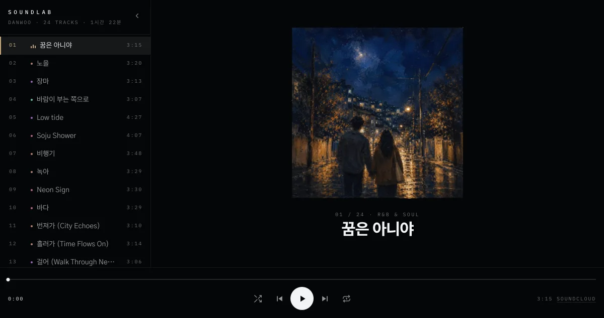
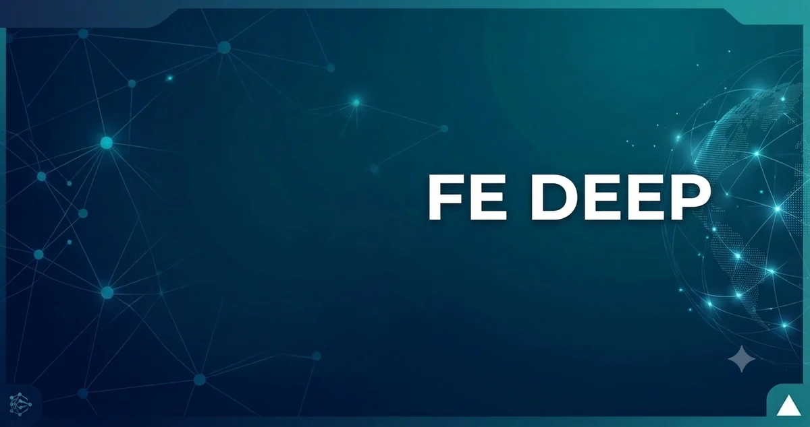
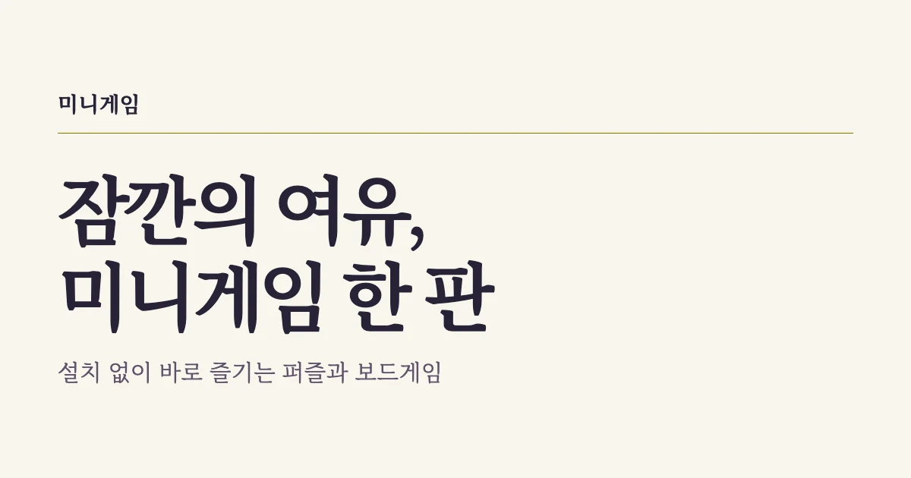

# Danwoo Lab

아이디어를 구현하는 실험실이에요. 모든 프로젝트는 허브 [lab.danwoo.dev](https://lab.danwoo.dev)에서 한눈에 볼 수 있어요.

<sub>공통: Next.js 16 · React 19 · TypeScript · Tailwind CSS 4 · pnpm·Turborepo 모노레포 (Dansoon만 Astro)</sub>

## 프로젝트

| [](https://saju.danwoo.dev)                                                                                                      | [](https://danwoo.dev)                             |
| :----------------------------------------------------------------------------------------------------------------------------------------------------------------------------------------- | :------------------------------------------------------------------------------------------------------- |
| **[청연사주](https://saju.danwoo.dev)**                                                                                                                                                    | **[Dansoon](https://danwoo.dev)**                                                                        |
| 사주 풀이를 웹툰 컷으로 읽어요.<br><sub>Supabase · React Query · Jotai · Playwright</sub>                                                                                                  | 프론트엔드 개발 기록을 모아요.<br><sub>Astro · Satori(OG 이미지)</sub>                                   |
| [](https://world.danwoo.dev)                                                                                             | [](https://prairie.danwoo.dev)           |
| **[Danwoo Island](https://world.danwoo.dev)**                                                                                                                                              | **[Unicorn Rush](https://prairie.danwoo.dev)**                                                           |
| 차를 몰고 열대 섬을 돌아다니는 3D 포트폴리오예요.<br><sub>원작 [brunosimon/folio-2025](https://github.com/brunosimon/folio-2025) (MIT) 포크 · three.js · Rapier 물리 · GSAP · Howler</sub> | three.js로 만든 초원을 유니콘을 타고 달리고 날아요.<br><sub>React Three Fiber · drei · GLSL 셰이더</sub> |
| [](https://komorebi.danwoo.dev)                                                                                                    | [](https://sound.danwoo.dev)                          |
| **[코모레비](https://komorebi.danwoo.dev)**                                                                                                                                                | **[soundlab](https://sound.danwoo.dev)**                                                                 |
| 여름 시골길을 픽셀 아트로 산책해요.<br><sub>three.js · Web Audio</sub>                                                                                                                     | 직접 만든 노래를 픽셀 파티클 비주얼라이저로 들어요.<br><sub>WebGL · Jotai</sub>                          |

## 그 밖의 앱

| [](https://fe-deep.danwoo.dev)                                             | [](https://game.danwoo.dev) |
| :----------------------------------------------------------------------------------------------------------------------- | :--------------------------------------------------------------------------- |
| **[프딥](https://fe-deep.danwoo.dev)**                                                                                   | **[미니게임](https://game.danwoo.dev)**                                      |
| 프론트엔드 개념을 깊게 파고든 기록을 모아 둬요.<br><sub>React Query · Framer Motion · 마크다운 콘텐츠 · Playwright</sub> | 난이도를 골라 가볍게 한 판 즐겨요.<br><sub>Web Worker · Jotai · Vitest</sub> |

## 모노레포 구성

| 항목          | 내용                                                                                      |
| ------------- | ----------------------------------------------------------------------------------------- |
| 빌드          | Turborepo — 앱별 작업을 병렬로 돌리고 원격 캐시로 결과를 재사용해요                       |
| 패키지 매니저 | pnpm workspace — 모든 의존성 버전은 `pnpm-workspace.yaml`의 `catalog:` 한 곳에서 관리해요 |
| 아키텍처      | 앱마다 FSD(Feature-Sliced Design)로 나누고, 레이어 규칙은 lint로 막아요                   |
| 코드 품질     | 공유 ESLint·Prettier 설정으로 모든 앱의 스타일을 맞춰요                                   |
| 디자인        | 색과 컴포넌트는 앱마다 따로 가지고, 서체·간격 같은 기본 룰만 공유해요                     |

```
apps/
  hub/               허브 (lab.danwoo.dev)
  danwoo-island/     Danwoo Island
  prairie/           Unicorn Rush
  komorebi/          코모레비
  soundlab/          soundlab
  fe-deep/           프딥
  awesome-sudoku/    스도쿠
  cheongyeon-saju/   청연사주 (분리)
  dansoon/           Dansoon (분리)
packages/            공유 패키지
```

## 공유 패키지

| 패키지                      | 이름                     | 역할                                            |
| --------------------------- | ------------------------ | ----------------------------------------------- |
| `packages/fonts`            | `@repo/fonts`            | 공유 마루부리 서체                              |
| `packages/config`           | `@config/tsconfig`       | 공유 TypeScript 설정(base / next)               |
| `packages/eslint-config`    | `@repo/eslint-config`    | 공유 ESLint 설정 — Next.js 규칙과 FSD 경계 검사 |
| `packages/prettier-config`  | `@repo/prettier-config`  | 공유 Prettier 설정                              |
| `packages/security-headers` | `@repo/security-headers` | 앱 공통 CSP·보안 헤더                           |

## 라이선스

코드는 [MIT 라이선스](LICENSE)예요. 직접 만든 이미지와 음원은 따로 표시가 없으면 제가 권리를 가지고 있어요. 외부에서 가져온 코드와 에셋은 해당 폴더의 라이선스 파일을 따라요.
