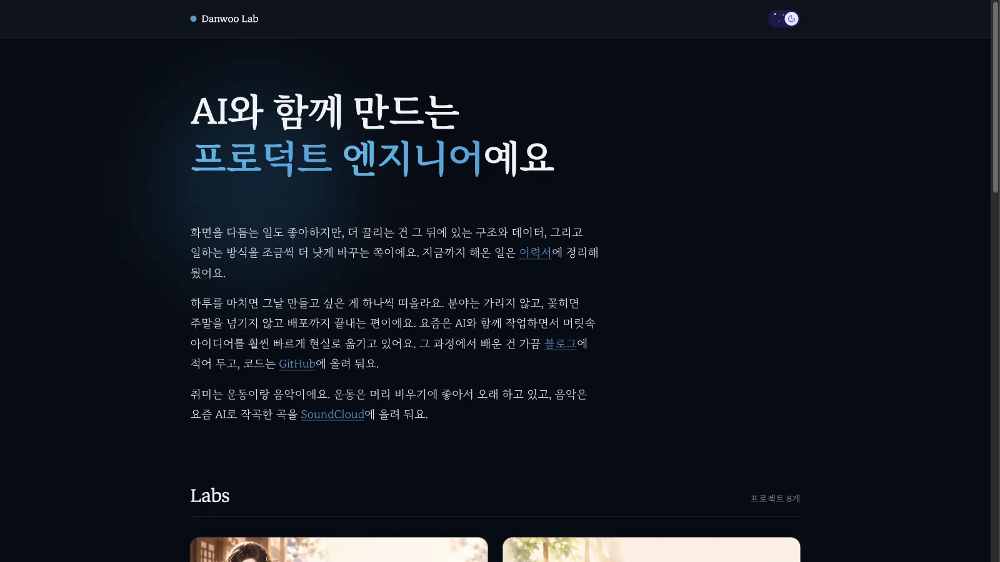
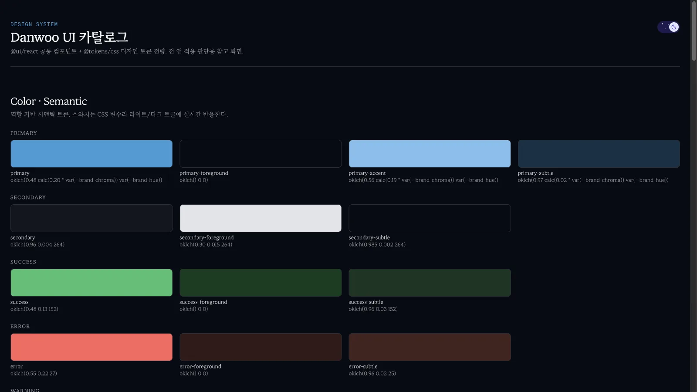

# Danwoo Lab

아이디어를 구현하는 실험실이에요. 전체 목록은 [lab.danwoo.dev](https://lab.danwoo.dev)에서 볼 수 있어요.

## 프로젝트

|           |                    |
| :--------------------------------------------------------------------------------------------- | :--------------------------------------------------------------------------------------------- |
| **[청연사주](https://saju.danwoo.dev)**                                                        | **[Dansoon](https://danwoo.dev)**                                                              |
| 사주 풀이를 웹툰 컷으로 읽어요.                                                                | 프론트엔드 개발 기록을 모아요.                                                                 |
|  |  |
| **[Danwoo Island](https://world.danwoo.dev)**                                                  | **[Unicorn Rush](https://prairie.danwoo.dev)**                                                 |
| 차를 몰고 열대 섬을 돌아다니는 3D 포트폴리오예요.                                              | three.js로 만든 초원을 유니콘을 타고 달리고 날아요.                                            |
|         |                 |
| **[코모레비](https://komorebi.danwoo.dev)**                                                    | **[soundlab](https://sound.danwoo.dev)**                                                       |
| 여름 시골길을 픽셀 아트로 산책해요.                                                            | 직접 만든 노래를 픽셀 파티클 비주얼라이저로 들어요.                                            |

## 그 밖의 앱

|  |  |
| :--------------------------------------------------------------------------- | :--------------------------------------------------------------------------- |
| **[프딥](https://fe-deep.danwoo.dev)**                                       | **[스도쿠](https://sudoku.danwoo.dev)**                                      |
| 프론트엔드 개념을 깊게 파고든 기록을 모아 둬요.                              | 난이도를 골라 가볍게 한 판 즐겨요.                                           |
|                        |                             |
| **[hub](https://lab.danwoo.dev)**                                            | **[design](apps/design)**                                                    |
| 이 프로젝트들을 모아 보여주는 소개 페이지예요.                               | 앱들이 같이 쓰는 색·글꼴·컴포넌트를 한눈에 보는 곳이에요.                    |

## 라이선스

코드는 [MIT 라이선스](LICENSE)예요. 직접 만든 이미지와 음원은 따로 표시가 없으면 제가 권리를 가지고 있어요. 외부에서 가져온 코드와 에셋은 해당 폴더의 라이선스 파일을 따라요.
