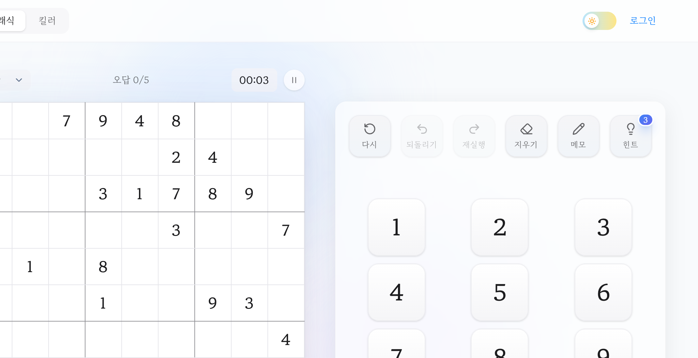

스도쿠 앱은 많다. 그런데 대부분 한 판이 끝날 때마다 광고가 뜬다. 광고를 보지 않고 스도쿠를 하고 싶어서 직접 만들었다. 그렇게 시작한 [스도쿠](https://sudoku.danwoo.dev/)에는 지금도 광고 코드가 한 줄도 없다.

판을 그리고 숫자를 넣고 정답을 확인하는 첫 버전은 첫날 커밋에 이미 들어 있었다. 오래 걸린 건 "제대로 된 퍼즐을 내는 일"이었다. 커밋 기록을 따라가며 그 과정을 정리했다.

## 1. 1년 반 동안 이어진 작업

첫 커밋은 2025년 5월 15일이다. Next.js로 프로젝트를 만들고 같은 날 스도쿠 모델과 화면을 올렸다. 다음 날에는 킬러 스도쿠 모드를 추가했다. 킬러 스도쿠는 숫자 대신 "케이지"라는 점선 영역과 그 합만 주어지는 변형 규칙이다.

작업은 몇 번의 집중기로 나뉜다.

| 시기 | 한 일 |
| --- | --- |
| 2025년 5~6월 | 첫 구현. 클래식·킬러 모드, 타이머, 일시 정지, 난이도 선택, Firebase 로그인 |
| 2026년 2월 | 기능 집중기. 실행취소, 점수·랭킹·통계, 실수 제한, 접근성, 성능 개선, Next.js 16 업그레이드 |
| 2026년 7월 | 개인 프로젝트 모노레포로 옮겨 옴 |
| 2026년 8월 | 별도쿠 모드 실험, 구조 정리와 CI |
| 2026년 9월 | 퍼즐 생성·검증 로직 재작성, 생성 워커 도입, 별도쿠 모드 제거 |

모노레포로 옮기기 전 저장소에 175개, 옮긴 뒤에 42개의 커밋이 쌓였다.

## 2. 지금 있는 기능

- **모드 두 가지:** 클래식과 킬러
- **난이도 네 단계:** 쉬움, 중간, 어려움, 전문가
- **메모:** 칸마다 후보 숫자를 작게 적어 둘 수 있다.
- **힌트 3번, 실수 5번:** 다섯 번째 실수를 하면 게임이 끝난다.
- **실행취소·다시실행:** 최근 50수까지 되돌리고 다시 적용할 수 있다.
- **기록과 랭킹:** Google 로그인을 하면 기록이 Firestore에 저장되고 난이도·모드별 최고 기록과 누적 포인트 랭킹에 오른다. 포인트는 난이도별 범위 안에서 빨리 풀수록 높게 매긴다.

진행 중인 판은 브라우저 저장소에 남아서 창을 닫았다 열어도 이어서 풀 수 있다.

## 3. 처음 만든 생성기는 난이도를 구분하지 못했다

스도쿠 앱에서 가장 중요한 건 퍼즐을 만드는 생성기다. 처음 생성기는 미리 정해 둔 완성 판을 변형해 새 판을 만들고 전략별 가중치에 따라 칸을 지우는 방식이었다.

2026년 9월에 이 생성기가 실제로 어떤 판을 내는지 측정해 봤다. 결과는 이랬다.

- 중간·어려움·전문가가 모두 25칸 안팎을 남겨서 난이도 사이에 차이가 거의 없었다.
- 전문가 목표는 15~19칸이었는데 유일한 해를 가지는 스도쿠의 이론상 최소 단서 수는 17칸이다. 목표 자체가 성립하지 않는 구간이 있었다.
- 킬러 모드는 대부분 해가 두 개 이상이었다. 케이지가 끊어져 있거나, 생성 중 재귀가 끝나지 않을 가능성도 있었다.

해가 두 개 이상이라는 건 퍼즐로서 치명적이다. 스도쿠는 논리만으로 답이 하나로 정해져야 한다. 해가 둘이면 어느 순간 "찍어야만" 진행되는 칸이 생기고 정답과 다른 값을 넣었는데 규칙상으로는 맞는 이상한 상황도 생긴다.

## 4. 생성기를 다시 짰다

새 생성기는 세 단계로 퍼즐을 만든다.

### 완성 판을 만들고 유일해를 지키며 칸을 지운다

먼저 빈 판을 무작위 순서로 채워 완성 판을 만든다. 그다음 칸을 하나씩 지워 보는데 지울 때마다 "이 칸을 비워도 해가 하나로 유지되는가"를 검사해서 통과한 칸만 비운다.

검사 방식이 중요하다. 해의 개수를 처음부터 세면 이미 알고 있는 정답을 매번 다시 찾게 된다. 그래서 질문을 "지운 칸에 원래 값이 아닌 숫자를 넣어도 풀리는 판이 있는가"로 바꿨다. 그런 판이 하나라도 있으면 유일해가 깨지는 것이니 그 칸은 다시 채운다.

해를 찾는 솔버는 비트마스크로 칸마다 후보 숫자를 들고 있고 후보가 가장 적은 칸부터 채워 보는 백트래킹(MRV, Minimum Remaining Values)을 쓴다. 후보가 적은 칸부터 정하면 잘못된 갈래를 일찍 발견해서 탐색이 크게 줄어든다. 킬러 모드는 케이지 합에 가능한 숫자 조합을 표로 미리 만들어 두고 같은 솔버에 제약으로 넣는다. 킬러는 탐색량에 상한을 두고 상한을 넘기면 "유일하지 않다"고 보고 그 칸을 지우지 않는다. 확인하지 못한 판을 내보내는 것보다 안전한 쪽을 택한 것이다.

### 사람이 푸는 방식으로 채점한다

남은 칸 수만으로는 난이도가 정해지지 않는다. 같은 25칸이라도 쉬운 기법만으로 풀리는 판이 있고 고급 기법이 있어야 풀리는 판이 있다. 그래서 사람이 쓰는 풀이 기법을 쉬운 순서대로 사다리로 만들고 퍼즐을 그 사다리로 실제로 풀어 보며 "어느 기법까지 필요했는지"로 채점한다.

1. 싱글: 한 칸에 들어갈 수 있는 숫자가 하나뿐이거나, 한 줄에서 어떤 숫자가 들어갈 자리가 하나뿐인 경우
2. 락드: 한 블록 안에서 어떤 숫자의 후보가 한 줄에만 몰려 있어, 같은 줄의 다른 블록에서 그 후보를 지울 수 있는 경우
3. 서브셋: 네이키드 서브셋은 한 줄의 두세 칸이 같은 후보 묶음만 가질 때 같은 줄의 다른 칸에서 그 후보들을 지운다. 히든 서브셋은 어떤 숫자 두세 개가 한 줄의 특정 칸들에만 들어갈 수 있을 때 그 칸들에서 나머지 후보를 지운다.
4. 고급: X-Wing, Swordfish, XY-Wing, XYZ-Wing, 컬러링
5. 추측: 이 채점기에 구현한 기법만으로는 더 진행되지 않는 경우

킬러 모드는 여기에 케이지 조합, 케이지 잠금, 그리고 한 줄이나 블록의 합이 항상 45라는 점을 이용하는 "45 규칙"을 끼워 넣었다.

### 난이도는 단서 수와 기법 범위로 정의한다

난이도마다 남길 칸 수와 허용하는 기법 범위를 정하고 채점 결과가 범위를 벗어나면 다시 만든다. 아래는 클래식 모드의 목표값이다. 남기는 칸 수는 목표일 뿐이라, 유일해를 지키면서 더 지울 칸이 없으면 목표보다 많은 칸이 남는다.

| 난이도 | 목표 단서 수 | 필요한 기법 |
| --- | :---: | --- |
| 쉬움 | 40 | 싱글만 |
| 중간 | 30 | 싱글 ~ 락드 |
| 어려움 | 27 | 락드 ~ 서브셋 |
| 전문가 | 23 | 고급 |

킬러 모드는 케이지 합이 단서 역할을 해서 목표 단서 수가 24·14·6·0칸으로 훨씬 적다. 범위에 맞는 판이 나올 때까지 다시 만들고, 범위에 딱 맞는 판을 못 찾았을 때 대신 내보내는 판에서도 추측 단계로 채점된 판은 뺀다. 풀리는 판이 나올 때까지 시도 횟수를 늘려 더 뽑는데, 300번 시도로 측정해 보니 추측 판이 나오는 비율은 클래식 전문가가 24%, 킬러 전문가가 8%였다. 늘린 시도 횟수를 다 쓰는 일은 사실상 없어서, 전문가 난이도도 이 채점기에 구현한 기법만으로 풀리는 판이 나온다. 이 앱에서는 "찍어야 풀리는 판"을 어려운 판이 아니라 피해야 할 판으로 봤다.

킬러 케이지도 다시 만들었다. 이웃한 칸으로만 케이지를 키워 끊어진 케이지가 생기지 않게 하고 케이지 안에서 숫자가 겹치지 않게 했다. 1칸짜리 케이지는 사실상 숫자를 그냥 알려 주는 셈이라 줄였다. 합칠 이웃이 없는 칸은 1칸으로 남지만, 케이지 배치를 20번 뽑아 1칸 케이지가 가장 적은 배치를 고른다.

## 5. 생성이 느려서 화면이 멈췄다

채점해서 범위에 들 때까지 다시 만드는 방식은 정확한 대신 느리다. 클래식 전문가 난이도는 한 판을 만드는 데 상위 5% 기준으로 0.5초까지 걸렸다. 이 계산이 메인 스레드에서 돌면 "새 게임"을 누르는 순간 화면이 멈춘다.

그래서 생성을 웹 워커로 옮겼다. 워커는 별도 스레드에서 돌아서 퍼즐을 만드는 동안에도 화면은 계속 반응한다. 여기에 모드·난이도별로 다음 판 한 장을 미리 만들어 두는 프리페치를 더했다. 같은 설정으로 다시 시작할 때 미리 만들기가 끝나 있으면 기다리지 않고 바로 시작한다.

몇 가지 경우도 함께 처리했다.

- 생성하는 동안에는 오버레이로 보드를 덮어 입력을 막는다.
- "새 게임"을 연달아 누르면 마지막 요청만 반영한다.
- 서버 렌더링이나 테스트 환경처럼 워커를 쓸 수 없거나 워커가 죽으면, 메인 스레드에서 직접 만든다.

## 6. 틀린 답을 어떻게 판정할까

판정 기준은 두 번 바뀌었다. 2026년 2월에는 정답과 비교하던 방식을 행·열·블록 충돌 검사로 바꿨다. 같은 줄에 같은 숫자가 있으면 틀렸다고 표시하는 방식이다.

그런데 이 방식은 킬러 모드에서 구멍이 있었다. 행·열·블록에는 문제가 없지만 케이지 합을 어기는 값은 잡지 못한다. 9월에 생성기를 다시 짜면서 판정을 다시 "정답과 다른 값"으로 통일했다. 유일해가 보장되니 정답과 다르면 틀린 값이라고 말할 수 있게 된 것이다. 같은 값을 다시 넣는 건 무시하고 힌트는 선택한 빈칸이나 틀린 칸부터 채우게 했다.

## 7. 작은 성능 문제들

2026년 2월 집중기에는 성능 문제도 여럿 정리했다.

- **구독이 너무 많았다.** 당시 상태 관리는 Zustand였는데 화면 곳곳에서 스토어를 구독하는 수가 390개였다. 필요한 값만 얕게 비교해 고르는 셀렉터(useShallow)로 바꿔 100개로 줄였다. 지금은 상태 관리를 Jotai로 옮겼다.
- **실행취소 기록이 무거웠다.** 수를 둘 때마다 보드 전체를 깊이 복사해 기록에 쌓고 있었다. 보드를 불변 값으로 다루고 참조만 저장하도록 바꿨다.
- **킬러 케이지 묶음 계산이 O(n²)였다.** Set으로 조회하도록 바꿔 한 번에 찾게 했다.
- **첫 화면에 Firebase가 다 실렸다.** 로그인과 기록 저장에만 필요한 Firebase 인증·Firestore를 실제로 쓸 때 불러오도록 바꾸고 결과 시트도 늦게 불러오게 했다.

## 8. 별도쿠는 만들었다가 지웠다

2026년 8월에는 별도쿠라는 새 모드를 실험했다. 격자에 별을 놓는 퍼즐로, 기획서와 색약 사용자를 위한 색 팔레트 검증까지 하고 랭킹 탭도 붙였다.

한 달 뒤인 9월 4일에 별도쿠를 통째로 지웠다. 라우트, 데이터 모델, 화면, 랭킹 탭, 실험용 스크립트까지 정리했다. 커밋에 남긴 이유는 "스도쿠 앱을 클래식·킬러 두 모드에 집중한다"였다. 같은 날 생성기 재작성과 워커 도입이 들어갔다. 기능을 하나 덜어 내고 남은 두 모드의 퍼즐 품질에 집중한 셈이다. 이 결정은 [AI로 빨리 만들 수 있게 되자, 무엇을 만들지 고민하게 됐다](/posts/too-easy-to-build/)에서 다룬 "만들고 지우기"의 한 사례이기도 하다.

## 9. 정리

광고 없이 스도쿠를 하고 싶다는 단순한 이유로 시작했다. 커밋 기록을 돌아보면 가장 큰 변경은 퍼즐 자체의 품질에 관한 것이었다.

- 해가 하나로 정해지는가
- 난이도가 이름값을 하는가
- 그 판을 만드는 동안 화면이 멈추지 않는가

판을 그리고 입력을 받는 부분은 첫 커밋 며칠 안에 들어갔다. 위 세 가지를 지키도록 생성기를 다시 짠 건 첫 구현에서 약 1년 4개월 뒤였다. 일부 작업은 AI와 함께 했는데 생성기를 다시 짠 9월에는 먼저 지금 생성기가 내는 판을 측정해서 문제를 숫자로 확인한 뒤 고쳤다. AI에게 일을 맡길 때 무엇을 먼저 정해야 하는지는 [AI에게 코드를 맡기기 위한 위임의 조건](/posts/delegating-code-to-ai/)에 따로 정리했다.

스도쿠는 [sudoku.danwoo.dev](https://sudoku.danwoo.dev/)에서 광고 없이 할 수 있다.
