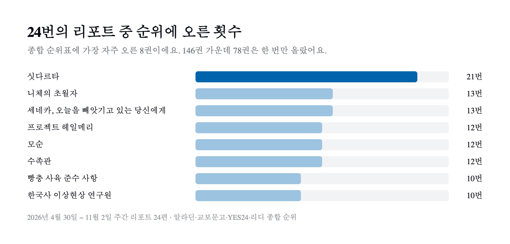

매주 월요일 아침, 서점 베스트셀러를 모아 한 페이지로 정리하는 주간 책 순위를 만들고 있다. 알라딘, 교보문고, YES24, 리디의 전체 베스트셀러 순위를 모아 하나의 종합 순위로 합친 표로 시작했고 지금은 알라딘을 뺀 세 곳을 모은다.

한 주씩 볼 때는 "이번 주 1위가 무엇인가" 정도만 눈에 들어온다. 기록이 24주치 쌓인 김에 전부 한데 모아 봤다. 같은 표를 길게 늘어놓으니 한 주짜리 순위에서는 보이지 않던 것들이 보였다.

## 1. 어떤 데이터를 모았나

기간은 2026년 4월 30일부터 11월 2일까지이고 주간 리포트 24편이 대상이다. 각 서점의 전체 베스트셀러 순위를 모았다. 서점마다 수집할 수 있는 순위 깊이가 달라서 순위를 점수로 바꿔 합산했다. 수집과 같은 책 판별 과정은 [서점 네 곳의 베스트셀러를 한 페이지에 모으기까지](/posts/bestseller-aggregator/)에 따로 정리했다.

숫자를 보기 전에 데이터의 빈틈부터 적어 둔다.

- 6월 1일과 7월 6일 사이에는 리포트가 없다. 24편은 연속된 24주가 아니라 약 27주에 걸친 기록이다.
- 리디는 5주(5월 11일~6월 1일, 7월 6일) 수집에 실패했고 알라딘은 11월 2일 한 주가 빠졌다.
- 8월 첫 주 전까지는 종합 순위표 크기가 13~20권으로 주마다 달랐다. 8월 3일부터는 15권(11월 2일만 14권)으로 거의 고정됐다.
- 장르는 수집 스크립트가 서점의 카테고리 경로로 분류한 값이다. 경로가 없으면 키워드로 분류하는데 소설 쪽 키워드가 넓어서 소설로 잘못 들어가는 책이 있을 수 있다.

아래 숫자는 리포트 24편의 종합 순위표에서 직접 셌다. 리포트 원문은 공개 저장소의 [`apps/dansoon/contents/book`](https://github.com/KimDanwoo/labs/tree/main/apps/dansoon/contents/book)에 주별로 남아 있다. 8월 3일부터는 서점별 수집 원본과 점수 내역도 [`apps/dansoon/data/bestseller`](https://github.com/KimDanwoo/labs/tree/main/apps/dansoon/data/bestseller)에 함께 저장했다. 같은 리포트로 다시 셀 때 필요한 기준은 두 가지다.

- 종합 순위를 매기는 산식이 중간에 바뀌었다. 7월 27일 리포트까지는 서점별로 `31 - 순위`를 그대로 더했다. 이 방식은 순위를 적게 수집하는 서점의 하위권을 과대평가해서 8월 3일 리포트부터는 서점마다 `(수집 깊이 + 1 - 순위) / 수집 깊이`로 0~1 사이 점수를 매겨 더한다. 8월 전후 순위표는 산식이 다르다는 점을 감안하고 봐야 한다.
- 같은 책인지는 제목으로 판단했다. 제목 뒤에 괄호나 대괄호로 붙은 판 표기는 떼고 셌다. 『코스모스』와 『코스모스 (100만 부 기념판)』, 『프로젝트 헤일메리』와 그 리커버 특별판이 이런 경우다. 이 기준으로 세면 아래의 146권과 78권이 나온다.

## 2. 146권 가운데 절반은 한 주 만에 사라졌다

24편의 종합 순위표에 한 번이라도 오른 책은 146권이다. 그중 78권(53%)은 딱 한 주만 순위에 있었다.

매주 새로 들어오는 책 수도 셌다. 앞뒤 주의 표 크기가 같은 8월 10일 이후로 보면 매주 15권 가운데 4~7권이 새 얼굴이었다. 순위표의 3분의 1 정도가 매주 바뀌는 셈이다. 8월 이전 수치는 표 크기가 들쭉날쭉해서 같은 기준으로 비교하지 않았다.

## 3. 『싯다르타』는 21번 연속 순위에 있었다

반대로 오래 머문 책도 있다. 순위에 오른 주가 많은 순서로 8권을 뽑았다.

| 책 | 저자 | 오른 횟수 | 가장 긴 연속 | 최고 순위 |
| --- | --- | :---: | :---: | :---: |
| 싯다르타 | 헤르만 헤세 | 21 | 21회 | 1위 |
| 니체의 초월자 | 프리드리히 니체 | 13 | 7회 | 3위 |
| 세네카, 오늘을 빼앗기고 있는 당신에게 | 루키우스 안나이우스 세네카 | 13 | 13회 | 1위 |
| 프로젝트 헤일메리 | 앤디 위어 | 12 | 9회 | 1위 |
| 모순 | 양귀자 | 12 | 7회 | 5위 |
| 수족관 | 유래혁 | 12 | 11회 | 2위 |
| 빵충 사육 준수 사항 | 김혜영 | 10 | 9회 | 4위 |
| 한국사 이상현상 연구원 | 최인서 | 10 | 10회 | 1위 |

『싯다르타』는 5월 18일에 처음 순위에 오른 뒤 11월 2일까지 리포트 21편에 모두 있었다. 6월과 7월 사이 리포트가 없는 4주 동안의 순위는 알 수 없지만, 기록이 있는 주에는 한 번도 빠지지 않았다.

눈에 띄는 건 위 세 권의 저자다. 헤르만 헤세의 『싯다르타』는 1922년에 나온 소설이고 니체는 19세기, 세네카는 고대 로마의 철학자다. 오래 머문 책 목록의 맨 위를 100년에서 2천 년 전에 쓰인 글이 차지하고 있다. 원문이 오래됐어도 지금 팔리는 판은 최근에 새로 번역하거나 엮어 낸 책일 수 있어서, 이 데이터만으로 "고전이 다시 읽힌다"고 단정하기는 어렵다. 다만 서점 한 곳의 공식 집계에서도 같은 흐름이 보인다. [교보문고가 6월에 발표한 2026 상반기 도서 판매 트렌드 리포트](https://www.newsis.com/view/NISX20260608_0003660865)(뉴시스 보도)에 따르면 1~5월 교보문고 종합 베스트셀러에서 『싯다르타』는 6위였고, 외국소설 30위 안에 든 세계문학전집이 12종이었다.

개인적으로는 AI 시대에 들어서면서 철학적인 것들에 대한 관심이 많이 올라가고 있는 것 같다. 순위에 가장 오래 머문 세 권이 모두 철학자의 글이거나 깨달음을 찾아 떠나는 이야기라는 점이 그 느낌과 겹친다. 물론 24주치 순위만으로 그 이유가 AI라고 말할 수는 없다. 데이터를 보며 든 내 생각이다.

## 4. 1위는 9권이 나눠 가졌다

24주 동안 종합 1위에 오른 책은 9권이다.

| 책 | 1위 횟수 |
| --- | :---: |
| 프로젝트 헤일메리 | 4 |
| 싯다르타 | 4 |
| 세네카, 오늘을 빼앗기고 있는 당신에게 | 3 |
| 한국사 이상현상 연구원 | 3 |
| 품격 있는 대화를 위한 지식 브리핑 | 2 |
| 오디세이아 | 2 |
| 그랬다고 적었다 | 2 |
| 빨강의 자서전 | 2 |
| 가호 | 2 |

앞에서 본 교보문고 상반기 리포트에서도 종합 1위는 『프로젝트 헤일메리』였다. 그래도 어느 한 권이 오래 1위를 지키지는 않았다. 가장 많이 1위를 한 책도 24주 중 4주였다. 『싯다르타』처럼 21주 동안 순위에 있으면서 1위는 4번만 한 책도 있다. 오래 머무는 것과 맨 위에 오르는 것은 서로 다른 일이었다.

## 5. 서점마다 1위가 달랐다

수집된 서점 모두의 1위가 같은 책이었던 주는 24주 가운데 2주뿐이다. 10월 26일과 11월 2일의 『가호』(무라카미 하루키)이고 그중 11월 2일은 알라딘이 빠진 세 곳 기준이다. 나머지 22주는 서점마다 1위가 달랐다.

종합 순위표의 칸 단위로 보면 차이가 더 분명하다. 24편의 종합 순위표에는 모두 370칸이 있는데 네 서점에 모두 오른 칸은 32칸(9%)이고 한 서점에만 오른 칸이 132칸(36%)이다.

| 한 서점에만 오른 칸 | 칸 수 |
| --- | :---: |
| 리디 | 58 |
| 알라딘 | 30 |
| 교보문고 | 28 |
| YES24 | 16 |
| 합계 | 132 |

리디는 수집에 실패한 주가 5주나 되는데도 혼자만 오른 책이 가장 많았다. 리디는 전자책 서점이고 나머지 세 곳은 종이책을 중심으로 파는 서점이다. 리디에만 오른 책으로는 『십이국기』 시리즈 세트(전 14권, 4주), 『헝거 게임: 50번째 추첨의 날』(3주), 『눈물을 마시는 새』(3주) 같은 장르 소설과 시리즈물이 많았다. 같은 "베스트셀러"라도 어느 서점 순위를 보느냐에 따라 전혀 다른 목록을 보게 된다.

## 6. 소설이 절반을 넘었다

370칸을 장르별로 나누면 이렇다.

| 장르 | 칸 수 | 비율 |
| --- | :---: | :---: |
| 소설 | 200 | 54% |
| 인문사회 | 71 | 19% |
| 에세이 | 33 | 9% |
| 경제경영 | 30 | 8% |
| 자기계발 | 26 | 7% |
| 과학기술 | 10 | 3% |

소설이 절반을 넘고 과학기술은 24주 동안 10칸뿐이었다. 1절에 적었듯 소설 분류가 넓게 잡히는 경향이 있어서 실제 비율은 이보다 조금 낮을 수 있다. 그래도 순서가 바뀔 정도의 차이는 아니다.

## 7. 모아서 보니 보인 것

24주치를 한데 모으고 나서 정리된 사실은 세 가지다.

- 순위표는 매주 3분의 1 정도가 바뀌고 오른 책의 절반은 한 주 만에 사라진다. 그 와중에 『싯다르타』처럼 20주 넘게 머무는 책이 있다.
- 수집된 서점 모두의 1위가 같았던 주는 24주 중 2주였고 그중 한 주는 세 곳 기준이다. 서점 한 곳의 순위만 보면 전체의 일부만 보게 된다.
- 전자책 서점인 리디는 다른 세 곳과 겹치지 않는 장르 소설과 시리즈물을 많이 올렸다.

한 서점의 순위표는 그 서점의 판매 기록이다. 여러 곳을 겹쳐 놓아야 어떤 책이 어디서나 팔리는지, 어떤 책이 한 서점에서만 팔리는지가 갈린다. 그렇게 겹쳐 본 표에서 가장 오래 남은 자리는 철학 쪽이었다. 주간 리포트는 지금도 매주 쌓이고 있다.
