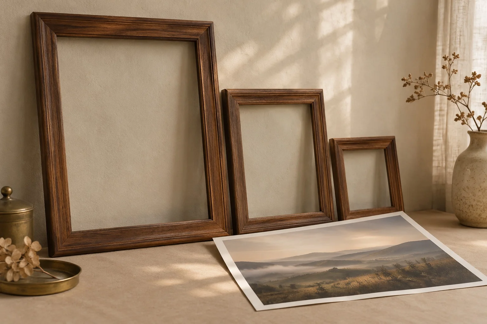

블로그를 [티스토리에서 Astro로 옮긴](/posts/tistory-to-astro/) 뒤로도 글을 계속 올렸다. 그런데 이 블로그가 검색엔진과 모바일 환경에 맞게 잘 만들어져 있는지는 한 번에 확인해 본 적이 없었다. 2026년 11월 7일, 그걸 확인했다.

결론은 대부분 이미 되어 있었다는 것이다. 검사 스크립트는 경고를 수백 건 쏟아냈지만 대부분 스크립트가 잘못 센 것이었고, 실제로 고친 것은 세 가지였다.

## 1. 무엇으로 확인했나

세 군데를 봤다.

- **빌드 결과물:** `astro build`로 만든 HTML 113개를 스크립트로 전부 읽었다. 제목·설명이 겹치는 페이지, `h1` 개수, 이미지의 `alt`와 크기 속성, 구조화 데이터(JSON-LD)가 있는지를 셌다.
- **배포된 사이트:** `curl`로 응답 헤더를 봤다. 압축, 캐시, 리다이렉트가 기대대로 동작하는지 확인했다.
- **Lighthouse:** 모바일 기준으로 홈과 글 페이지를 측정했다. Google PageSpeed Insights API는 그날 할당량이 다 차 있어서 Lighthouse 12.6.1을 로컬에서 돌렸다.

## 2. 경고 대부분은 검사 스크립트의 오탐이었다

스크립트가 처음 낸 숫자는 이랬다.

| 항목 | 개수 |
| --- | --- |
| `alt` 속성이 없는 이미지 | 351 |
| `width`·`height`가 없는 이미지 | 37 |
| `h1`이 6개인 페이지 | 1 |
| 설명이 50자보다 짧은 페이지 | 다수 |

하나씩 열어 보니 거의 다 문제가 아니었다.

- **`alt` 351건:** 글 목록·이전/다음 글 카드의 썸네일과 글 커버 이미지였다. 썸네일은 바로 옆에 제목 링크가 있고 커버는 제목 바로 아래 놓이는 장식이라, 일부러 빈 `alt`를 줬다. Astro의 `<Image>` 컴포넌트는 빈 `alt`를 값 없이 `alt`로만 출력하는데, 스크립트가 `alt=`만 찾다 보니 이걸 "없음"으로 셌다.
- **크기 없는 이미지 37건:** 이미지를 크게 보여 주는 라이트박스 대화상자 안의 빈 ``였다. 글 37개에 하나씩 있고, 열기 전에는 화면에 그려지지 않는다.
- **`h1` 6개:** [SEO의 구조적 진화](/posts/seo-structural-evolution/) 글이었다. 본문의 HTML 예시 코드가 코드 블록 복사 버튼의 속성 값 안에도 들어 있는데, 스크립트가 그 문자열 속 `<h1>`까지 셌다. 실제 `h1`은 글 제목 하나다.
- **짧은 설명:** 매주 자동으로 만들던 도서 리포트와 "React 태그가 달린 글 모음" 같은 태그·카테고리 페이지가 대부분이었다. 한국어는 글자당 정보가 많아서 영어 기준의 길이를 그대로 적용하기 어렵다. 다만 설명이 틀에 박혀 있는 건 사실이라 남은 일로 적어 뒀다.


검사 스크립트가 낸 숫자는 출발점일 뿐이었다. 원인을 하나씩 열어 보기 전까지는 고칠 목록이 아니었다.

## 3. 이미 되어 있던 것

오탐을 걸러 내고 나니 기본기는 갖춰져 있었다.

- 모든 페이지에 canonical, Open Graph, 트위터 카드가 있고, 검색에 노출되는 페이지는 제목이 서로 다르다. 설명은 태그·카테고리 페이지만 틀에 박혀 있다(도서 리포트는 `noindex`이고 sitemap에서도 빠져 있었다).
- 글에는 `BlogPosting` JSON-LD가 있다.
- robots.txt, sitemap, RSS가 있고 HTTP는 HTTPS로 308 리다이렉트된다.
- HTML은 brotli로 압축되고, `/_astro/` 아래의 빌드 산출물은 1년 `immutable` 캐시다.
- 폰트는 글자 범위별로 나눠서 필요한 조각만 받고 `font-display: swap`이다.
- 이미지는 webp로 바뀌고, lazy 로딩과 `width`·`height`가 붙어 레이아웃이 흔들리지 않는다.

Lighthouse 점수도 홈은 성능·접근성·권장사항·SEO가 모두 100이었다. 문제는 글 페이지였다.

## 4. 고친 것 세 가지

### 슬래시 없는 주소가 그대로 열렸다

이 블로그의 글 주소는 `/posts/<slug>/`처럼 끝에 슬래시가 붙는다. 그런데 슬래시를 빼고 `/posts/fsd-eslint-boundaries`로 들어가도 리다이렉트 없이 200이 돌아왔다. 같은 글이 두 주소에 존재하는 셈이다.

canonical이 슬래시 붙은 주소를 가리키고 있어서 검색 순위에 주는 피해는 크지 않았을 것이다. 그래도 고치는 데는 Vercel 설정 한 줄이면 됐다.

```json
{
  "trailingSlash": true
}
```

배포 후에는 슬래시 없는 주소가 308로 슬래시 붙은 주소로 넘어간다.

### 커버 이미지가 화면보다 컸다

글 맨 위의 커버 이미지는 본문 폭 42rem(672px)의 두 배인 1344px 하나만 만들고 있었다. 모바일 화면도 이 이미지를 그대로 받았고, Lighthouse는 "적절한 크기의 이미지" 항목에서 약 100KiB를 줄일 수 있다고 했다.

Astro의 `<Image>`에 `widths`와 `sizes`를 주면 크기별 이미지를 만들고 `srcset`을 붙여 준다.

```astro
---
const COVER_WIDTH = 1344;
const COVER_WIDTHS = [640, 960, COVER_WIDTH];
const COVER_SIZES = '(min-width: 42rem) 42rem, 100vw';
---

<Image
  src={cover}
  alt=""
  width={COVER_WIDTH}
  widths={COVER_WIDTHS}
  sizes={COVER_SIZES}
  loading="eager"
  fetchpriority="high"
/>
```



처음에는 "모바일은 이제 640px을 받는다"고 생각했는데, 측정해 보니 그렇지 않았다. 브라우저는 화면 폭에 기기 픽셀 비율(DPR)을 곱한 크기를 고른다. Lighthouse의 모바일 기기는 고해상도 화면이라 960px을 받았다. 그래도 커버 하나가 50.9KB에서 29.8KB로 줄었다. 같은 Lighthouse 항목의 절감 예상치는 약 100KiB에서 78KiB가 됐다. 남은 대부분은 본문 이미지 몫이다.

### sitemap에 수정 날짜가 없었다

sitemap에는 주소만 있고 `lastmod`(마지막 수정일)가 없었다. `lastmod`가 정확하면 검색엔진이 어떤 글을 다시 가져갈지 정하는 데 참고한다.

`@astrojs/sitemap`의 `serialize` 옵션으로 글 주소에만 날짜를 넣었다. 까다로운 점은 `astro.config.mjs`에서는 Astro의 content collection을 쓸 수 없다는 것이다. 그래서 글 폴더의 frontmatter에서 `updatedAt`, 없으면 `publishedAt` 한 줄만 직접 읽었다.

```js
const POSTS_DIR = new URL('./contents/posts/', import.meta.url);
const readFrontmatterDate = (source, key) =>
  source.match(new RegExp(`^${key}:\\s*["']?([^"'\\n]+)`, 'm'))?.[1]?.trim();
const POST_LASTMOD = new Map(
  readdirSync(POSTS_DIR, { withFileTypes: true })
    .filter((entry) => entry.isDirectory())
    .flatMap((entry) => {
      const source = readFileSync(new URL(`${entry.name}/index.md`, POSTS_DIR), 'utf8');
      const date = readFrontmatterDate(source, 'updatedAt') ?? readFrontmatterDate(source, 'publishedAt');
      return date ? [[entry.name, new Date(date).toISOString()]] : [];
    }),
);

sitemap({
  serialize: (item) => {
    const slug = new URL(item.url).pathname.match(/^\/posts\/([^/]+)\/$/)?.[1];
    const lastmod = slug && POST_LASTMOD.get(slug);
    return lastmod ? { ...item, lastmod } : item;
  },
});
```

날짜를 정규식으로 읽기 때문에 frontmatter에 날짜를 `publishedAt: "…"`처럼 한 줄로 적는다는 가정에 기댄다. 배포 후 sitemap에는 글 37개 모두 `lastmod`가 들어갔고, 확인한 글에서는 값이 JSON-LD의 `dateModified`와 같았다.

## 5. 숫자로 본 전후

글 페이지(모바일) Lighthouse 성능 점수는 이렇게 나왔다.

| 시점 | 성능 | LCP |
| --- | --- | --- |
| 고치기 전 1회차 | 75 | 5.5초 |
| 고치기 전 2회차 | (점수 기록 안 함) | 1.4초 |
| 고친 후 3회 | 96 / 97 / 96 | 2.6~2.7초 |

이 표로 "점수가 75에서 96으로 올랐다"고 말하기는 어렵다. 고치기 전 1회차와 2회차의 LCP(가장 큰 요소가 그려지는 시간)가 4초 넘게 차이 났다. 1회차는 Vercel의 엣지 캐시가 비어 있었던 것으로 보이는데, 그 측정에서 서버 응답 시간만 따로 확인하지는 않았다. 고친 뒤의 LCP(2.6~2.7초)는 고치기 전 2회차(1.4초)보다 오히려 느렸다. 측정마다 조건이 달랐으니 점수 차이를 이번 수정의 효과로 볼 수는 없다. 이번 수정의 효과로 확실하게 말할 수 있는 건 커버 이미지가 50.9KB에서 29.8KB로 줄었다는 정도다.

## 6. 남은 것

- **본문 이미지:** 점검할 때는 본문 이미지에 `srcset`이 없었다. Lighthouse가 남은 절감 예상치로 꼽은 이미지 중 하나가 본문 도식 한 장(약 62KB 절감)이었다. 지금은 마크다운을 HTML로 바꾸는 단계에서 본문 이미지에도 커버와 같은 `widths`와 `sizes`를 붙인다.
- **외부 스크립트:** Lighthouse가 꼽은 안 쓰는 JavaScript는 Google 태그 매니저(118KB 중 79KB)와 카카오 애드핏(53KB 중 39KB)이었다. 태그 매니저는 통계 태그를 걸지 않은 채 스크립트만 받고 있어서 뺐다. 애드핏은 광고를 쓰는 비용이라 그대로 뒀다.
- **태그·카테고리 설명:** 틀에 박힌 설명을 페이지마다 다르게 쓸 수 있다.
- **옛 주소 리다이렉트:** 예전에 쓰던 `/tech/*` 주소는 전부 홈으로 보내고 있다. Google은 이런 리다이렉트를 soft 404(실제로는 없는 페이지)로 볼 수 있다. 옛 주소로 들어오는 방문이 아직 있다면 글별로 연결해야 한다.

점검에서 가장 오래 걸린 건 고치는 일이 아니라 경고를 하나씩 열어 보는 일이었다. 수백 건이던 경고가 고칠 일 세 개로 줄어든 건 원인을 확인한 뒤였다.

썸네일 없는 글의 미리보기 이미지는 [OG 이미지(링크 미리보기)를 빌드할 때 만들기](/posts/build-time-og-images/)에서 만든 방식을 그대로 쓴다.
