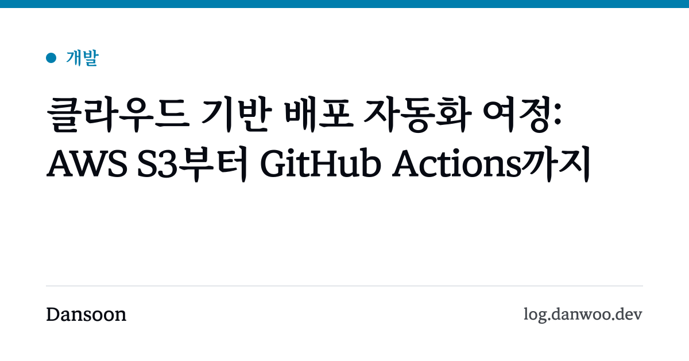

블로그 글 링크를 메신저나 SNS에 붙이면 제목 옆에 이미지가 함께 뜬다. 페이지의 `og:image` 메타 태그가 가리키는 이미지다.

티스토리에서 옮긴 글 중 7편은 대표 이미지가 없었다. 매주 올라오는 책 순위 리포트도 마찬가지였다. 이런 페이지는 모두 사이트 기본 이미지를 써서, **링크를 여러 개 공유하면 전부 같은 그림으로 보였다.** 미리보기만 봐서는 어떤 글인지 구분할 수 없었다.

그렇다고 글마다 이미지를 직접 만들 수는 없었다. 리포트는 매주 새로 생기고, 글도 계속 늘어난다. 그래서 **제목으로 이미지를 자동으로 그리기로 했다.**

## 1. 요청할 때 그릴까, 빌드할 때 그릴까

방법은 크게 두 가지다. 요청이 들어올 때 서버에서 이미지를 그리는 방법과, 빌드할 때 미리 그려 파일로 두는 방법이다.

이 블로그는 서버 없이 정적 파일만 배포한다. 제목은 빌드할 때 이미 정해져 있으니 요청할 때마다 그릴 이유가 없었다. **빌드할 때 그려 두면 일반 이미지 파일처럼 캐시되고, 서버 함수도 필요 없다.**

그리는 도구로는 Vercel이 만든 [satori](https://github.com/vercel/satori)를 골랐다. HTML과 CSS 일부를 받아 SVG로 그려 주는 라이브러리다. SVG를 PNG로 바꾸는 일은 이미 쓰고 있던 sharp에 맡겼다.

## 2. Astro에서 이미지 파일 만들기

Astro는 `.astro` 페이지뿐 아니라 파일을 돌려주는 엔드포인트도 정적으로 만들 수 있다. 파일 이름을 `[slug].png.ts`로 두고 `getStaticPaths`로 경로를 정하면, 빌드할 때 글마다 PNG 파일이 하나씩 생긴다.

```ts
// src/pages/og/posts/[slug].png.ts
export const getStaticPaths = (async () => {
  const posts = await getPublishedPosts();
  // 썸네일이 있는 글은 그 이미지를 쓰므로 카드를 만들지 않는다
  return posts.filter((post) => !post.data.thumbnail).map((post) => ({ params: { slug: post.id }, props: { post } }));
}) satisfies GetStaticPaths;

export const GET: APIRoute<{ post: Post }> = async ({ props: { post } }) => {
  const { title, category } = post.data;
  return pngResponse(await renderOgImage({ label: CATEGORY_LABEL[category], color: OG_ACCENT[category], title }));
};
```

글 페이지에서는 썸네일이 있으면 그 이미지를, 없으면 `/og/posts/<글 주소>.png`를 `og:image`로 넣는다.

satori는 보통 JSX와 함께 쓰지만, 이 블로그에는 React가 없다. satori가 받는 것은 결국 `{ type, props }` 형태의 객체라서, JSX 대신 작은 함수로 객체를 만들었다.

```ts
const el = (style, children) => ({ type: 'div', props: { style, children } });

el({ display: 'flex', flexDirection: 'column', padding: '72px 80px 64px' }, [
  el({ display: 'flex', fontSize: 30, color }, label),
  el({ display: 'block', fontSize: 66, lineClamp: 3 }, title),
  // ...
]);
```

디자인은 블로그 화면과 맞췄다. 위쪽에 카테고리 색 띠와 카테고리 이름을 두고, 제목은 크게, 맨 아래에는 블로그 이름과 주소를 넣었다.



## 3. 막혔던 부분

### woff2 서체를 읽지 못한다

블로그 서체인 마루부리는 웹용 woff2 파일로만 갖고 있었다. 그런데 satori는 ttf, otf, woff만 읽는다. woff2를 넘기면 서체를 읽지 못한다.

fontTools로 woff2를 woff로 한 번 변환해 앱 안에 두었다. 크기는 422KB지만 **빌드할 때만 쓰는 파일이라 방문자가 내려받지 않는다.** 글자를 일부만 남기지 않고 전체를 담은 이유도 있다. 앞으로 어떤 제목이 들어올지 모르는데, 서체에 없는 글자가 나오면 이미지에서 그 글자만 빠지기 때문이다.

### 패딩이 캔버스 밖으로 밀려났다

첫 결과물에는 맨 아래 블로그 이름 줄이 아예 없었다. 위치를 바꿔도 마찬가지여서, 요소를 최소한으로 줄인 예제를 만들어 SVG를 직접 열어 봤다.

```html
<svg width="1200" height="630">
  <rect x="0" y="0" width="1360" height="790" fill="#fff" />
  <!-- ... 맨 아래 줄의 글자가 y=683에 그려져 있었다 -->
</svg>
```

캔버스는 1200×630인데 배경 사각형은 1360×790이었다. 좌우 패딩 80px씩, 위아래 패딩 80px씩이 크기 **바깥에 더해진 것**이다. 박스 크기를 content-box 방식으로 계산해서, 맨 아래 줄이 630px 밖에 그려지고 있었다.

`boxSizing: 'border-box'`를 지정하자 패딩이 크기 안으로 들어왔고, 맨 아래 줄도 제자리에 나타났다.

### 긴 제목이 오른쪽으로 넘쳤다

"클라우드 기반 배포 자동화 여정: AWS S3부터 GitHub Actions까지"처럼 긴 제목은 오른쪽 끝을 넘어 잘렸다. 제목 영역에 너비(캔버스 너비 - 좌우 패딩)를 직접 지정해 해결했다. 한글이 단어 중간에서 줄바꿈되지 않도록 `wordBreak: 'keep-all'`도 넣었다.

## 4. 결과

빌드할 때마다 썸네일이 없는 글 7편과 책 리포트 48편의 이미지가 만들어진다. 한 장에 30KB 안팎이고, 새 글이나 새 리포트가 생기면 따로 손대지 않아도 이미지가 붙는다.

메신저는 미리보기를 한동안 캐시하기 때문에, 이미 공유했던 링크는 예전 이미지가 남아 있을 수 있다. 바로 바꾸려면 각 서비스의 캐시 초기화 도구를 쓰면 된다.

한 번 만들어 두면 신경 쓸 일이 없는 작업이었다. 다만 패딩과 긴 제목 문제는 **빌드가 성공해도 드러나지 않았고, 만든 이미지를 직접 열어 보고서야 알 수 있었다.** 이미지를 만드는 코드는 결과물을 눈으로 확인하는 단계까지가 테스트라는 걸 다시 느꼈다.
