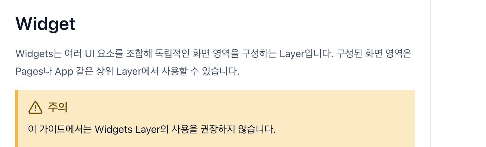
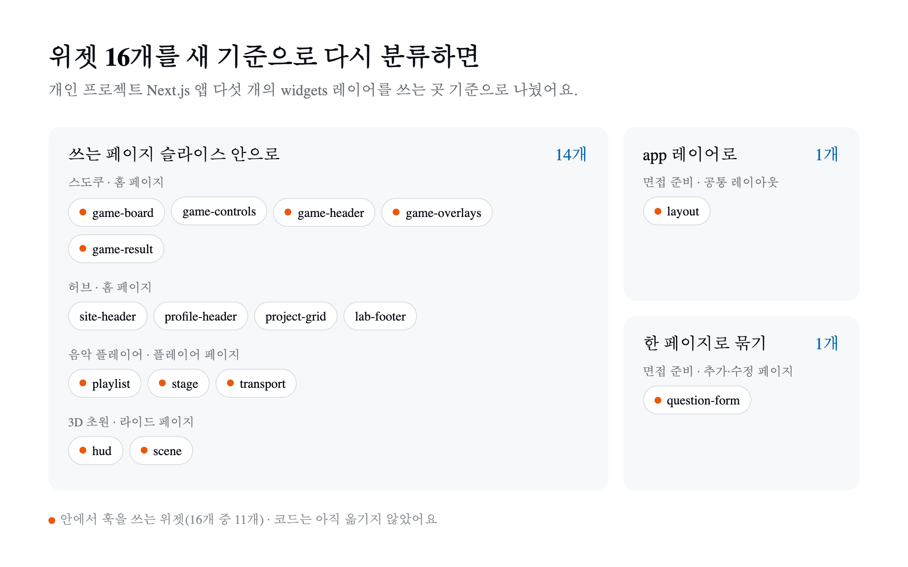

1년 전 [FSD 2.1은 무엇이 달라졌을까?](/posts/fsd-2-1/)에서 Widget을 이렇게 설명했다.

> 2.0에도 존재했지만 2.1에서 역할이 더 명확해짐

올해 7월 FSD 공식 문서는 반대 방향으로 갔다. 레이어 문서의 Widgets 항목에 경고 상자가 하나 붙었다.

> 이 가이드에서는 Widgets Layer의 사용을 권장하지 않습니다.

버전 번호는 그대로다. 공식 문서 저장소의 최신 릴리스는 지금도 2024년 11월 13일에 나온 v2.1이다. 그런데 2026년 한 해 동안 문서 내용은 꽤 많이 바뀌었다. 무엇이 바뀌었는지 정리하고, 직접 만든 앱들의 위젯을 새 기준으로 다시 분류해 봤다.

## 1. 버전은 그대로인데 문서는 많이 바뀌었다

2026년에 [공식 문서 저장소](https://github.com/feature-sliced/documentation)와 주변 도구에 들어간 변화 가운데 구조 판단에 영향을 주는 것만 골랐다.

| 시기 | 변화 |
| --- | --- |
| 1월 | entities를 과하게 만드는 문제를 다룬 [Excessive Entities](https://fsd.how/kr/docs/guides/issues/excessive-entities) 문서 추가 |
| 2월 | 문서 사이트를 Docusaurus에서 Astro Starlight로 이전, 같은 레이어 슬라이스끼리의 cross-import 문제를 다룬 문서 추가 |
| 3월 | AI 코딩 에이전트용 공식 스킬 저장소 [feature-sliced/skills](https://github.com/feature-sliced/skills) 공개 |
| 4월 | 관련 슬라이스를 폴더로 묶는 [Slice groups](https://fsd.how/kr/docs/reference/slice-groups) 문서 추가 |
| 5월 | 한 슬라이스 안에 서버 전용 모듈이 섞일 때 쓰는 `index.server.ts` 공개 API 안내 추가 |
| 6월 | Next.js에서 FSD 레이어 이름을 `_app`, `_pages`로 바꾸라는 안내 추가 |
| 7월 | **Widgets 레이어를 권장하지 않음** ([PR #933](https://github.com/feature-sliced/documentation/pull/933)) |
| 8월 | 한국어 문서에도 Widgets 변경 반영 |
| 11월 | 공식 린터 steiger 0.9.0 출시 |

하나씩 보면 흩어진 변경 같지만 방향은 하나로 모인다. **레이어와 슬라이스를 미리 나누지 말고, 필요해졌을 때 나누라는 것이다.** 그 방향이 가장 크게 드러난 변화가 Widgets다.

## 2. Widgets를 권하지 않게 된 이유

Widgets는 원래 여러 entity와 feature를 조합한 독립적인 UI 블록을 두는 레이어였다. 헤더, 푸터, 상품 목록 같은 것들이다. 2024년에 쓴 [FSD 가이드](/posts/fsd-guide/)에서도 예시로 이 셋을 들었다.

PR #933은 권장을 거둔 이유를 이렇게 설명한다. 실제 프론트엔드 코드에서 UI 블록은 화면만 그리지 않는다. 데이터를 가져오고, 상태를 관리하고, 이벤트를 처리한다. 그러면 사용자 흐름을 맡는 Features와 UI 블록을 맡는 Widgets의 책임이 겹친다. 어떤 코드를 features에 둘지 widgets에 둘지 정하기 어려워지고, 프로젝트가 커질수록 그 경계는 더 흐려진다.



여기서 오해하기 쉬운 부분이 있다. **권장하지 않는다는 것이지 없앴다는 것이 아니다.** PR은 Widgets를 제거하거나 금지하는 것이 아니라고 분명히 적었다. 이미 Widgets를 문제없이 쓰고 있는 프로젝트는 구조를 바꿀 필요가 없고, 프로젝트에 맞으면 계속 써도 된다. 레이어 목록에서 흐리게 표시되는 Processes는 2023년 v2.0 때부터 deprecated였던 레이어라서 이번 변화와는 결이 다르다.

### 위젯 대신 어디에 두나

공식 문서는 "위젯을 만들지 않는다는 것이 그 UI 블록을 다른 레이어로 그대로 옮긴다는 뜻은 아니다"라고 덧붙인다. 코드의 성격에 따라 갈 곳이 다르다.

| 이런 코드라면 | 여기에 둔다 |
| --- | --- |
| 특정 화면에서만 쓰는 조합 | 그 화면의 `pages` 슬라이스 |
| 여러 페이지에서 쓰는 사용자 동작과, 그 동작에 필요한 UI 조합 | `features` |
| 비즈니스 맥락이 없는 공용 UI | `shared` |
| 앱 전체 레이아웃 같은 UI | `app` |

첫 줄이 핵심이다. 문서의 Pages 항목은 "페이지의 UI 블록이 재사용되지 않는다면 page 슬라이스 안에 두는 것이 전혀 문제없다"고 한다. 팀이 찾기 쉽다면 page 슬라이스에 담는 코드 양에도 제한이 없다고 한다. 2.1의 Page-first가 한 단계 더 나아간 셈이다.

## 3. 같은 방향의 다른 변화: 먼저 나누지 않는다

Widgets 말고도 올해 문서에는 "미리 나누지 말라"는 내용이 계속 쌓였다.

**entities가 없어도 된다.** Excessive Entities 문서는 entities 레이어를 아예 두지 않는 선택지부터 꺼낸다. 이 레이어가 없어도 FSD를 어기는 것이 아니며, 백엔드가 데이터 처리를 대부분 맡는 얇은 클라이언트라면 entities가 필요 없을 가능성이 높다고 한다. 구체적인 기준도 있다.

- 처음에는 코드를 지금 쓰는 슬라이스의 `model` 세그먼트에 두고, 요구사항이 안정되면 그때 entities로 옮긴다. 문서는 이것을 "FSD 2.1은 선제적 분해 대신 지연된 분해를 권한다"고 표현한다.
- 비즈니스 로직이 거의 없는 CRUD 요청은 entities가 아니라 `shared/api`에 둔다.
- 토큰이나 로그인 응답 같은 인증 데이터는 `user` entity를 만들지 말고 `shared/auth`나 `shared/api`에 둔다.

**공식 AI 스킬은 더 엄격하다.** 3월에 나온 공식 스킬은 페이지 밖으로 코드를 꺼내는 조건을 세 가지로 정해 두고, 셋이 모두 맞을 때만 꺼내라고 한다.

1. 같은 코드가 가정이 아니라 **지금** 여러 곳에서 쓰인다.
2. 쓰는 쪽 어느 하나와도 무관한, 자기만의 변경 이유가 있다.
3. 경계의 책임이 하나로 좁혀져 있다.

페이지 사이에 코드가 중복되는 것도 그 자체로는 꺼낼 이유가 아니라고 본다. 공식 린터 steiger에도 같은 생각을 담은 규칙이 있다. 쓰는 곳이 하나뿐인 슬라이스를 잡는 `insignificant-slice`와, 한 레이어에 슬라이스가 너무 많은 경우를 잡는 `excessive-slicing`이다.

**슬라이스가 많아지면 묶는다.** 반대로 슬라이스가 너무 많아져 찾기 어려울 때를 위해 Slice groups가 생겼다. `entities/payment/` 아래에 `invoice`, `receipt`, `transaction`을 모으는 식이다. 다만 그룹은 슬라이스가 아니다. 자기 세그먼트나 `index.ts`를 갖지 않고 의존 규칙도 바꾸지 않는, 찾아보기 위한 폴더일 뿐이다. 문서는 국내 사례로 [카카오페이의 pages 레이어 그룹화](https://tech.kakaopay.com/post/fsd/)를 참고 자료로 걸어 두었다.

## 4. Next.js를 쓴다면 바뀐 두 가지

Next.js는 `app`과 `pages`를 라우팅 폴더로 쓰기 때문에 FSD의 `app`, `pages` 레이어와 이름이 겹친다. 예전 가이드에서는 FSD 레이어를 `src/` 아래로 넣어 피하는 방법을 정리했고, 랩스 저장소에서는 `pages`를 `views`로 바꿔 부르고 있다.

6월에 추가된 [공식 Next.js 가이드](https://fsd.how/kr/docs/guides/tech/with-nextjs)는 어느 라우터를 쓰든 두 레이어를 모두 `_app`, `_pages`처럼 접두사를 붙여 바꾸라고 한다. steiger도 이 이름을 인식한다. 라우트 파일에서는 페이지를 다시 내보내기만 한다.

```tsx
// app/example/page.tsx
export { ExamplePage as default, metadata } from '@/_pages/example';
```

다른 하나는 서버 전용 공개 API다. App Router에서는 클라이언트에서도 쓰는 모듈과 서버에서만 도는 모듈이 한 슬라이스에 섞일 수 있다. 서버 전용 모듈을 `index.ts`로 함께 내보내면, 클라이언트 컴포넌트가 그 슬라이스를 import할 때 서버 코드까지 클라이언트 쪽으로 딸려 들어가 빌드가 깨질 수 있다. 이 문제가 실제로 생기면 `index.server.ts`를 따로 두고 서버 컴포넌트나 `server-only` 모듈은 그쪽으로 내보내라고 한다. 문제가 생기기 전에 미리 나누라는 말은 아니라는 점도 앞의 흐름과 같다.

## 5. 내가 만든 위젯 16개를 새 기준으로 다시 보니

이 변화를 남의 이야기로만 정리할 수는 없었다. 개인 프로젝트 모노레포의 Next.js 앱 일곱 개 가운데 다섯 개가 widgets 레이어를 쓰고 있기 때문이다. 위젯은 모두 16개다. 각 위젯을 어디서 import하는지, 안에서 훅을 쓰는지 세어 봤다.

| 앱 | 위젯 | 쓰는 곳 |
| --- | --- | --- |
| 스도쿠 | game-board, game-controls, game-header, game-overlays, game-result | 홈 페이지 하나 |
| 허브 | site-header, profile-header, project-grid, lab-footer | 홈 페이지 하나 |
| 음악 플레이어 | playlist, stage, transport | 플레이어 페이지 하나 |
| 3D 초원 | hud, scene | 라이드 페이지 하나 |
| 면접 준비 | layout | 사용자 화면 전체에 씌우는 공통 레이아웃 |
| 면접 준비 | question-form | 질문 추가·수정 페이지 두 곳 |

결과는 문서가 말한 그대로였다.

**16개 중 14개는 쓰는 페이지가 하나다.** 재사용되는 UI 블록을 두라고 만든 레이어인데, 실제로는 페이지 하나를 구역별로 나눠 담는 폴더로 쓰고 있었다. 허브의 헤더, 푸터, 프로젝트 목록은 2024년 가이드에 위젯 예시로 들었던 바로 그 구성이다.

**16개 중 11개는 안에서 훅을 쓴다.** 스도쿠의 `game-board`는 보드를 그리기만 하는 것 같지만, 안에서 전역 상태 atom을 읽고 쓰며 키보드 조작 훅과 게임 초기화 훅까지 실행한다. 3D 초원의 `scene`은 entity 다섯 개와 feature 두 개에 의존한다. "UI 블록이 데이터와 상태와 이벤트를 품으면서 features와 경계가 겹친다"는 PR의 설명이 내 코드에서도 그대로 보였다.

새 기준으로 다시 분류하면 이렇게 된다.



- **쓰는 페이지가 하나인 14개**는 그 페이지 슬라이스 안으로 들어간다. 위젯 이름은 page 슬라이스 안의 `ui` 컴포넌트 이름으로 남는다.
- **면접 준비 앱의 레이아웃 위젯**(`layout`)은 사용자 화면 전체에 헤더와 푸터를 씌우는 레이아웃이므로 `app` 레이어로 간다.
- **질문 폼 위젯**(`question-form`)은 질문 추가 페이지와 수정 페이지에서 쓴다. 쓰는 곳이 둘이니 features로 꺼낼 수도 있다. 하지만 두 페이지는 같은 폼을 빈 상태로 여느냐, 기존 질문을 채워 여느냐의 차이뿐이다. 문서는 회원가입과 로그인처럼 매우 비슷한 페이지는 한 page 슬라이스로 묶어도 된다고 한다. 지금은 다른 화면에서 이 폼을 쓰지 않으니, 두 페이지를 질문 편집 page 슬라이스 하나로 묶는 쪽이 맞다고 봤다.

아직 코드를 옮기지는 않았다. 앞에서 말했듯 이미 쓰고 있는 widgets는 여전히 유효하다. 그리고 이 모노레포의 lint 규칙은 `views → widgets → features` 방향을 강제하고 있어서, 위젯을 걷어내려면 규칙부터 바꿔야 한다. 레이어 이름도 공식 권장인 `_pages`가 아니라 `views`다. 내 설정 자체가 이번 변화 이전의 기준 위에 서 있는 셈이다.

## 6. 지금 위젯을 쓰고 있다면

서둘러 옮길 필요는 없다고 본다. 공식 입장도 "권장하지 않음"이지 "사용 중단"이 아니다. 다만 새로 만드는 코드부터는 기준을 바꿀 만하다.

- 새 UI 블록은 일단 그 블록을 쓰는 페이지 슬라이스에 둔다.
- 다른 페이지에서 **실제로** 필요해지면, 사용자 동작이면 features로, 비즈니스 맥락이 없는 UI면 shared로 꺼낸다.
- 기존 위젯은 고칠 일이 생겼을 때 쓰는 곳을 세어 본다. 쓰는 곳이 하나라면 그 페이지로 옮긴다.

재사용되는 UI 블록을 두는 레이어였지만, 내 위젯 16개 가운데 두 페이지 이상에서 쓰이는 건 거의 같은 두 화면이 나눠 쓰는 폼 하나뿐이었다. 레이어가 하나 늘면 코드를 둘 자리를 한 번 더 고민해야 한다. 그 비용에 비해 얻는 것이 적었다.

## 정리

- FSD 버전은 지금도 2.1이다. 대신 2026년에 공식 문서가 크게 바뀌었다.
- Widgets 레이어는 7월부터 권장하지 않는다. UI 블록이 로직을 품으면서 Features와 책임이 겹치기 때문이다. 금지가 아니라서 기존 프로젝트는 그대로 써도 된다.
- 위젯 대신 화면 전용 조합은 pages에, 재사용되는 사용자 동작은 features에, 맥락 없는 UI는 shared에, 앱 전체 레이아웃은 app에 둔다.
- entities 최소화, 공식 AI 스킬의 꺼내기 조건, steiger 규칙까지 모두 "필요해지기 전에 나누지 말라"는 같은 방향을 가리킨다.
- Next.js에서는 `_app`, `_pages` 접두사와 `index.server.ts`가 새 공식 안내다.

FSD의 레이어 구성을 처음 본다면 [쉽게 정리한 FSD 가이드](/posts/fsd-guide/)를, 2.0과 2.1의 차이가 궁금하다면 [FSD 2.1은 무엇이 달라졌을까?](/posts/fsd-2-1/)를 먼저 읽으면 좋다. 두 글의 Widgets 설명은 이번 변화 이전 기준이다.
