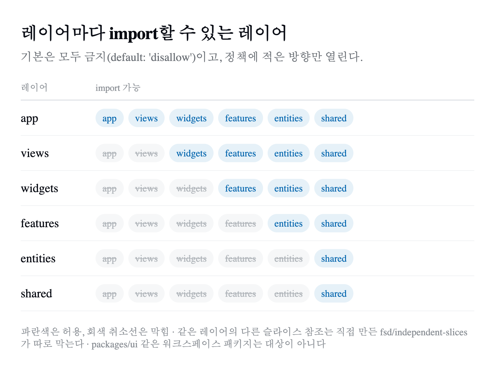
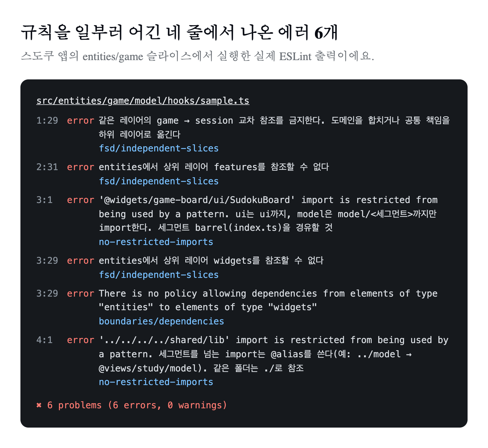

2026년 8월 24일, 공유 ESLint 설정에 커밋 하나를 올렸다.

```text
chore(eslint-config): import 세그먼트 깊이를 lint로 강제한다 — 문서에만 있던 룰이라 새 코드마다 샜다
```

개인 프로젝트를 모아 둔 모노레포에는 Next.js 앱이 일곱 개 있고 모두 [Feature-Sliced Design(FSD)](/posts/fsd-guide/)으로 나뉘어 있다. 규칙은 저장소의 작업 규칙 문서(당시 CLAUDE.md)에 적어 뒀다. 그런데 같은 문서 안에서도 규칙마다 처지가 달랐다. 레이어 방향 규칙에는 처음부터 "lint 강제"라고 적혀 있었고 세그먼트 규칙에는 그 표시가 없었다. 문서에만 있던 세그먼트 규칙이 새 코드마다 어긋났다.

그 뒤로 문서에만 있던 규칙을 하나씩 lint로 옮겼다. 지금은 규칙을 어기면 `pnpm lint`가 실패하고 CI도 같은 명령으로 막는다.

> 2026년 11월 10일에 덧붙인다. 이 글을 올리고 나흘 뒤에 import 규칙을 FSD 공식 문서의 공개 API 방식으로 바꿨다. 1~7장은 그전까지의 기록이라 그대로 두고, 바뀐 규칙은 8장에 정리했다.

## 1. 문서에서 lint로 옮겨 온 순서

규칙은 한 번에 옮기지 않았다. 커밋 기록을 날짜순으로 정리하면 이렇다.

| 날짜 | 옮긴 규칙 |
| --- | --- |
| 2026-06-01 | 모노레포 전환과 함께 레이어 방향을 eslint-plugin-boundaries로 강제 |
| 2026-08-24 | import 세그먼트 깊이 제한 |
| 2026-08-30 | 식별자·파일·디렉토리 네이밍 규약, 세그먼트를 넘는 상대경로 금지 |
| 2026-11-04 | 직접 만든 FSD 규칙 6개, 저장소 전체 구조 검사 |
| 2026-11-10 | 공식 공개 API 기준으로 import 규칙 교체, widgets 레이어 제거(8장) |

모든 앱은 같은 설정을 쓴다. 공유 패키지 `@repo/eslint-config`의 `fsd.config.mjs`를 각 앱의 `eslint.config.mjs`가 펼쳐 쓰는 구조라, 규칙을 한 곳에서 고치면 일곱 개 앱에 함께 적용된다.

## 2. 레이어 방향: eslint-plugin-boundaries

[eslint-plugin-boundaries](https://github.com/javierbrea/eslint-plugin-boundaries)는 FSD 전용 도구가 아니다. 폴더를 "요소(element)"로 등록하고 요소 사이에 허용할 의존 관계를 직접 적는 범용 플러그인이다. 먼저 레이어 여섯 개를 요소로 등록했다. Next.js의 `pages` 폴더와 이름이 겹치지 않도록 페이지 레이어는 `views`라고 부른다.

```js
const FSD_ELEMENTS = [
  { type: 'app', pattern: 'src/app/**' },
  { type: 'views', pattern: 'src/views/**' },
  { type: 'widgets', pattern: 'src/widgets/**' },
  { type: 'features', pattern: 'src/features/**' },
  { type: 'entities', pattern: 'src/entities/**' },
  { type: 'shared', pattern: 'src/shared/**' },
];
```

그다음 레이어마다 import해도 되는 레이어를 정책으로 적었다. 핵심은 기본값을 `disallow`로 둔 것이다. 정책에 적힌 방향만 열리고 적지 않은 방향은 모두 막힌다.

```js
const DEPENDENCY_POLICIES = [
  { from: { element: { type: 'features' } }, allow: { to: { element: { types: { anyOf: ['entities', 'shared'] } } } } },
  { from: { element: { type: 'entities' } }, allow: { to: { element: { type: 'shared' } } } },
  // app, views, widgets, shared도 같은 방식으로 적는다
];

rules: {
  'boundaries/dependencies': ['error', { default: 'disallow', policies: DEPENDENCY_POLICIES }],
}
```



`packages/ui` 같은 워크스페이스 패키지와 `node_modules`는 요소로 등록하지 않았으므로 이 규칙의 대상이 아니다. 디자인 시스템 컴포넌트는 어느 레이어에서든 가져다 쓸 수 있다.

## 3. 세그먼트 깊이와 상대경로

레이어 방향만으로는 막지 못하는 문제가 있었다. 다른 슬라이스의 내부 파일을 직접 import하는 경우다. 규칙은 "슬라이스 밖에서는 세그먼트 배럴(`index.ts`)까지만 import한다"였는데, 문서에만 있어서 새 코드마다 어긋났다. 앞의 8월 24일 커밋이 이 규칙을 `no-restricted-imports` 패턴으로 옮긴 것이다.

```js
{
  group: ['@entities/*/ui/*', '@features/*/ui/*', '@widgets/*/ui/*', '@views/*/ui/*', '**/model/*/*', '!**/__tests__/**'],
  message: 'ui는 ui까지, model은 model/<세그먼트>까지만 import한다. 세그먼트 barrel(index.ts)을 경유할 것.',
}
```

8월 30일에는 세그먼트를 넘는 상대경로도 막았다. `../model`은 import하는 파일이 한 단계 깊어지면 함께 깨지지만 `@views/study/model`은 그대로다. 같은 슬라이스 안에서도 상대경로와 alias가 213 대 88로 섞여 있었다.

- 세그먼트를 넘는 상대경로 200건을 alias로 바꿨다.
- 같은 폴더 안의 형제 파일 참조(`./X`) 688건은 그대로 뒀다. alias로 바꾸면 자기 세그먼트의 배럴을 자기가 다시 import하는 순환이 생긴다.
- 슬라이스 밖으로 나가는 상대경로는 원래 0건이었다. 레이어 경계는 그때 이미 깨끗했다.

같은 날 네이밍 규약도 lint로 옮겼다. `.tsx` 파일은 PascalCase, 훅과 `.ts` 파일은 camelCase, 디렉토리는 kebab-case다. 이때 걸린 위반은 4건이었다.

## 4. 플러그인이 보지 못하는 것: 직접 만든 규칙 6개

11월 4일에는 eslint-plugin-boundaries와 `no-restricted-imports`로는 표현하기 어려운 규칙을 직접 만들었다. 파일 하나(`rules/architecture.mjs`, 171줄)에 규칙 6개가 들어 있고 공유 설정에서 `fsd/` 접두사로 켠다.

| 규칙 | 막는 것 |
| --- | --- |
| `fsd/slice-structure` | 슬라이스 바로 아래에 `ui/`, `model/`, `lib/`가 아닌 파일을 두는 것. `model`은 `hooks/`, `types/`, `store/` 같은 세그먼트 폴더 안에만 둔다 |
| `fsd/independent-slices` | 아래 레이어가 위 레이어를 import하는 것, 같은 레이어의 다른 슬라이스를 import하는 것 |
| `fsd/component-file` | 컴포넌트를 `ui/` 밖에 두거나, 파일 이름과 다른 이름의 컴포넌트를 한 파일에 더 선언하는 것 |
| `fsd/routing-location` | Next.js 라우팅 파일(`page`, `layout`, `route` 등)을 FSD의 `src/app/`에 두는 것 |
| `fsd/entity-state` | `entities/<도메인>/model/store/` 밖에서 Jotai 전역 atom을 만드는 것 |
| `fsd/interactive-composition` | `Link` 안에 `Button`을 중첩하는 것(`asChild`로 감싼 경우는 허용) |

두 번째 규칙은 eslint-plugin-boundaries와 역할이 겹친다. 차이는 판단 방법이다. boundaries는 import를 실제 파일로 해석한 뒤 그 파일이 어느 요소에 속하는지 본다. 직접 만든 규칙은 import 문자열을 경로로 풀어 레이어와 슬라이스를 바로 계산한다. 상대경로, `@views/` 같은 alias, `export ... from`, 동적 `import()`까지 같은 방식으로 본다.

이 차이는 실제로 결과를 가른다. 아래 5장의 예시에서 `@features/game-record/model`은 `model` 폴더에 배럴 파일이 없어 실제 파일로 해석되지 않는다. 이 줄은 직접 만든 규칙만 잡았고 boundaries는 잡지 못했다.

규칙마다 테스트도 있다. 같은 슬라이스 import는 통과하고 다른 슬라이스와 위 레이어 import는 실패하는지, 상대경로·재수출·동적 import로 경계를 우회할 수 없는지 등 7개 시나리오를 `node:test`로 확인한다.

## 5. 실제로 막히는 장면

스도쿠 앱의 `entities/game` 슬라이스 안에서 규칙을 일부러 어긴 코드를 lint에 넣어 봤다. 파일은 만들지 않고 표준 입력으로만 검사했다.

```ts
// src/entities/game/model/hooks/sample.ts
import { sessionAtom } from '@entities/session/model/store';
import { useGameRecord } from '@features/game-record/model';
import { SudokuBoard } from '@widgets/game-board/ui/SudokuBoard';
import { cn } from '../../../../shared/lib';
```

네 줄에서 에러 6개가 나왔다.



- 1번 줄은 같은 레이어(`entities`)의 다른 슬라이스 `session`을 가져와서 막혔다.
- 2번 줄은 아래 레이어에서 위 레이어 `features`를 가져와서 막혔다. 직접 만든 규칙만 잡은 줄이다.
- 3번 줄은 위 레이어 참조라 두 규칙이 함께 잡았고 `ui/SudokuBoard`까지 파고들어 세그먼트 깊이 규칙에도 걸렸다.
- 4번 줄은 세그먼트를 넘는 상대경로라 막혔다.

에러 메시지에는 어떻게 고치면 되는지가 함께 들어 있다. "도메인을 합치거나 공통 책임을 하위 레이어로 옮긴다", "세그먼트 barrel(index.ts)을 경유할 것" 같은 식이다. 이 저장소에서는 코딩 에이전트의 작업 완료 조건에도 `pnpm lint` 통과가 들어 있어서 에이전트가 만든 코드도 같은 메시지를 받는다.

## 6. lint 밖에서 지키는 것

ESLint는 파일 단위로 코드를 본다. 패키지 설정이나 여러 파일에 걸친 순환 참조처럼 파일 하나만 봐서는 판단할 수 없는 규칙은 별도 스크립트 `check:architecture`가 검사한다.

- 외부 의존성 버전은 `pnpm-workspace.yaml`의 catalog로만 관리하고 워크스페이스 의존성은 `workspace:*`로 적는다.
- `strict`, `noUncheckedIndexedAccess`, `verbatimModuleSyntax` 같은 공유 TypeScript 엄격 옵션을 앱에서 끌 수 없다.
- `any`를 쓸 수 없다.
- 구조 규칙(`fsd/*`, `no-restricted-imports`)을 `eslint-disable`로 우회할 수 없다.
- 동적 import를 포함한 런타임 순환 참조와, 클라이언트 코드가 서버 전용 코드를 참조하는 경우를 찾는다.

`pnpm lint`는 이 스크립트를 먼저 돌리고 나서 각 앱의 ESLint를 실행한다. 지금은 워크스페이스 14개와 새 앱 템플릿 1개를 검사한다. 새 앱은 이 템플릿을 복제해 만들므로(`pnpm new-app`), 템플릿이 검사를 통과하면 새 앱도 같은 규칙에서 시작한다.

`eslint-disable` 우회 금지가 생긴 날 남아 있던 예외도 정리됐다. 8월 상대경로 정리 때 면접 준비 앱의 feedback 슬라이스는 `types`, `constants`, `actions`가 세그먼트 폴더가 아닌 루트 파일이어서 alias로 가리킬 수 없었다. 그래서 `eslint-disable`로 남겨 뒀는데, 11월 4일에 이 파일들을 `model/` 아래 세그먼트로 옮기면서 예외가 사라졌다.

작업 규칙 문서도 같은 날 정리했다. Codex와 Claude가 함께 읽는 AGENTS.md 한 곳에 규칙을 두고 도구별 문서에는 같은 내용을 다시 적지 않는다. 문서에는 무엇을 왜 지키는지 적고 지켜졌는지는 lint와 구조 검사가 확인한다. 코드를 AI에게 맡기는 조건은 [AI에게 코드를 맡기기 위한 위임의 조건](/posts/delegating-code-to-ai/)에 따로 정리했다.

## 7. 한계와 다른 도구

이 글을 처음 올릴 때 규칙 체계는 widgets 레이어를 전제로 했다. 레이어 정책에 `views → widgets → features` 방향이 그대로 들어 있었다. FSD 공식 문서는 2026년 7월부터 widgets 레이어를 권장하지 않는데, 그 내용은 [FSD는 왜 Widgets 레이어를 권하지 않게 됐을까](/posts/fsd-2026-widgets/)에 정리했다. 위젯을 페이지 슬라이스로 옮기려면 정책 한 줄과 직접 만든 규칙의 레이어 목록을 함께 고쳐야 했고, 이 일은 11월 10일에 했다(8장).

FSD 규칙을 검사하는 도구는 이것 말고도 있다. FSD 공식 린터인 [steiger](https://github.com/feature-sliced/steiger)는 FSD 구조 규칙이 미리 들어 있는 별도 CLI다. eslint-plugin-boundaries는 규칙을 직접 적어야 하는 대신 ESLint 규칙이라서 다른 lint 에러와 함께 편집기와 `pnpm lint`에서 바로 보인다. 이 저장소는 후자에 직접 만든 규칙과 구조 검사 스크립트를 더한 형태다.

## 8. 2026년 11월: 공식 공개 API로 규칙을 바꿨다

3장의 규칙은 내가 정한 것이었다. 세그먼트마다 `index.ts`를 두고 `@entities/game/model/types`처럼 세그먼트까지 적어서 가져오게 했다. FSD 공식 문서는 반대를 권한다. 슬라이스 루트에 `index.ts` 하나만 두고, 슬라이스가 있는 레이어에서는 세그먼트 안에 `index.ts`를 두지 말라고 한다([Public API](https://fsd.how/docs/reference/public-api/)). 11월 10일에 앱 일곱 개와 lint 규칙을 공식 방식으로 옮겼다.

| 항목 | 이전 | 지금 |
| --- | --- | --- |
| 슬라이스 밖에서 import | 세그먼트 배럴까지(`@entities/game/model/types`) | 슬라이스 루트만(`@entities/game`) |
| 슬라이스 안에서 import | 세그먼트를 넘으면 alias | 상대경로로 파일을 직접 |
| 세그먼트 안 `index.ts` | 필수 | 금지 |
| shared | `@shared/ui` 배럴 | 항목 단위(`@shared/ui/BottomSheet`) |
| 레이어 | 6개 | 5개(widgets 제거) |
| 전역 atom 위치 | `entities/<도메인>/model/store/` | 쓰는 슬라이스의 `model/` |

상대경로 규칙은 정반대가 됐다. 8월 30일에는 세그먼트를 넘는 상대경로 200건을 alias로 바꿨는데, 이번에는 슬라이스 안의 alias를 모두 상대경로로 되돌렸다. 공식 문서가 같은 슬라이스 안에서는 상대경로를, 다른 슬라이스는 alias를 쓰라고 하기 때문이다. 슬라이스 안에서 자기 `index.ts`를 거쳐 가져오면 순환 참조가 생긴다.

lint 설정에서는 `no-restricted-imports` 패턴 두 개를 지우고 직접 만든 규칙 `fsd/public-api`를 더했다. 직접 만든 규칙은 7개가 됐고 파일은 262줄이다. `fsd/slice-structure`는 세그먼트 이름을 `ui`·`model`·`api`·`lib`·`config`로 제한하고, 세그먼트 안의 `index.ts`와 shared 바로 아래의 도메인 폴더를 막는다. 테스트는 10개 시나리오로 늘었다.

5장과 같은 방식으로 스도쿠 앱의 `entities/game` 안에서 규칙을 어긴 코드를 넣어 봤다.

```ts
// src/entities/game/model/hooks/sample.ts
import { sessionAtom } from '@entities/session/model/store/sessionAtoms';
import { cellAt } from '@entities/game';
import { validate } from '@entities/game/lib/validator';
import { cn } from '@shared/lib';
```

```text
1:29  error  entities/session는 공개 API(index.ts)로만 import한다                        fsd/public-api
1:29  error  같은 레이어의 game → session 교차 참조를 금지한다. 도메인을 합치거나 공통 책임을 하위 레이어로 옮긴다  fsd/independent-slices
2:24  error  슬라이스 안에서 자기 공개 API를 import하지 않는다(순환 참조)                          fsd/public-api
3:26  error  슬라이스 안에서는 상대경로로 import한다                                         fsd/public-api
4:20  error  @shared/lib/<항목>처럼 항목 진입점으로 import한다                              fsd/public-api
```

공식 린터 steiger도 이때 다시 검토했다. steiger는 `views`라는 이름을 pages 레이어로 인식하지 못해서, 이 저장소에서는 화면 레이어가 검사에서 빠졌다. 그래서 steiger는 들이지 않고 ESLint 규칙을 고쳐 쓰는 쪽을 택했다. 바뀐 기준 전체는 [FSD 가이드](/posts/fsd-guide/)의 4장에 있다.

## 정리

- 문서로만 정한 규칙은 새 코드마다 어긋났다. 규칙은 lint로 옮겨야 지켜졌다.
- 레이어 방향은 eslint-plugin-boundaries로 막았다. 기본값을 `disallow`로 두고 허용할 방향만 적었다.
- 세그먼트 깊이와 상대경로는 처음에 `no-restricted-imports` 패턴으로 막았다. 상대경로 200건을 alias로 바꾸고 순환을 만드는 같은 폴더 참조 688건은 남겼다.
- 플러그인으로 표현하기 어려운 규칙은 직접 만들었다. 처음에는 6개였고 지금은 7개다. import 문자열을 경로로 풀어 판단하므로 파일로 해석되지 않는 import도 잡는다.
- 파일 하나로 판단할 수 없는 규칙은 `check:architecture`가 검사하고 `pnpm lint`와 CI가 둘 다 실행한다.
- 11월 10일에 import 규칙을 공식 공개 API 방식으로 바꿨다. 세그먼트 깊이 규칙은 `fsd/public-api`로 대체했고, 슬라이스 안은 다시 상대경로를 쓴다.

FSD 레이어 구성은 [FSD 가이드](/posts/fsd-guide/)에, import 경로와 배럴 패턴은 [import 경로 관리 알아보기](/posts/import-path-alias-barrel-fsd/)에 정리돼 있다.

같은 방식으로 디자인 토큰 규칙을 도구에 맡긴 과정은 [디자인 토큰 규칙을 문서 대신 도구가 지키게 만들기](/posts/design-token-conventions/)에 있다.
