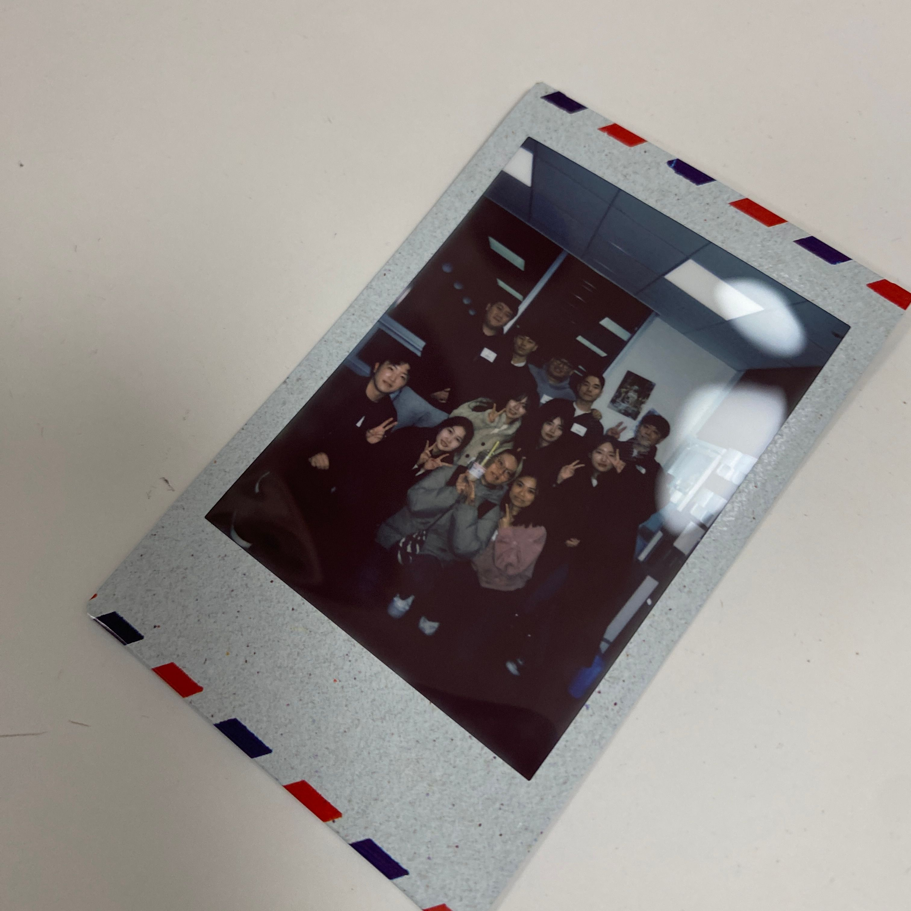
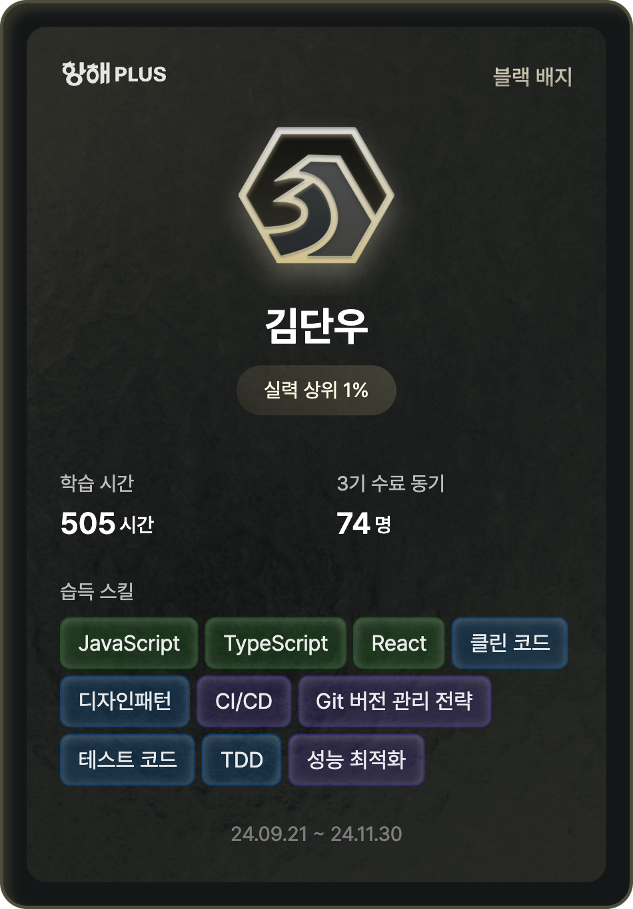

"더 깊이 알고 싶다", "이게 최선일까?", "정말 이게 맞는 걸까?"

개발자로서 끊임없이 마주치는 이 질문들에 대한 답을 찾을 수 없겠지만,

정해진 길이 없는 개발자의 성장 경로에서, 혼자만의 학습이 아닌 새로운 방향을 찾고 싶었다.

그렇게 시작한 10주간의 여정이 마무리되었다.

다양한 경력을 가진 팀원들과 함께하며 새로운 시각을 발견했다.

밤늦게까지 이어진 과제와 코드 리뷰 시간은 단순한 기술 공유를 넘어 서로의 관점을 이해하는 소중한 시간이었다.

'이런 식으로도 생각할 수 있구나!' 하는 깨달음의 순간들이 쌓여갔고,

열정 넘치는 코치님들의 멘토링은 기술 외적인 부분에서도 값진 배움을 선물해주었다.

처음엔 모든 과제를 완벽하게 해내겠다는 욕심을 부렸지만,

회사 업무와 병행하는 게 쉽지만은 않았다.

하지만 314팀 동료들과 함께하며 서로 의지가 되었고, 각자의 방식으로 묵묵히 나아가는 모습에 동기부여를 받았다.

주말은 과제에 집중하고, 평일에는 운동 후 자기 전까지 시간을 투자하는 나만의 리듬을 찾아갔다.

덕분에 모든 과제를 무사히 통과할 수 있었고, 코치님들의 꼼꼼한 피드백으로 한걸음씩 성장할 수 있었다.

이번 항해99를 통해 '함께하는 성장'이 얼마나 값진 것인지 깊이 깨달았다.

각자 다른 배경과 경험을 가진 동료들과 지식을 나누고,

서로의 코드를 들여다보며 나눈 대화들은 혼자였다면 절대 발견하지 못했을 새로운 시각을 열어주었다.

때로는 늦은 밤까지 이어진 코드 리뷰 시간이 피곤하기도 했지만,

그 속에서 발견한 팀워크의 가치는 앞으로의 개발자 여정에서도 잊지 못할 소중한 경험이 되었다.

항해라는 여정이 끝났지만, 이는 또 다른 시작점이다. 열정 가득했던 동료들,

아낌없는 조언을 해주신 코치님들, 그리고 세심하게 신경 써주신 매니저님들 덕분에 무사히 여기까지 올 수 있었다.

이 값진 경험을 발판 삼아 앞으로도 새로운 도전을 이어가려 한다.

함께해준 314팀, 코치님들, 매니저님들께 진심으로 감사드립니다!

