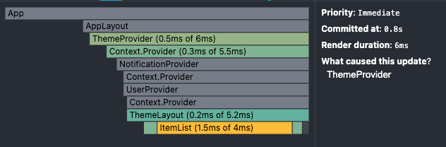
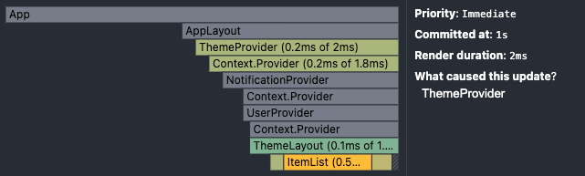

## 1\. 문제: 불필요한 재렌더링과 메모이제이션

3주차에는 리액트 컴포넌트를 최적화하는 방법에 집중했다. 특히 메모이제이션과 렌더링 최적화를 통해 성능을 개선하는 것이 목표였다. 리액트의 가상 DOM을 직접 구현한 과제는 [내가 리액트를 직접 만들어봤다?](/posts/build-my-own-react/)에 정리했다.

주요 문제는 세 가지였다.

1.  **컴포넌트 재렌더링**: 상태나 props가 바뀔 때마다 불필요하게 컴포넌트가 다시 렌더링되는 문제를 해결해야 했다. 이를 막기 위해서는 값이 실제로 변경된 경우에만 렌더링을 트리거해야 했고 이를 최적화할 방법을 고민했다.
2.  **메모이제이션**: 동일한 연산을 반복해서 수행하는 대신, 이전의 연산 결과를 기억해 성능을 높이는 방법을 적용할 필요가 있었다. 이 과정에서 useMemo와 useCallback을 적절히 활용하는 방법을 고민했다.
3.  **깊은 비교 vs 얕은 비교**: 객체나 배열 같은 복잡한 데이터 구조를 다룰 때, 얕은 비교만으로는 변화 여부를 정확히 감지할 수 없었다. deepEquals를 활용해 깊은 비교를 적용할지, 아니면 성능상의 이유로 얕은 비교를 사용할지에 대한 균형을 맞춰야 했다.

## 2\. 시도: 비교 함수, 메모이제이션 훅, memo

이번 주에는 컴포넌트 최적화를 위해 몇 가지 방법을 시도했다.

1.  **shallowEquals와 deepEquals 구현**: 먼저 객체와 배열의 비교를 위해 얕은 비교와 깊은 비교 함수를 만들었다. shallowEquals는 주로 간단한 데이터 타입에서 사용하고 내부 구조를 고려해야 하는 경우엔 deepEquals를 사용해 복잡한 데이터도 정확히 비교할 수 있도록 했다.
2.  **useMemo와 useCallback 활용**: 상태나 props가 자주 변하지 않는 컴포넌트에서 불필요한 재계산을 피하기 위해 useMemo와 useCallback을 구현하고 적용했다. useMemo는 복잡한 연산이 들어간 부분에서 이전 결과를 기억하고 useCallback은 의존성이 같으면 이전 렌더링의 함수 참조를 그대로 돌려주었다.
3.  **memo와 deepMemo 구현**: 컴포넌트를 최적화하기 위해 리액트의 memo와 비슷한 기능을 구현했다. memo는 얕은 비교를 통해 props가 바뀌지 않으면 컴포넌트가 다시 렌더링되지 않도록 했고 deepMemo는 더 깊은 비교가 필요한 상황에서 활용할 수 있게 만들었다.

## 3\. 해결: 구현 코드

### 1\. shallowEquals와 deepEquals

```ts
// 얕은 비교
function shallowEquals(objA: unknown, objB: unknown, equals = Object.is): boolean {
  if (objA === objB) {
    return true
  }

  if (!isObject(objA) || !isObject(objB)) {
    return false
  }

  if (Array.isArray(objA) && Array.isArray(objB)) {
    return compareArrays(objA, objB, equals)
  }

  return compareObjects(objA, objB, equals)
}

// 깊은 비교
function deepEquals(objA, objB) {
  return shallowEquals(objA, objB, deepEquals);
}
```

deepEquals는 shallowEquals의 비교 함수 자리에 자기 자신을 넘겨, 중첩된 값까지 재귀로 비교한다. 이 두 함수로 상황에 따라 얕은 비교와 깊은 비교를 골라 쓸 수 있었다.

### 2\. useMemo와 useCallback

```tsx
// useMemo
function useMemo<T>(factory: () => T, deps: DependencyList, equals = shallowEquals) {
  const ref = useRef({ deps: undefined, value: undefined });
  if (!equals(ref.current.deps, deps)) {
    ref.current.value = factory();
    ref.current.deps = deps;
  }
  return ref.current.value;
}

// useCallback
function useCallback<T extends (...args: any[]) => any>(factory: T, deps: DependencyList) {
  return useMemo(() => factory, deps);
}

// useDeepMemo
function useDeepMemo<T>(factory: () => T, deps: DependencyList): T {
  return useMemo(factory, deps, deepEquals)
}
```

useMemo는 ref에 이전 deps와 계산 값을 저장해 두고, deps가 달라졌을 때만 factory를 다시 실행한다. 비교 함수는 세 번째 인자로 받고 기본값은 shallowEquals다. useCallback은 함수 자체를 메모하는 useMemo다. useDeepMemo는 세 번째 인자로 deepEquals를 넘겨 깊은 비교를 쓰는 변형이다. 덕분에 불필요한 재계산을 줄이고 memo와 함께 쓰면 하위 컴포넌트의 재렌더링도 줄일 수 있었다.

### 3\. memo와 deepMemo

```ts
export function memo(Component, equals = shallowEquals) {
  return (newProps) => {
    const previousPropsRef = useRef<object | null>(null);
    const elementRef = useRef<ReactElement | null>(null);
    if (elementRef.current === null || !equals(previousPropsRef.current, newProps)) {
      previousPropsRef.current = newProps;
      elementRef.current = createElement(Component, newProps);
    }
    return elementRef.current;
  };
}

export function deepMemo(Component) {
  return memo(Component, deepEquals);
}
```

memo는 equals 함수(기본값 shallowEquals)로 이전 props와 새 props를 비교해, 같으면 이전에 만든 요소를 그대로 돌려준다. 같은 요소를 받은 리액트는 그 컴포넌트를 다시 렌더링하지 않는다. deepMemo는 비교 함수 자리에 deepEquals를 쓴다. 복잡한 데이터 구조를 다루는 컴포넌트에 deepMemo를 적용해 성능과 정확도 모두를 만족시킬 수 있었다.

## 4\. 알게 된 것: 메모이제이션과 비교 방식의 균형

이번 주차 작업으로 컴포넌트 최적화의 중요성을 다시 한 번 깨달았다. 메모이제이션을 적용했을 때 성능이 얼마나 개선되는지 체감할 수 있었다.

-   **메모이제이션**: useMemo와 useCallback을 적재적소에 사용해 불필요한 연산을 피하고 좀 더 효율적으로 동작하도록 만들 수 있었다. 특히 복잡한 로직이 포함된 컴포넌트에서는 성능 차이가 확연했다.
-   **깊은 비교와 얕은 비교의 균형**: 상황에 따라 shallowEquals와 deepEquals를 적절히 선택하는 것이 중요하다는 점을 알게 되었다. 리액트도 이런 비교 방식으로 성능을 최적화한다는 것을 알 수 있었다. 모든 곳에 깊은 비교를 쓸 필요는 없지만, 필요한 곳에는 확실히 적용해야 한다는 것도 깨달았다.
-   **컴포넌트의 불필요한 재렌더링 방지**: memo와 deepMemo를 통해 props가 변하지 않는 컴포넌트가 다시 렌더링되지 않도록 최적화할 수 있었다. 성능을 크게 개선할 수 있었고 특히 대규모 데이터를 다룰 때 효과가 두드러졌다. 다만 꼭 필요한 곳이 아니라면 memo를 쓰지 않는 것이 좋다는 것도 알게 되었다.

이번 주에는 컴포넌트 성능을 최적화하면서 렌더링 성능을 개선했다. 개선 결과는 React DevTools Profiler로 확인했다.

### 최적화 전



최적화 전에는 ThemeProvider에서 업데이트가 발생할 때, ItemList, ThemeLayout 같은 하위 컴포넌트들이 불필요하게 다시 렌더링되는 문제가 있었다. 전체 렌더링 시간이 6ms였고, 그중 ItemList가 1.5ms를 차지했다. ThemeProvider와 Context.Provider도 각각 0.5ms, 0.3ms로 적지 않은 렌더링 시간이 걸렸다.

### 최적화 후



최적화 후에는 useCallback과 useMemo를 적극적으로 활용해 렌더링 시간을 크게 줄일 수 있었다. 최적화 후 전체 렌더링 시간은 2ms로, 약 3배 가까이 개선되었다. ItemList의 렌더링 시간은 1.5ms에서 0.5ms로, ThemeProvider의 렌더링 시간은 0.5ms에서 0.2ms로 줄었다.

### 측정 결과를 다음 최적화의 기준으로

이번에 캡처한 Profiler에서는 전체 렌더링 시간이 6ms에서 2ms로 줄었다. ItemList는 1.5ms에서 0.5ms로 줄어들었다. 메모이제이션 적용 뒤 어떤 컴포넌트의 시간이 달라졌는지 확인할 수 있었다.

다음에도 먼저 Profiler에서 다시 렌더링되는 컴포넌트와 걸리는 시간을 보고 적용할 곳을 정하려 한다. 얕은 비교로 충분한지, 깊은 비교가 필요한지도 그 컴포넌트가 받는 데이터에 맞춰 판단할 것이다.
