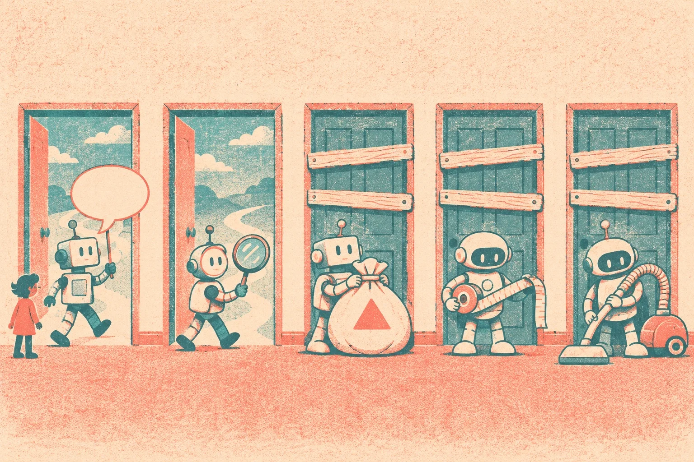

## 1. 실패는 성공으로 끝났다

[베스트셀러 리포트](/posts/bestseller-aggregator/)는 매주 월요일 [GitHub Actions 예약 실행](https://docs.github.com/en/actions/writing-workflows/choosing-when-your-workflow-runs/events-that-trigger-workflows#schedule)으로 서점 순위를 모아 만든다. 처음엔 네 곳이었다. 알라딘은 처음부터 [공식 API(TTB)](https://blog.aladin.co.kr/openapi)로 받았다. HTML을 분석할 필요가 없어서 네 곳 중 가장 안정적인 수집처였다.

11월 2일 수집에서 알라딘 API가 빈 목록을 돌려줬다. 오류 응답이 아니라 정상 응답에 항목만 없었다. 수집 스크립트는 빈 목록을 그대로 받아들였고 워크플로는 성공으로 끝났다. 그 주 리포트는 알라딘 없이 세 곳으로만 집계돼 나갔다.

저장된 데이터로 보면 차이가 분명하다.

| 수집일 | 알라딘 종합 | 알라딘 분야별 | 교보문고 | YES24 | 리디 |
| --- | --- | --- | --- | --- | --- |
| 2026-10-26 | 20 | 60 | 20 | 20 | 11 |
| 2026-11-02 | 0 | 0 | 20 | 20 | 11 |

API가 왜 빈 목록을 돌려줬는지는 지금도 확인하지 못했다. "실패해도 성공처럼 보이는 구간"이 있었다는 건 알 수 있었다. 수집 건수가 0이면 멈추는 검사가 있었다면 그 주에 바로 알았을 것이다.

## 2. 크롤링으로 바꾸려다 robots.txt를 열었다

API로 받을 수 없으면 웹 페이지에서 순위를 읽어 오면 된다고 처음엔 생각했다. 교보문고, YES24, 리디는 이미 화면에서 순위를 읽어 오고 있었다. 작업 전에 알라딘의 [robots.txt](https://www.aladin.co.kr/robots.txt)를 먼저 열었다.

맨 위에 `Last Updated: 2026-10-13`이 적혀 있고 봇을 Tier 1부터 Tier 5까지 묶어 규칙을 따로 줬다. 맨 아래 대체 규칙은 이렇다.

```txt
User-agent: *
Disallow: /
```

목록에 이름이 없는 봇은 사이트 전체에 접근하지 말라는 뜻이다. 내 수집기는 어느 목록에도 없으니 여기에 해당한다.

이전 모습은 인터넷 아카이브에서 확인했다. 아카이브에 남은 가장 최근 사본은 [2026년 1월 9일에 `www1.aladin.co.kr` 주소로 저장된 것](https://web.archive.org/web/20260109112517/https://www1.aladin.co.kr/robots.txt)이다(이 주소도 지금은 새 파일을 보여 준다). 그 사본에서는 `User-agent: *`에 `/search/`, `/ttb/` 같은 경로 몇 개만 막혀 있었고 나머지는 열려 있었다. 전면 차단으로 바뀐 정확한 날짜는 모른다. 아카이브에 그 사이 사본이 없고 파일에 적힌 수정일만 보고 그날 바뀌었다고 단정할 수는 없다.

크롤링으로 바꾸지 않은 이유는 짧다. 크롤링은 정책적으로 막혔을 수도 있다고 봤다.

## 3. AI 봇을 용도별로 나눠 놓았다

robots.txt를 읽다 보니 수집기를 막은 것보다 봇을 나눈 방식이 더 눈에 들어왔다. 등급별 대상과 규칙을 정리하면 이렇다(2026-11-16 기준).

| 묶음 | 대표 봇 | 규칙 |
| --- | --- | --- |
| Tier 1 | Claude-User, ChatGPT-User, Perplexity-User, OAI-SearchBot, Claude-SearchBot, Applebot | 대부분 허용, 검색·API·주문 경로 차단 |
| Tier 2 | Googlebot, Bingbot, Yeti(네이버), Daumoa, 카카오톡·슬랙 링크 미리보기 | Tier 1과 거의 같음 |
| Tier 3 | GPTBot, ClaudeBot, Google-Extended, Applebot-Extended, Meta-ExternalAgent | 전면 차단 |
| Tier 4 | AhrefsBot, SemrushBot 등 SEO 분석 봇 | 전면 차단 |
| Tier 5 | CCBot, Bytespider, Scrapy, FirecrawlAgent 등 | 전면 차단 |
| 그 외 | 목록에 없는 모든 봇 | 전면 차단 |

검색엔진 봇의 용도는 [Google 크롤러 목록](https://developers.google.com/search/docs/crawling-indexing/google-common-crawlers), [Bing 크롤러 안내](https://www.bing.com/webmasters/help/which-crawlers-does-bing-use-8c184ec0), [네이버 서치어드바이저의 robots.txt 안내](https://searchadvisor.naver.com/guide/seo-basic-robots)에서 확인할 수 있다. 구글과 네이버 크롤러가 페이지를 읽는 방식의 차이는 [SEO의 구조적 진화](/posts/seo-structural-evolution/)에 정리해 두었다.

Tier 1과 Tier 2의 규칙을 비교해 보면 다른 줄은 `Crawl-delay`(3초와 5초)와 Tier 2의 허용 경로 하나뿐이다. 구글은 [robots.txt 문서](https://developers.google.com/search/docs/crawling-indexing/robots/robots_txt)에서 `crawl-delay`를 지원하지 않는다고 밝히고 있어서 Googlebot에는 이 차이도 의미가 없다. 등급 번호가 우선순위를 뜻하는지는 파일에 설명이 없다.

설명이 붙은 묶음은 Tier 3 하나다. "AI training / mixed-use collection: disallowed"라는 주석이 달려 있고 특정 봇 이름을 막는 방식이라 모든 학습을 막는다는 보장은 아니라고 스스로 적어 두었다. 학습용 봇만 골라 막는 방법이 궁금하다면 이 묶음이 그대로 예시가 된다.

```txt
User-agent: GPTBot
User-agent: ClaudeBot
User-agent: Google-Extended
User-agent: Applebot-Extended
User-agent: Amazonbot
User-agent: Meta-ExternalAgent
User-agent: cohere-ai
Disallow: /
```

흥미롭게도 같은 회사의 봇이 양쪽으로 갈린다.

- Anthropic: [공식 안내](https://support.claude.com/en/articles/8896518-does-anthropic-crawl-data-from-the-web-and-how-can-site-owners-block-the-crawler)에 따르면 ClaudeBot은 모델 학습에 쓰일 수 있는 웹 콘텐츠를 모으고 Claude-User는 사용자가 Claude에게 질문했을 때 웹사이트에 접속한다. 알라딘은 ClaudeBot을 막고 Claude-User는 열어 두었다.
- OpenAI: [봇 문서](https://platform.openai.com/docs/bots)는 GPTBot을 학습용 수집, OAI-SearchBot을 ChatGPT 검색 노출용, ChatGPT-User를 사용자 요청에 따른 방문으로 나눈다. 알라딘은 GPTBot만 막고 나머지 둘은 Tier 1에 두었다.

정리하면 사람이 질문해서 가져가는 접속과 검색 노출은 받고 학습용 수집과 SEO 분석, 범용 수집, 목록에 없는 봇은 막는다.

표에서는 Googlebot과 Claude-User가 같은 "허용" 쪽에 있지만 둘이 하는 일은 꽤 다르다고 본다. 구글봇은 페이지를 미리 모아 두는 수집기다. AI 에이전트는 사람이 물어볼 때 그 자리에서 페이지를 읽고 읽은 내용으로 판단해서 답을 만든다. 학습용 수집기는 구글봇처럼 모아 가는 쪽이지만 검색 결과로 사람을 다시 보내 주지는 않는다. 내 해석으로는 알라딘의 기준이 "AI냐 아니냐"보다 "이 접속이 결국 사람에게 닿느냐"에 가깝다.



다만 robots.txt는 요청일 뿐이다. 표준 문서인 [RFC 9309](https://www.rfc-editor.org/rfc/rfc9309.html)도 이 규칙이 접근을 통제하는 수단이 아니라고 적고 있다. OpenAI 문서에는 ChatGPT-User가 사용자가 시작한 동작이라 robots.txt 규칙이 적용되지 않을 수 있다는 문장도 있다. 사이트가 봇을 나눠 적는 것과 봇이 실제로 그 규칙을 따르는지는 별개다.

## 4. 빼고 나서 드러난 의존

알라딘을 수집에서 빼는 것 자체는 간단했다. 알라딘이 순위 외에 다른 일도 하고 있었던 게 문제였다.

- **장르 판정**: 종합 순위에 올라온 책이 어느 장르인지 알라딘 분야별 목록을 보고 정하고 있었다.
- **출판사**: 표에 보여 주는 출판사 정보를 알라딘 응답에서 가져왔다.
- **목록 검증**: 교보문고와 YES24 화면에서 읽은 목록이 맞는지 알라딘 목록과 대조하고 있었다.

API 하나가 비자 세 군데가 같이 흔들렸다. 그래서 역할을 하나씩 다른 곳으로 옮겼다([PR #263](https://github.com/KimDanwoo/labs/pull/263)).

| 역할 | 이전 | 이후 |
| --- | --- | --- |
| 순위 집계 | 알라딘·교보문고·YES24·리디 | 교보문고·YES24·리디 |
| 장르 판정 | 알라딘 분야별 목록 | YES24 분야별 베스트셀러(순위 집계에는 넣지 않음) |
| 출판사 | 알라딘 API | 교보문고·YES24 화면 |
| 목록 검증 | 알라딘 목록과 대조 | 교보문고는 리디, YES24는 리디·교보문고와 대조 |

11월 9일에 전체를 다시 돌려 보니 장르를 정하지 못해 빠지는 책이 바꾸기 전 코드로는 16권, 바꾼 코드로는 2권이었다. 고치는 김에 교보문고의 `예약판매` 배지 때문에 같은 책이 두 번 잡히던 문제도 정리했다.

## 정리

1. **성공한 워크플로도 결과를 봐야 한다.** 초록 체크는 스크립트가 끝까지 돌았다는 표시였을 뿐, 데이터가 제대로 들어왔는지는 알려 주지 않았다. 지금 수집기는 빈 목록을 받으면 그 서점을 빼고 집계를 이어 간다. 0건이면 실패로 처리하는 검사를 다음에 넣는다.
2. **출처를 뺄 때는 그 출처가 맡던 일부터 센다.** 순위 하나만 빠지는 줄 알았는데 장르, 출판사, 검증까지 알라딘에 걸려 있었다. 출처마다 무슨 역할을 하는지 적어 두었다면 빈 목록이 온 날 영향 범위를 바로 알았을 것이다.
3. **막히면 우회보다 출처를 바꾼다.** 크롤러를 만들기 전에 robots.txt를 열어 본 덕에 멈출 수 있었다. YES24로 장르 기준을 옮기고 나니 장르를 정하지 못한 책은 오히려 줄었다.

robots.txt는 오랫동안 검색엔진과 나머지를 나누는 파일이었다. 알라딘 파일은 이제 사람 대신 들어오는 AI, 학습용으로 모아 가는 AI, 검색에 노출시키는 봇을 따로 적는다. 내 수집기는 그 목록 어디에도 없는 "그 외"다.

수집기를 처음 만든 과정은 [서점 네 곳의 베스트셀러를 한 페이지에 모으기까지](/posts/bestseller-aggregator/)에, 24주 동안 모은 순위를 비교한 내용은 [베스트셀러 순위 24주 비교](/posts/bestseller-24-weeks/)에 정리해 두었다.
