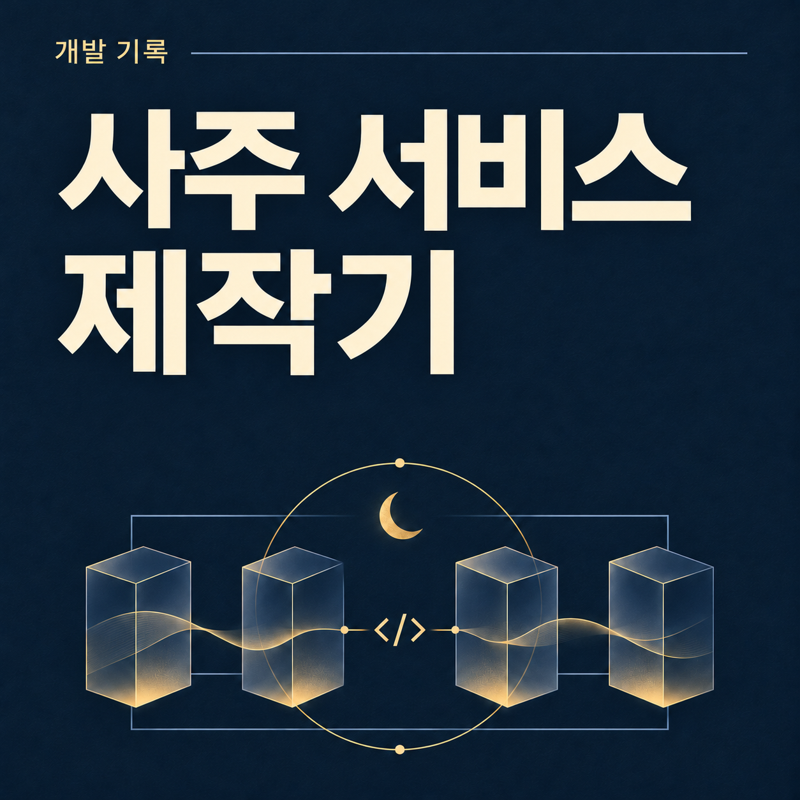

청연사주는 생년월일시를 입력하면 사주와 운세를 볼 수 있는 개인 프로젝트다. 현재 사주 조회 경로는 계산 결과에 맞는 해석과 문장을 구성하는 규칙 기반 구조다.

개인 프로젝트지만 기존 사주 서비스에 익숙한 사람이 들어와도 계산과 풀이, 사용 흐름에서 부족함을 느끼지 않는 서비스를 만들고 싶었다.

개발에는 AI를 적극적으로 활용했다. 주로 Claude Code로 구현하고 Codex에 계획과 코드·로직의 교차 검토를 맡겼다. 기능을 만들고 결과를 본 뒤 다시 보강하는 작업을 반복했다.

서비스를 고도화할수록 사주 도메인을 더 잘 이해하게 됐고 내 서비스라는 마음도 커졌다. 사용 흐름과 운영, 수익화까지 고민하게 됐으며 다음에는 무엇을 더 좋게 만들 수 있을지 생각하는 과정 자체가 즐거웠다.

구현을 AI에 위임하면서도 다음에 고칠 때 다루기 쉬운 코드를 만들려면 무엇을 더 이해해야 할지 고민했다. 이 글에는 계획과 코드를 검토하며 더 나은 방법을 찾고, 공통으로 쓸 부분과 분리할 경계, 아직 만들지 않을 것을 정해 간 과정을 담았다.

## 1. 기능을 갖추는 것과 완성도를 높이는 것은 달랐다

사주 서비스는 결과 문장을 길게 보여준다고 완성되는 제품이 아니었다. 입력한 정보가 계산에 정확히 반영돼야 하고 풀이가 자신의 상황과 어긋나지 않아야 한다. 처음 보는 사람도 읽을 수 있어야 하지만 자세히 보고 싶은 사람에게는 근거와 세부 항목도 필요하다.

청연사주에는 사주 풀이와 만세력, 대운·세운, 분야별 상세, 궁합, 오늘의 운세가 들어갔다. 이후에는 주제별 시기 풀이와 타로도 추가했다. 다만 기능 수가 많다는 이유만으로 기존 서비스만큼 쓸 만해지는 것은 아니었다.

보강할 때는 기능 목록에 드러나지 않는 문제를 살폈다.

-   같은 출생 정보가 계산 설정 때문에 엉뚱하게 달라지는 경우
-   태어난 시각을 모르는 사람에게 가정한 시각의 풀이가 섞이는 경우
-   기혼자가 새 만남을 권하는 문장을 받는 경우
-   점수가 상한에 몰리거나 같은 조언이 반복되는 경우
-   로그인하거나 새로고침한 뒤 보고 있던 정보가 사라지는 경우

완성도는 기능 목록만으로 결정되지 않았다. 계산과 풀이가 만들어지는 과정부터 로그인 이후의 사용 흐름까지 함께 손봤다. 기존 서비스에 익숙한 사람도 불편 없이 쓸 수 있게 만들려는 목표였고, 경쟁 서비스보다 정확하다고 입증한 것은 아니다.

## 2. AI에 구현을 맡기고, 다른 AI로 다시 검토했다

Claude Code는 이 프로젝트에서 주된 구현 파트너였다. 기능 구현과 리팩터링뿐 아니라 전문 로직 보강, 테스트 작성에도 도움을 받았다. Codex에는 계획 검토와 구현 후 리뷰, 도메인 로직의 교차 감사를 맡겼다.

나는 원하는 방향과 범위를 정하고 결과를 검수하면서 수정과 보강을 이어 갔다. 명리와 천문 계산의 세부 원리를 처음부터 모두 알고 직접 도출한 것은 아니다. 그 영역에서는 AI의 구현과 분석을 적극 활용했다.

AI의 설명을 듣고 끝내기보다 오류 사례를 테스트로 남기고 수정 과정도 기록했다. 구현 결과를 다시 확인하고 다음 변경에서 같은 문제가 생기는지 살펴볼 근거가 필요했다.

```text
개선할 범위 정하기
  → Claude Code로 계획·구현
  → Codex로 계획·코드·로직 검토
  → 결과 검수와 수정 방향 결정
  → 보강·회귀 테스트·출력 확인
```

연애운을 고도화할 때는 코드 검토를 거쳐 계획부터 수정했다. 처음 계획에서는 기존 시기 계산을 연 단위로 파악했지만 실제로는 향후 12개 절기월을 계산하는 기능이 이미 있었다. 그래서 새 계산을 중복해서 만드는 대신 기존 계산에 상태별 문구를 붙이는 작업으로 범위를 바로잡았다.

이때 더 나은 방법을 찾는 일은 코드를 더 만드는 일이 아니었다. 현재 구현을 확인하고 중복되는 계산을 계획에서 덜어내는 일이었다. AI에게 코드를 맡길 때 규칙, 검증, 피드백 루프를 어떻게 두는지는 [AI에게 코드를 맡기기 위한 위임의 조건](/posts/delegating-code-to-ai/)에 정리했다.

## 3. 다음에 바꾸기 쉬운 구조: FSD 레이어와 상태 분리

애플리케이션의 큰 구조는 내가 정했다. 실제 구현과 전문 로직 보강은 AI에 위임했다. 이후 기능을 더할 때 같은 계산을 다시 만들거나 상태를 불필요하게 섞지 않으려면 코드가 들어갈 위치와 변경이 영향을 주는 범위를 이해해야 했다. 계산·화면·상태를 어떤 기준으로 나눌지 고민한 것도 다음 작업을 설명하고 검토하기 쉽게 만들기 위해서였다.

현재 구조는 FSD 레이어를 바탕으로 한다. ([FSD 가이드](/posts/fsd-guide/)에 개념을 따로 정리했다.) app은 라우팅과 진입점, views는 페이지 구성, widgets는 화면을 구성하는 블록, features는 사용자 기능, entities는 도메인 모델과 계산, shared는 공통 기반을 맡는다.

```text
app → views → widgets → features → entities → shared
```

폴더 이름보다 변경의 경계를 먼저 봤다. 사주 계산과 해석은 entities/destiny에 모으고 서버 액션 getDestinyViewModel이 검증·계산·해석을 조립하게 했다. 화면은 ViewModel을 받아 표시한다. 새 결과 화면을 추가할 때 계산과 해석까지 복제하지 않도록 한 선택이다. 레이어의 역방향 import를 제한하는 ESLint 규칙도 함께 뒀다.

상태도 한곳에 몰아넣지 않았다. 입력 중인 폼은 메모리, 로그인 왕복에도 유지할 현재 사주는 sessionStorage, 홈의 대표 프로필 선택은 브라우저 저장소, 회원이 저장한 사주는 Supabase에 둔다. 서버 계산 결과는 TanStack Query로 공유한다. 저장소가 하나인 편이 단순해 보여도 수명과 소유자가 다른 상태를 묶으면 복원·초기화 조건까지 얽힌다. 저장 수단의 통일보다 각 상태가 언제 남고 언제 사라져야 하는지를 기준으로 나눴다.

계산을 서버로 옮기면 클라이언트 번들에서 엔진을 분리할 수 있지만 결과를 받기 위한 서버 왕복은 필요하다. 이 비용이 사라지는 것은 아니다. 현재는 TanStack Query로 결과·상세 화면이 같은 입력의 계산을 공유하게 했다. 입력뿐 아니라 기준 연도도 캐시 키에 포함해 해가 바뀐 풀이를 같은 결과로 취급하지 않도록 했다. 다음 기능을 붙일 때 같은 계산과 화면을 다시 만들지 않으려면 무엇을 함께 쓸 수 있을지 살폈다.

-   주제별 화면마다 계산을 새로 만들지 않고 기존 결과와 ViewModel을 활용했다. 화면을 추가하면서 계산 기준이 분산되는 것을 피하기 위해서다. 새로운 계산이 필요한 요구는 단순한 화면 확장과 구분해 다뤘다.
-   웹툰 모드와 리포트 모드는 같은 데이터와 카드를 사용하게 했다. 모드별 화면을 완전히 따로 만들 자유도보다는, 같은 풀이를 두 곳에서 각각 수정해야 하는 비용을 줄이는 쪽을 선택했다.
-   엔진이 하나인 단계에서는 범용 엔진 인터페이스나 CMS를 먼저 만들지 않았다. 아직 확인하지 못한 공통점을 미리 추상화하기보다 현재 기능을 구현하고 검증하는 데 집중했다. 엔진이 둘 이상으로 늘어나 실제 중복이 드러나면 그때 공통 경계를 다시 판단하는 기준을 뒀다.

AI에 위임할 때도 기능 이름만 전달하는 데서 끝내지 않았다. 구조 안에서 바꿀 범위와 순서를 정하고 작업 단위별로 커밋을 나눠 검토할 수 있게 했다. 구현 완료와 배포 승인도 분리했다. Claude Code가 구현하고 Codex가 검토한 뒤에도 머지와 배포는 내 검수를 거쳐 진행하도록 했다.

이렇게 경계를 나눈 이유는 다음 작업을 AI에 맡길 때도 바꿀 위치와 확인할 범위를 설명할 수 있게 하려는 것이었다. 화면만 바꾸려는데 계산까지 함께 고쳐야 하는 구조는 피하고 싶었다.

지금의 요구를 감당하면서 다음 변경도 이해하고 검토할 수 있는 구조를 우선했다. 더 범용적인 구조를 미리 완성하기보다 기능을 붙이고 검토하는 과정에서 드러난 중복과 수정 비용을 다음 판단에 반영하려 했다.

## 4. 로직 보강의 중심은 결과가 틀어지는 조건이었다

청연사주는 조회할 때마다 LLM이 운세를 생성하지 않는다. 입력을 검증하고 사주를 계산한 뒤 계산 결과에 맞는 해석과 문장을 구성한다.

앞단의 계산이 달라지면 뒤의 풀이도 달라진다. AI와 함께 로직을 보강할 때도 시간 보정이나 생시 미상 같은 조건에서 결과가 어떻게 달라지는지 확인했다.

### 시간 보정의 적용 범위

진태양시로 보정한 값을 절입 시각과 비교하는 데까지 사용하면 실제로는 입춘 이후 출생인데 이전으로 판정될 수 있었다. 현재 구현은 실제 출생 순간을 현대 KST로 환산한 값과 진태양시용 값을 나누고 연주·월주·대운과 일주·시주에 각각 맞는 기준을 사용한다.

AI와 함께 진태양시 옵션을 켜고 꺼도 입춘 직후 출생자의 연주·월주는 유지되는지 확인하는 회귀 테스트를 추가했다. 보정 기능의 존재 여부와 함께 그 기능이 다른 계산을 잘못 바꾸지 않는지도 확인하는 검사다.

### 생시 미상의 처리

태어난 시각을 모르면 내부적으로 정오를 기준값으로 쓰지만 그 시주를 실제 정보처럼 해석에 넣어서는 안 된다. 이를 보강하면서 `isTimeUnknown`을 유지하고 판단 대상에서 시주를 제외하도록 했다.

아래는 이 동작을 확인하는 테스트의 일부다. `base`는 생시 미상인 동일 날짜의 입력이다.

```ts
const noon = calculateDestiny({ ...base, hour: 12 });
const dawn = calculateDestiny({ ...base, hour: 4 });

expect(noon.knownPositions).toEqual(['year', 'month', 'day']);
expect(noon.fiveElements.weighted).toEqual(dawn.fiveElements.weighted);
expect(noon.bodyStrength).toEqual(dawn.bodyStrength);
expect(noon.yongsin).toEqual(dawn.yongsin);
```

임시 시각을 바꿨다는 이유로 그 값에 의존해서는 안 되는 판단이 달라지지 않는지 확인한다. 생시를 모르면 월주까지 불확실한 절입일에는 별도의 안내가 필요하다.

### 정상처럼 보이는 잘못된 입력

없는 윤달을 평달로 바꿔 계산하면 잘못된 입력에도 그럴듯한 결과를 줄 수 있다. `auditFixes.test.ts`에 Codex 감사로 찾은 문제를 회귀 테스트로 추가했다. 존재하지 않는 윤달을 거절하고 같은 천간이 여러 자리에 있을 때 관계의 위치 쌍을 놓치지 않는지 확인했다.

강약·격국·용신과 해석 우선순위도 AI와 함께 보강했다. 이 전문 로직의 구현과 검토에는 AI의 기여가 컸다. ‘풀이 문구를 더 많이 생성하는 일’과 함께 그 문구를 선택하는 계산과 판단도 점검했다.

## 5. 계산뿐 아니라 출력의 품질도 확인했다

AI끼리 검토를 마쳤다고 계산이 맞다는 근거가 충분해지는 것은 아니다. 기대값을 직접 정한 테스트만으로는 코드와 테스트가 같은 오해를 공유할 수 있다. 검증 경로를 넓히기 위해 독립 구현인 `lunar-typescript`와도 교차 비교했다.

1900~2050년의 24절기 시각과 1900~2100년에서 뽑은 표본 3,000일의 일주를 비교했다. 표준시 구간 출생 표본 1,500건으로는 네 기둥·대운 방향 등을 대조했다. 한국천문연구원 자료를 fixture로 정리해 절기 192개, 음력 월 시작일 1,868건을 대조하는 테스트도 추가했다.

이 검증 역시 AI의 도움을 받아 구축했다. 시간대와 역사적 시계 변경, 자료의 반올림 정밀도를 구분하는 조건을 코드에 반영했다. 두 결과가 같다는 것뿐 아니라 어떤 조건에서 비교했는지도 확인할 수 있게 했다.

출력 점수와 문장도 보강 범위였다. 분야별 신호를 더하면 점수가 상한에 몰릴 수 있고 문장을 늘려도 같은 조언이 계속 반복될 수 있다. 그래서 가중치 조정과 표본 분포 측정, 반복 정도 확인을 함께 진행했다.

10월 30일에는 300개 출생 표본에 30일을 적용해 분포를 비교했다. 재물·일·건강을 보강하면서 건강 점수의 96점 상한 비율은 7.8%에서 5.2%로 줄었다. 오늘 애정 한 줄의 변주를 늘린 뒤에는 30일 동안 받는 서로 다른 문장이 평균 7.0종에서 10.8종으로 늘었다.

이 수치는 실제 이용자 수나 운세 적중률이 아니다. 개발 과정에서 출력이 특정 점수나 문장에 얼마나 몰리는지 측정한 값이다. 코드가 돌아가는지와 읽을 만한 결과가 나오는지를 따로 확인하며 보강했다.

## 6. 한 번 계산하는 기능에서 다시 사용하는 서비스로

계산이 맞아도 로그인한 뒤 입력이 사라지거나 다른 사람의 사주가 홈에 남으면 사용 흐름이 끊긴다. 앞서 상태를 수명과 용도에 따라 나눈 이유도 이런 문제에 있었다.

카카오 로그인은 페이지를 떠났다가 돌아오는 흐름이다. 현재 보는 사주가 메모리에만 있으면 그 사이에 사라진다. 이런 흐름이 이어지도록 현재 사주 입력을 `sessionStorage`에 보관한다.

가족이나 친구의 사주를 보는 상황도 있었다. 가장 최근에 조회한 사주와 홈의 기준 프로필을 같게 두면 다른 사람의 사주를 한 번 볼 때마다 홈의 주인이 바뀐다. 그래서 ‘지금 보는 사주’와 ‘홈에 고정한 사주’를 별도의 상태로 다룬다.

연애 상태도 단순한 화면 옵션이 아니었다. 새로고침 후 솔로로 돌아가면 기혼자에게 새 만남을 권하는 문구가 나올 수 있다. 상태를 유지하고 고르기 전에는 해당 풀이를 숨기도록 보강했다.

이런 사례를 거치면서 서비스에 대한 이해가 넓어졌다. 사용자가 입력 버튼을 누른 순간부터 로그인하고 돌아올 때, 다른 사람을 조회한 뒤 홈으로 갈 때, 다음 날 다시 방문할 때까지 하나의 흐름으로 보게 됐다.

오늘의 운세와 타로, 주제별 시기 풀이도 같은 맥락에 있다. 한 번 결과를 읽고 끝나는 것 외에 다시 들어와 볼 수 있는 접점을 늘렸다. 다만 이 기능들이 실제 재방문을 얼마나 만들었는지는 별도의 지표로 확인해야 한다.

## 7. AdFit 광고의 생명주기부터 데이터 변경 순서까지

운영 단계에서는 사주 계산과 무관해 보이는 문제도 서비스 품질에 영향을 줬다. 광고가 한 사례다.

청연사주에는 카카오 AdFit 연동이 들어 있다. SPA에서는 광고 영역이 마운트될 때 광고 요소와 로더를 다시 붙여야 하는데 화면을 닫을 때 DOM만 지우면 SDK 내부 등록은 잠시 남을 수 있다. 그 사이에 같은 유닛을 다시 마운트하면 중복 등록 오류로 광고가 렌더링되지 않는 문제가 있었다.

현재 광고 컴포넌트는 정리 단계에서 SDK 등록부터 해제한다. 실제 코드의 일부다.

```ts
return () => {
  window.adfit?.destroy?.(ins);
  el.innerHTML = '';
};
```

광고 유닛 ID 자리에 로더 URL이 들어가 요청이 거절되던 사례도 있었다. 화면 전체가 멈추는 오류가 아니라 광고만 보이지 않는 상태여서 현재는 유닛 ID 형식을 검사하고 잘못된 값이면 요청하지 않도록 방어한다.

기능이 화면에 그려지는지만 보면 이런 문제를 놓칠 수 있다. 외부 SDK의 등록과 해제, 재마운트, 환경 설정까지 제품의 일부였다.

배포와 데이터 변경도 마찬가지다. 타로 덱을 22장에서 78장으로 늘릴 때는 그림과 배열에 더해 데이터베이스의 허용 카드 범위와 저장된 기록도 함께 봐야 한다. 새 범위를 쓰는 앱을 배포하기 전에 마이그레이션부터 적용하도록 순서를 정했다. 22번 이후 카드가 저장된 뒤에는 데이터 범위를 그대로 줄일 수 없으므로 앱 롤백과 데이터 범위 축소도 별개의 작업으로 다뤘다.

이런 운영 기반을 마련하는 작업에도 AI를 활용했다. 공개한 서비스를 계속 바꾸는 일에는 코드 수정뿐 아니라 배포 순서와 기존 데이터의 호환성까지 포함됐다.

## 8. 다음에는 수익이 나는 서비스로도 만들어 보고 싶다

광고를 통한 수익으로 운영 비용을 감당하면서 계속 개선할 수 있는 서비스를 만들어 보고 싶다.

AdFit을 연동했고 광고 운영을 고려해 호스팅을 Vercel Pro로 전환했다. 공개한 서비스를 유지하려면 운영 비용도 함께 관리해야 했다. 기능을 추가할 때 사용자 경험뿐 아니라 유지 비용과 외부 서비스의 이용 조건도 함께 보게 됐다.

수익화 가능성을 보려면 사람들이 어떤 화면을 보고 다시 찾아오는지 알아야 한다. Amplitude와 Vercel Analytics로 측정할 기반을 마련했다. 유입 경로, D1·D7 재방문, 리포트 보기 모드 사용 비율, 한 방문에서 여러 기능을 사용하는 비율 등을 앞으로 확인할 지표로 정했다.

여기서 필요한 지표와 이미 확인한 성과는 구분하려 한다. 광고 연동이 있다고 수익 모델이 검증된 것은 아니고 타로를 추가했다고 재방문이 늘었다고 단정할 수도 없다. 지금은 측정과 운영을 이어 가면서 그 가능성을 확인하는 단계다.

분석 도구를 붙일 때는 어떤 정보가 수집되는지도 확인해야 했다. 사주 공유 URL에는 입력 정보가 들어가므로 주소를 그대로 자동 수집하면 이름과 생년월일 같은 정보가 분석 도구로 넘어갈 수 있다. 현재는 URL의 쿼리와 해시를 제거하고 이름이 포함될 수 있는 화면 제목과 요소 텍스트 등의 수집 속성을 덜어낸다.

성장 지표를 보려면 수집할 정보의 범위부터 정해야 했다. 방문과 재방문을 측정하더라도 사주 입력 정보까지 함께 보내지 않도록 분석 설정을 손봤다.

## 고도화할수록 더 내 서비스가 됐다

AI의 도움으로 계산 로직과 테스트, 이미지, 운영 기반까지 서비스에 필요한 범위를 넓힐 수 있었다. 구현을 맡기는 동안에도 기존 코드를 더 잘 활용할 방법과 다음 고도화를 어렵게 만들지 않을 구조를 계속 살폈다. 계획을 다시 보고 구조와 우선순위를 조정하면서 나 역시 서비스를 바라보는 시야가 넓어졌다고 느낀다.

고도화할수록 주인의식도 더 분명해졌다. 계산 결과 하나를 고치는 일이 풀이와 화면에 어떤 영향을 주는지, 새로운 기능이 기존 사용 흐름과 잘 이어지는지, 운영하면서 무엇을 계속 살펴야 하는지가 모두 내 서비스의 문제였다. 한 기능의 완성보다 서비스 전체를 보고 선택하는 일이 점점 중요해졌다.

다음 고도화에서도 기능 추가만 보지 않으려 한다. 기존 계산을 활용할 수 있는지, 사용 흐름이 끊기지 않는지, 운영하면서 감당할 수 있는 변경인지 함께 따져 보고 싶다.

서비스를 더 잘 이해하게 될수록 무엇을 더 할 수 있을지 떠올랐고 그중 지금 필요한 것을 골라 실제로 바꿔 보는 과정이 재미있었다. 구현을 위임하면서도 내가 더 배울 부분은 계속 남았다. 그래서 청연사주를 계속 고도화하고 싶다.

[청연사주 바로가기 →](https://saju.danwoo.dev/)
