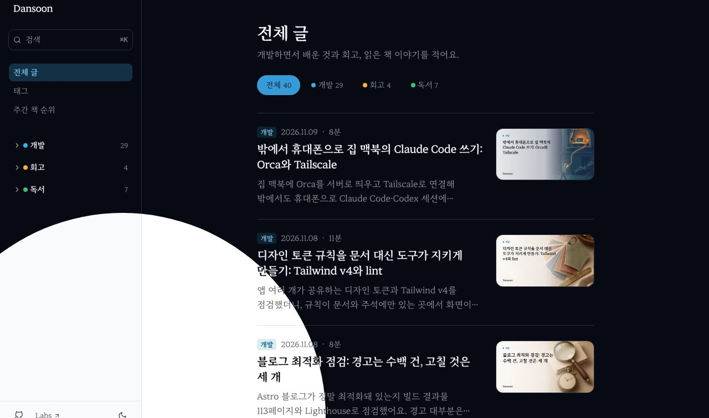

이 블로그의 다크모드 토글은 누르는 순간 색이 한 번에 바뀌었다. 기능에는 문제가 없지만 화면 전체가 갑자기 뒤집히는 느낌이 있었다. 토글 버튼에서 원이 퍼지거나 모이면서 테마가 바뀌게 만들었다.

## 1. View Transitions API로 화면 두 장을 겹친다

[View Transitions API](https://developer.mozilla.org/en-US/docs/Web/API/View_Transition_API)는 화면이 바뀌기 전과 후를 스냅샷으로 잡아 두 장을 겹쳐 보여 준다. `document.startViewTransition()`에 화면을 바꾸는 함수를 넘기면 된다.

```ts
const transition = document.startViewTransition(applyTheme);
```

브라우저는 바뀌기 전 화면을 `::view-transition-old(root)`, 바뀐 뒤 화면을 `::view-transition-new(root)`라는 의사 요소로 만든다. `transition.ready`가 이행되면 두 의사 요소가 준비된 상태라 여기에 `clip-path: circle()` 애니메이션을 걸면 원형 전환이 된다. MDN의 [`ViewTransition.ready` 예제](https://developer.mozilla.org/en-US/docs/Web/API/ViewTransition/ready)도 같은 방식으로 클릭 위치에서 원을 키운다.

원의 크기는 버튼에서 가장 먼 화면 모서리까지의 거리로 잡는다. 이 반지름이면 원이 화면 전체를 덮는다.

```ts
const farthestCornerDistance = ({ x, y }: Point) =>
  Math.hypot(Math.max(x, window.innerWidth - x), Math.max(y, window.innerHeight - y));
```

MDN 기준으로 `startViewTransition()`은 2025년 10월부터 주요 브라우저 최신 버전에서 쓸 수 있다(Baseline 2025).

### 다른 방법과 비교

| 방법 | 보이는 모습 | 비고 |
| --- | --- | --- |
| 색 속성에 CSS `transition` | 요소마다 색이 서서히 바뀐다 | 바뀌는 속성이 많으면 요소마다 속도가 어긋난다 |
| 완성형 토글 컴포넌트(Magic UI의 Animated Theme Toggler 등) | 클릭 위치에서 원이 퍼진다 | 내부는 같은 View Transitions 방식이다. React 컴포넌트라 쓰려면 Astro에 React 통합을 추가해야 한다 |
| `startViewTransition` 직접 사용 | 원하는 모양을 직접 정한다 | 코드 수십 줄. 이 글의 방식이다 |

이 블로그는 토글이 Astro 컴포넌트 안의 작은 스크립트라 직접 쓰는 쪽이 가장 가벼웠다.

## 2. 처음 만든 두 단계 애니메이션은 어색했다

처음에는 두 단계로 만들었다. 이전 화면이 토글 버튼 쪽으로 원을 그리며 줄어들어 사라지고 그다음 새 화면이 버튼에서 퍼져 나오는 방식이다. 두 단계 사이에는 화면이 비기 때문에 그 순간을 브랜드 강조색으로 채웠다.


실제로 눌러 보니 어색했다. 이유는 두 가지였다. 라이트도 다크도 아닌 강조색이 화면 전체를 한 번 덮는다. 그리고 줄어들고, 색이 보이고, 다시 퍼지는 세 동작이 0.74초 동안 이어진다.

그래서 방향마다 동작을 하나씩만 두었다.

- **다크로 바꿀 때**: 밝은 화면이 버튼 속으로 모여 사라지고 그 아래에서 어두운 화면이 드러난다. 불을 끄는 느낌이다.
- **라이트로 바꿀 때**: 밝은 화면이 버튼에서 퍼져 나와 어두운 화면을 덮는다. 불을 켜는 느낌이다.

중간에 끼어드는 색이 없고 한 번의 가감속(`cubic-bezier(0.65, 0, 0.35, 1)`)으로 0.6초 안에 끝난다.

| 다크로 바꾸는 중 | 라이트로 바꾸는 중 |
| --- | --- |
|  |  |

방향을 바꾸는 데 필요한 건 어느 의사 요소에 애니메이션을 거느냐뿐이다.

```ts
const IRIS_BY_DIRECTION = {
  collapse: { pseudoElement: '::view-transition-old(root)', isShrinking: true },
  expand: { pseudoElement: '::view-transition-new(root)', isShrinking: false },
} satisfies Record<IrisDirection, { pseudoElement: string; isShrinking: boolean }>;
```

기본 쌓임 순서는 새 화면이 위다. 다크로 갈 때는 이전 화면이 위에 있어야 줄어드는 모습이 보이므로 그때만 이전 화면의 `z-index`를 올린다.

```css
html.theme-transition-collapse::view-transition-old(root) {
  z-index: 1;
}
```

## 3. fill: forwards가 다음 전환까지 남았다

두 단계 버전에서는 이전 화면이 다 줄어든 뒤에도 새 화면이 퍼지기 전까지 숨어 있어야 했다. 그래서 애니메이션에 `fill: 'forwards'`를 붙여 끝난 상태를 유지했다. 한 단계로 바꾼 뒤에도 끝 프레임이 튀지 않게 이 옵션을 그대로 두었다.

다크로 한 번 바꾸고 다시 라이트로 바꾸자 화면 대부분이 하얗게 비었다.

원인은 애니메이션이 걸린 대상이었다. `document.documentElement.animate(..., { pseudoElement: '::view-transition-old(root)' })`로 만든 애니메이션은 `<html>`에 붙어 있다. 전환이 끝나 의사 요소가 사라져도 `fill: 'forwards'` 애니메이션은 반지름 0인 원 상태로 남아 있었다. 다음 전환에서 같은 이름의 의사 요소가 다시 생기자 남아 있던 애니메이션이 거기에 그대로 걸려 이전 화면이 처음부터 보이지 않았다.

전환이 끝나면 애니메이션을 지우도록 고쳤다.

```ts
const iris = transition.ready.then(() => animateIris(direction, centerOf(trigger))).catch(() => undefined);
transition.finished.finally(async () => {
  root.classList.remove(...transitionClasses);
  (await iris)?.cancel();
});
```

`fill`을 아예 빼는 방법도 있다. MDN 예제도 `fill` 없이 쓴다. 다만 줄어드는 쪽은 끝나는 순간 원래 크기로 돌아가는 프레임이 보일 수 있어서 끝 상태는 유지하고 전환이 끝난 뒤에 지우는 쪽을 택했다.

## 4. Astro 페이지 전환과 겹치지 않게

이 블로그는 Astro의 `<ClientRouter />`로 페이지를 옮긴다. [Astro 문서](https://docs.astro.build/en/guides/view-transitions/)에 따르면 이 라우터도 페이지를 옮길 때 `document.startViewTransition`을 부르고 기본 애니메이션은 교차 페이드(`fade`)다. 테마 전환과 페이지 전환이 같은 API와 같은 `root` 의사 요소를 쓰는 셈이다.

MDN도 원형 전환을 할 때는 기본 애니메이션을 끄고 두 화면이 섞이지 않게 하라고 안내한다. 이 설정을 전역으로 걸면 페이지 전환까지 바뀌므로 테마를 바꾸는 동안에만 `<html>`에 클래스를 붙이고 그 클래스 아래에서만 끈다.

```css
html.theme-transition::view-transition-old(root),
html.theme-transition::view-transition-new(root) {
  animation: none;
  mix-blend-mode: normal;
}
```

클래스는 `startViewTransition`을 부르기 직전에 붙이고 `transition.finished`에서 뗀다. 페이지 이동 전환은 지금까지처럼 교차 페이드로 동작한다.

## 5. 지원하지 않거나 움직임을 줄인 환경

두 경우에는 애니메이션 없이 바로 바꾼다.

```ts
const canAnimateThemeChange = () =>
  'startViewTransition' in document && !window.matchMedia('(prefers-reduced-motion: reduce)').matches;
```

- API가 없는 브라우저에서는 예전처럼 색이 한 번에 바뀐다.
- OS에서 동작 줄이기를 켠 사용자에게는 화면 전체가 움직이는 애니메이션을 보여 주지 않는다.
- `transition.ready`는 전환을 시작하지 못하면 거절된다. 그때도 테마는 이미 바뀌었으므로 애니메이션만 건너뛴다.

## 6. 0.6초짜리 애니메이션을 10배 느리게 확인하기

0.6초 동안 지나가는 애니메이션은 눈으로 봐서는 중간이 어떻게 그려지는지 알기 어렵다. 3장의 버그도 빠르게 지나가면 "한 번 깜빡였다" 정도로만 보인다.

Playwright로 페이지를 열고 Chrome DevTools Protocol의 `Animation.setPlaybackRate`로 재생 속도를 0.1배로 낮춘 뒤, 토글을 누르고 중간에 스크린숏을 찍었다.

```js
const cdp = await page.context().newCDPSession(page);
await cdp.send('Animation.enable');
await cdp.send('Animation.setPlaybackRate', { playbackRate: 0.1 });

await toggle.click();
await page.waitForTimeout(2500);
await page.screenshot({ path: 'to-dark-mid.png' });
```

2장의 캡처들이 이렇게 찍은 장면이다. 원의 중심이 버튼에 맞는지, 두 화면의 위아래가 맞는지, 두 번째 전환에서 화면이 비지 않는지를 장면으로 확인할 수 있었다.

## 정리

- `startViewTransition`으로 전후 화면을 잡고 `ready` 이후 `clip-path: circle()`을 걸면 원형 전환이 된다.
- 두 단계와 중간 색은 오히려 어색했다. 다크는 모여 꺼지고 라이트는 퍼져 켜지게, 방향마다 동작 하나로 줄였다.
- `<html>`에 건 `fill: 'forwards'` 애니메이션은 전환이 끝나도 남는다. 끝나면 `cancel()`로 지운다.
- 기본 애니메이션은 테마를 바꾸는 동안에만 클래스로 끈다. Astro 페이지 전환은 그대로 둔다.
- 미지원 브라우저와 동작 줄이기 환경은 즉시 전환한다.

이 블로그의 색은 공유 디자인 토큰에서 오는데 그 토큰을 정리한 과정은 [디자인 토큰 규칙을 문서 대신 도구가 지키게 만들기](/posts/design-token-conventions/)에 있다.

