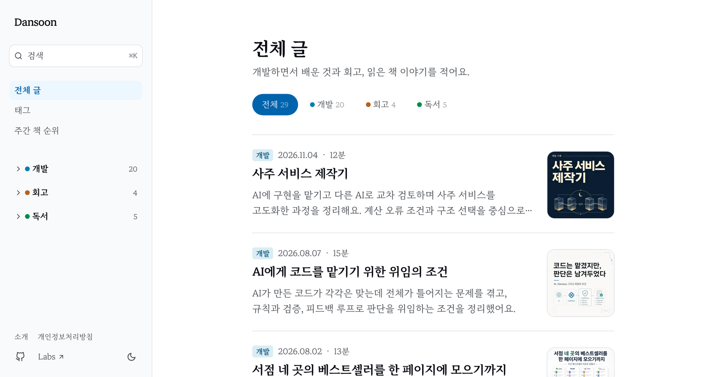
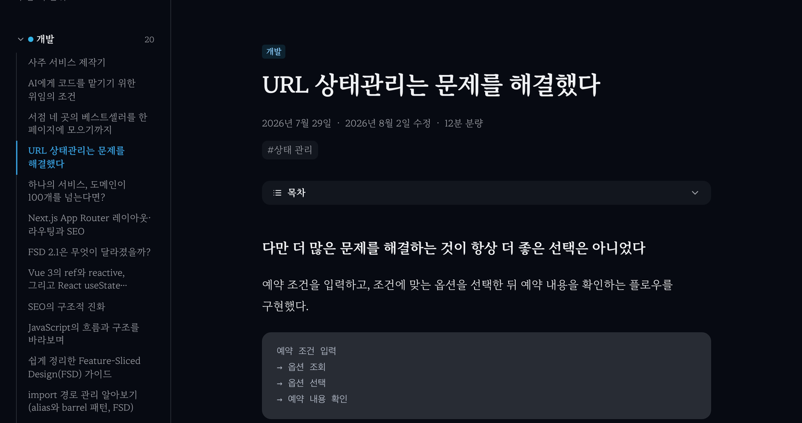

그동안 글은 티스토리에 썼다. 글을 쓰는 데는 불편함이 없었지만 읽는 화면은 내가 다룰 수 있는 영역이 아니었다. 광고와 스크립트가 함께 내려와 글 한 편을 여는 데 시간이 걸렸고 코드 블록이나 목차처럼 기술 글에 필요한 부분도 원하는 만큼 손보기 어려웠다.

마침 개인 프로젝트를 모아 둔 모노레포에 Astro로 만든 블로그가 있었다. 처음에는 AI로 기술 뉴스와 베스트셀러 순위를 자동으로 올리던 곳인데, 자동 뉴스는 생각보다 찾아 읽게 되지 않았다. 그래서 뉴스 수집은 멈추고 이곳을 내 글을 모으는 블로그로 바꾸기로 했다.

목표는 하나였다. 티스토리보다 빠르고 깔끔해야 한다. 그래야 옮길 이유가 있다.

## 1. 글 29편을 마크다운으로 옮겼다

글을 하나씩 복사해 붙이는 방법도 있었지만 29편이면 실수가 생기기 쉽다. 그래서 글 주소를 받아 마크다운 파일을 만드는 스크립트를 짰다. 흐름은 단순하다.

1. 티스토리 글 페이지를 받아 본문 영역만 잘라 낸다.
2. HTML을 [turndown](https://github.com/mixmark-io/turndown)으로 마크다운으로 바꾼다.
3. 본문 이미지를 내려받아 글 폴더에 함께 저장한다.
4. 제목과 발행일, 대표 이미지 같은 정보를 frontmatter(글 맨 위에 적는 메타 정보)로 적는다.

turndown은 기본 규칙만으로도 대부분을 바꿔 주지만 티스토리 에디터가 만든 HTML에는 맞지 않는 부분이 꽤 있었다. 시간을 쓴 곳은 변환 자체보다 예외 처리였다.

### 빈 문단과 이미지

티스토리 에디터는 간격을 띄우려고 `&nbsp;`만 든 빈 문단과 빈 제목을 자주 넣는다. 그대로 옮기면 마크다운에 의미 없는 빈 줄과 빈 제목이 남아서 내용이 없는 문단과 제목은 버리는 규칙을 먼저 넣었다.

이미지는 `<figure class="imageblock">` 안에 들어 있고 원본 주소는 `img`가 아니라 `data-url` 속성에 있는 경우가 많았다. 이 주소를 먼저 읽고 없을 때만 `img`의 `src`를 쓰도록 했다.

내려받은 사진은 그대로 저장하지 않고 한 번 다시 인코딩했다. 휴대폰으로 찍은 사진에는 EXIF에 촬영 위치(GPS)와 기기 정보가 남아 있을 수 있기 때문이다. sharp로 회전 정보만 반영하고 메타데이터 없이 다시 저장했다.

```js
// 사진 EXIF에 촬영 위치(GPS)·기기 정보가 남아 있을 수 있어, 방향만 적용하고 메타데이터 없이 다시 저장한다
await sharp(original).rotate().toFile(target.pathname);
```

### 코드 블록의 언어 추정

가장 손이 많이 간 곳은 코드 블록이었다. 언어를 지정해 둔 블록도 있었지만 상당수는 언어 정보가 없었다. 언어가 없으면 하이라이트가 적용되지 않아 코드가 단색으로 보인다.

그래서 코드 내용을 보고 언어를 추정하는 규칙을 위에서부터 차례로 적용했다.

```js
const LANGUAGE_HINTS = [
  ['text', /[├└│]──/],
  ['html', /^\s*(<!DOCTYPE|<html|<head|<body|<script|<!--|<div|<meta)/i],
  ['yaml', (code) => /^\s*(name|on|jobs):\s/.test(code) && !/;|^\s*\/\//m.test(code)],
  ['bash', /^\s*(\$ |pnpm |npm |npx |yarn |git |cd |mkdir |brew |curl )/m],
  ['json', /^\s*[{[]\s*"[^"]+"\s*:/],
  ['tsx', /<[A-Z][\w.]*[\s/>]|return \(\s*</],
  // ts 규칙은 생략
];
```

처음에는 YAML을 `키: 값` 형태로만 판단했더니 TypeScript 객체 코드까지 YAML로 잡혔다. `type: 'button'` 같은 줄이 YAML처럼 보였기 때문이다. GitHub Actions 설정에서 쓰는 `name`, `on`, `jobs`로 시작하고 세미콜론이나 `//` 주석이 없을 때만 YAML로 보도록 좁혔다. 폴더 구조를 그린 트리(`├──`)는 일반 텍스트로 남겼다.

### 본문 속 `<`와 표

본문에 `Array<T>`처럼 꺾쇠가 들어간 문장이 있으면 마크다운에서 HTML 태그로 해석돼 글자가 사라진다. 코드 밖의 `<`는 모두 이스케이프했다.

표는 칸 병합(`colspan`, `rowspan`)이 없으면 마크다운 표로 바꾸고 병합된 표는 HTML 그대로 남겼다. 마크다운 표로는 병합을 표현할 수 없어서 억지로 바꾸면 표가 깨진다.

### 마지막 확인

변환이 끝나면 코드 밖에 `<script>`, `<iframe>`, `on*=` 같은 위험한 HTML이 남았는지 검사하고 남아 있으면 그 글에서 멈추게 했다. 티스토리 글끼리 걸어 둔 링크는 새 블로그의 주소로 바꿨다.

글 목록에 보이는 요약은 따로 다시 썼다. 처음에는 본문 앞부분을 잘라 요약으로 썼는데 인사말이나 배경 설명으로 시작하는 글이 많아 목록만 봐서는 무슨 글인지 알기 어려웠다. 무엇을 다루고 무엇을 얻을 수 있는지가 보이도록 29편의 요약을 새로 정리했고 스크립트를 다시 돌려도 이 요약을 먼저 쓰게 했다.

## 2. 읽는 화면을 새로 만들었다

화면은 노션이나 문서 사이트처럼 단정한 방향으로 정했다. PC에서는 왼쪽에 카테고리별 글 목록, 가운데에 본문, 오른쪽에 목차를 두는 3단 구조다. 다른 글로 이동해도 왼쪽 목록이 다시 그려지거나 맨 위로 튀지 않도록 레이아웃을 유지했고 사이드바와 본문이 따로 스크롤되게 했다.



기술 글에서 중요한 코드 블록은 빌드할 때 하이라이트를 입히는 방식을 골랐다. 브라우저에서 하이라이트 스크립트를 실행하지 않으니, 코드가 많은 글도 내려받을 자바스크립트가 늘지 않는다.



서체는 개인 프로젝트 전체에서 쓰는 마루부리로 맞췄다. 한글 서체는 파일이 커서, 자주 쓰는 글자와 나머지 글자를 나눠 필요한 조각만 받도록 했다. 대부분의 글은 영문과 상용 한글 조각만 받고 드문 글자가 있을 때만 나머지 조각을 받는다.

## 3. 티스토리와 새 블로그의 로딩 속도 비교

같은 글 한 편을 크롬에서 모바일 4G 수준으로 네트워크를 제한해 열고 비교했다. FCP는 첫 콘텐츠가 화면에 그려지는 시점, LCP는 가장 큰 콘텐츠가 그려지는 시점이다.

| 항목 | 티스토리 | 새 블로그 |
| --- | --- | --- |
| 요청 수 | 약 73개 | 16개 |
| 전송량 | 6.0MB | 0.6MB |
| 첫 화면 표시(FCP·LCP) | 약 0.95초 | 0.54~0.66초 |
| 로딩 완료(load) | 6.0초 | 1.1초 |

첫 글자가 보이는 시점보다 다 받는 데 걸리는 시간과 전송량의 차이가 컸다. 티스토리는 광고와 각종 스크립트를 함께 받느라 페이지가 끝까지 로딩되는 데 오래 걸렸다. 새 블로그는 정적 HTML과 이미지, 필요한 서체 조각 정도만 받았다.

한 번 측정한 값이라 환경에 따라 달라질 수 있다. 그래도 방향은 분명했다.

## 4. 주소 이사: 티스토리 원문과 /tech 주소 리다이렉트

옮기는 것보다 신경 쓰인 부분은 이미 걸려 있는 링크였다.

티스토리는 글 주소를 다른 사이트로 영구 이동(301)시키는 기능을 제공하지 않는다. 그래서 원문 29편의 본문을 이사 안내와 새 주소 링크로 바꿨다. 원문을 그대로 두면 같은 글이 두 곳에 있게 되고 지우면 들어오던 링크가 끊긴다.

기존 Astro 블로그에도 정리할 주소가 있었다. 자동 뉴스가 쌓여 있던 `/tech/...` 주소 139개다. 뉴스는 옮기지 않았기 때문에 Vercel 설정으로 모두 홈으로 영구 이동시켰다.

```json
{ "source": "/tech/:path*", "destination": "/", "permanent": true }
```

배포하고 확인해 보니 `/tech`는 홈으로 갔지만 `/tech/글주소/`는 여전히 404였다. `:path*` 패턴이 끝에 슬래시가 붙은 주소와는 맞지 않았다. 그런데 실제로 걸려 있던 링크는 전부 슬래시로 끝나는 형태였다. 규칙을 두 개로 나눠 해결했다.

```json
[
  { "source": "/tech", "destination": "/", "permanent": true },
  { "source": "/tech/(.*)", "destination": "/", "permanent": true }
]
```

로컬에서는 이 리다이렉트를 확인할 수 없어서 배포한 뒤 실제 주소로 하나씩 열어 보고서야 알았다. 리다이렉트 규칙은 실제 링크 모양 그대로 시험해야 한다는 걸 배웠다.

## 마치며: 옮긴 뒤에도 동작하게 만드는 일

옮기는 작업 자체보다 옮긴 뒤에도 그대로 동작하게 만드는 데 시간이 더 들었다. 코드 블록의 언어, 사진의 메타데이터, 슬래시 하나 차이의 주소처럼 눈에 잘 띄지 않는 부분이 대부분이었다.

이제 글을 쓰는 곳과 보여 주는 곳을 모두 내가 다룰 수 있게 됐다. 화면이 마음에 들지 않으면 직접 고치면 된다. 앞으로의 글은 이곳에 쓸 생각이다. 대표 이미지가 없는 글의 링크 미리보기 이미지를 만든 과정은 [OG 이미지(링크 미리보기)를 빌드할 때 만들기](/posts/build-time-og-images/)에 정리했다.

옮긴 뒤 블로그가 실제로 최적화돼 있는지는 [블로그 최적화 점검](/posts/blog-optimization-check/)에서 다시 확인했다.
