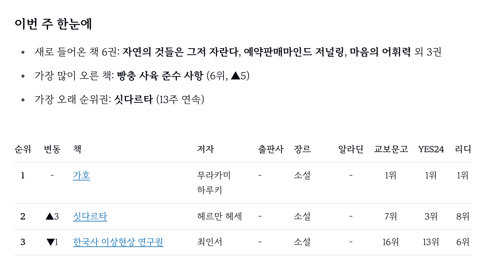

무언가를 만들다 보면 막히는 지점은 늘 있었다. 처음 써 보는 라이브러리 설정, 원인을 알 수 없는 에러, 배포 환경에서만 생기는 문제 같은 것들이다. 그래도 결국에는 다 풀었다. 문서를 뒤지고 이슈를 찾아 읽고 이것저것 바꿔 보면서. 다만 그 시간이 길었다.

AI를 쓰면서 그 시간이 크게 줄었다. 에러 메시지를 붙여 넣으면 원인 후보가 나오고 처음 보는 기술도 물어 가며 바로 쓸 수 있다. 화면 초안과 배포 설정까지 함께 만든다. 막히는 지점은 지금도 있다. 넘는 데 걸리는 시간이 눈에 띄게 줄었을 뿐이다.

**작업이 빨라지자 만들 수 있는 것이 많아졌다.** 나만 겪는 일도 아니었다.

## 1. 너무 빨리 만들 수 있게 됐다

예전에는 아이디어가 떠올라도 실제로 만드는 건 그중 일부였다. 시간이 들고 모르는 걸 익혀야 했기 때문이다. 그 비용을 감당할 만큼 만들고 싶은 것만 끝까지 갔다.

원하는 걸 말로 설명하면 AI가 코드를 써 주는 바이브 코딩이 흔해지면서 그 비용이 많이 낮아졌다. 저녁에 떠올린 아이디어가 그날 밤 주소를 가진 서비스가 된다. 할 일 관리, 습관 기록, 운세, 뉴스 요약 같은 서비스는 원래도 많았는데 요즘은 무언가를 찾아보면 이름도 화면도 비슷한 서비스가 줄줄이 나온다. 정확히 얼마나 늘었는지 셀 수는 없다. 그래도 콘텐츠와 서비스가 너무 방대해졌다는 느낌은 지울 수 없다.

만드는 사람에게는 하나를 더 만든 것이지만 쓰는 사람에게는 고를 것이 하나 더 늘어난 것이다. 고를 것이 많으면 고르기가 어렵다. 어떤 서비스가 계속 운영될지, 다음 달에도 이 주소가 살아 있을지 알 수 없다.

그리고 나도 그 서비스를 만드는 쪽에 있었다.

## 2. 내 블로그도 그랬다, AI 뉴스 141편

개인 프로젝트를 모아 둔 모노레포에는 사주 서비스, 음악 분석 도구, 프론트엔드 면접 준비 서비스, 스도쿠, 게임 몇 개, 그리고 이 블로그가 들어 있다. 대부분 AI와 함께 만들었다. AI에게 코드를 어디까지 맡길지는 [AI에게 코드를 맡기기 위한 위임의 조건](/posts/delegating-code-to-ai/)에 따로 정리했다.

이 블로그도 시작은 AI가 기술 뉴스를 정리해 올리는 곳이었다. 월요일부터 토요일까지 매일 아침 10시에 GitHub Actions가 돌면서 Hacker News 인기 글 다섯 개를 골랐다. Gemini 2.5 Flash가 각 글을 한국어로 요약하고 짧은 코멘트를 붙이면, 그 결과가 마크다운 파일로 저장소에 커밋됐다.

```md
---
title: "오늘의 테크 뉴스 TOP 5 (2026년 11월 5일)"
description: "오늘 Hacker News에서 가장 주목받은 테크 뉴스 5가지를 AI가 정리했습니다."
---

> 💡 새로운 에이전트 기반 코드 생성 AI 모델이 나왔네요. 실제 개발 워크플로우에 얼마나 통합될지 기대됩니다.

Ricursive에서 새로운 대규모 언어 모델(LLM)인 Ripple-65B를 공개했습니다. ...
```

2026년 4월 28일에 첫 글이 올라갔고 11월 5일까지 141편이 쌓였다. 한 편에 뉴스가 다섯 개씩이니 요약이 700개 가까이 된다. 손대지 않아도 블로그는 매일 커졌다.

그런데 정작 나는 그 뉴스를 생각보다 찾아 읽게 되지 않았다.

## 3. ChatGPT 브리핑이 있는데, 이 뉴스가 의미가 있을까

그사이 AI 도구들이 비슷한 일을 직접 하기 시작했다. ChatGPT에는 관심사에 맞춰 소식을 정리해 주는 브리핑 기능이 생겼고, Claude에서는 루틴으로 정해진 시간에 원하는 작업을 돌릴 수 있다. 누구나 자기에게 맞춘 뉴스 요약을 매일 받아 볼 수 있게 된 셈이다.

그러자 질문이 생겼다. **내 블로그에 올라가는 AI 뉴스가 의미가 있을까?**

내 블로그의 뉴스는 Hacker News 인기 글을 요약한 것이었다. Hacker News는 직접 가서 봐도 되고 같은 목록을 요약해 주는 곳도 많다. 이제는 각자 쓰는 AI가 그 일을 해 준다. 코멘트도 "기대됩니다", "주목할 만합니다" 같은 문장이 되풀이됐다. **어디서나 받아 볼 수 있는 요약을 한 번 더 만들고 있었다.**

## 4. 의미가 있는 쪽으로 고도화했다

그래서 자동화의 방향을 바꿨다. 이미 있는 글을 요약하는 대신 실제 사이트에서 데이터를 직접 수집해 정리하는 쪽이다.



그렇게 만든 것이 주간 도서 리포트다. 알라딘·교보문고·YES24·리디의 베스트셀러를 모아 종합 순위와 장르별 순위를 만들고, 웹소설은 카카오페이지·네이버 시리즈·리디의 순위를 장르별로 정리한다. 지금까지 베스트셀러 리포트와 웹소설 리포트가 각각 24편씩 쌓였다.

둘 다 AI가 정리한다는 점은 같다. 다른 건 재료다.

| | AI 뉴스 | 주간 도서 리포트 |
| --- | --- | --- |
| 재료 | Hacker News 한 곳의 인기 글 | 여러 서점·플랫폼에서 직접 수집한 순위 |
| 주기 | 월~토 매일 | 매주 |
| 다른 데서 구할 수 있나 | 원문과 요약이 어디에나 있다 | 여러 순위를 한자리에 모은 곳은 드물다 |

AI가 글을 쓴다는 사실보다 **AI가 무엇을 재료로 쓰느냐가 결과물의 쓸모를 갈랐다.**

## 5. 그래도 AI 뉴스 자동화는 껐다

뉴스 쪽은 더 고도화할 방향이 보이지 않았다. 요약을 더 잘하게 만들 수는 있어도 어디서나 구할 수 있는 요약이라는 사실은 바뀌지 않는다.

11월 5일, 뉴스를 만들던 워크플로와 수집 스크립트를 지웠다. 그때 남긴 커밋 메시지는 이렇다.

```text
chore(dansoon): 테크 뉴스 자동 수집 중단

블로그를 직접 쓴 글 중심으로 재편하기 위해 Gemini 기반 자동 생성 워크플로와
수집 스크립트, 원시 데이터를 제거한다.
```

이때 베스트셀러와 웹소설 수집도 함께 지웠다가 같은 작업 안에서 다시 되돌렸다. 고도화해서 쓸모가 생긴 쪽은 남기고 그렇지 않은 쪽만 지웠다.

빈자리는 내가 쓴 글로 채웠다. 티스토리에 따로 써 오던 글 29편을 마크다운으로 옮기고 블로그 화면도 글을 읽기 좋게 새로 만들었다. 그 과정은 [티스토리 글 29편을 Astro 블로그로 옮기며](/posts/tistory-to-astro/)에 정리했다.

## 6. 많이 만들다 보니, 무엇이 필요한지 고민하게 됐다

정리는 블로그에서 끝나지 않았다. 많이 만들수록 "이게 정말 필요한가"를 묻는 순간이 잦아졌다. 지난 몇 달 동안 저장소에는 만드는 커밋만큼 지우는 커밋도 늘었다.

**앱 두 개를 지웠다.** 운동 기록 앱 gymlog와 plco다. gymlog는 6월 말에 루틴, 운동 기록, 통계, Firebase 연동까지 갖추고 시작했고 10월 말에 지웠다. 커밋 메시지에 남긴 이유는 한 줄이었다.

```text
chore: gymlog·plco 앱 제거 — 완성도 낮아 유지 중단
```

기능이 있다고 완성된 앱이 되지는 않았다.

**기능도 덜어 냈다.** 스도쿠 앱에 있던 변형 규칙 모드 별도쿠는 라우트와 리더보드 탭까지 있었지만 통째로 지웠다. 프론트엔드 면접 준비 서비스에서는 다른 문항과 겹치거나 중요도가 낮은 주제 9개와 꼬리질문 8개를 정리했다.

만들기 어려웠을 때는 이 질문을 따로 할 필요가 없었다. 만드는 데 드는 시간이 알아서 걸러 줬기 때문이다. 이제는 그 필터가 약해졌으니 질문을 일부러 해야 한다.

## 7. 그 고민도 빨리 반영할 수 있어서, 더 많이 하게 된다

많이 만들게 된 이유가 AI의 속도였다. 그런데 무엇이 필요한지 고민한 결과를 반영하는 일도 같은 속도로 할 수 있다.

11월 5일 오후 저장소에 들어간 변경을 순서대로 적으면 이렇다.

1. 테크 뉴스 자동 수집 중단
2. 티스토리 글 29편 이전과 블로그 화면 재구축
3. 예전 뉴스 주소를 홈으로 연결
4. 소개·개인정보처리방침 페이지 추가
5. 썸네일 없는 글의 [링크 미리보기 이미지를 빌드할 때 생성](/posts/build-time-og-images/)
6. 허브의 블로그 카드와 링크 갱신
7. 블로그 이전 과정을 정리한 글 발행

블로그의 정체성을 바꾸는 작업이 모두 같은 날 들어갔다. 예전 같았으면 "뉴스를 끄고 내 글로 채우자"고 판단하고도 실제로 옮기기까지 한참 걸렸을 것이다.

그래서 고민이 더 잦아졌다. 고민해서 바꾸는 비용이 낮으니 더 자주 묻고 더 자주 바꾼다. **빨리 만들 수 있으면 빨리 고칠 수 있고, 빨리 지울 수도 있다.**

## 8. 만들되, 끝까지

그렇다고 덜 만들자는 쪽으로 정리하지는 않았다. 빨리 만들고 빨리 고칠 수 있으니 오히려 더 많이 만들게 된다.

대신 "끝까지"의 범위를 넓혀 생각하게 됐다. 나에게 끝까지는 이런 흐름이다.

1. **만든 것을 계속 운영한다.** 내가 쓰지 않는 서비스를 다른 사람이 쓸 이유를 찾기는 어렵다.
2. **더 나은 방향을 찾는다.** AI 뉴스가 의미가 있는지 묻다가 직접 수집하는 도서 리포트로 방향을 바꾼 것처럼.
3. **더 고도화할 수 없고 쓸모도 없다고 판단되면 지운다.** 뉴스와 gymlog가 그랬다.

지우는 데까지 가야 끝까지 만든 것이다. 만들기 쉬워진 만큼, 만든 것을 어떻게 끝낼지도 만드는 사람이 정해야 한다.
