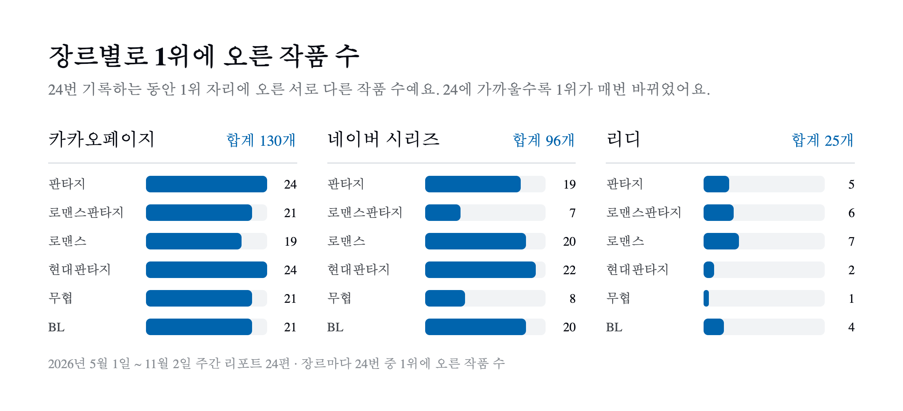

주간 책 순위를 만들 때 일반 도서 베스트셀러와 함께 웹소설 순위도 매주 모은다. 카카오페이지, 네이버 시리즈, 리디 세 곳에서 판타지·로맨스판타지·로맨스·현대판타지·무협·BL 여섯 장르의 순위를 모아 플랫폼별로 정리하는 리포트다.

일반 도서 쪽은 24주치를 모아 [서점 네 곳의 베스트셀러 순위 24주를 모아 비교해 보니](/posts/bestseller-24-weeks/)에 정리했다. 웹소설도 같은 기간의 기록이 쌓여 있어서 같은 방식으로 모아 봤다. 결과는 일반 도서와 꽤 달랐다.

## 1. 어떤 데이터를 모았나

기간은 2026년 5월 1일부터 11월 2일까지, 주간 리포트 24편이다. 6월 1일과 7월 6일 사이에는 리포트가 없어서 실제로는 약 27주에 걸친 기록이다. 일반 도서와 달리 웹소설은 24편 모두 세 플랫폼의 여섯 장르가 빠짐없이 수집됐다.

리디는 장르별로 15위까지 수집하지만 비교를 맞추려고 세 플랫폼 모두 장르별 TOP 10만 썼다. TOP 10을 다 채우지 못한 목록이 40개 있어서 24편을 합친 순위표 칸은 4,155개다. 숫자를 보기 전에 알아 둘 점이 있다.

- 같은 작품인지는 제목으로 판단했다. 띄어쓰기와 기호를 무시하고 비교하지만 플랫폼마다 제목이 조금 다르면 다른 작품으로 센다. 그래서 아래의 "겹친 작품" 수는 실제보다 적을 수 있다.
- 리포트는 대부분 1주 간격이지만 5월 1일과 4일은 3일 간격이고 6월 1일과 7월 6일 사이는 4주가 비어 있다. 아래에서 "24회"는 수집된 24번을 뜻하고, 공백 기간에도 순위에 있었는지는 알 수 없다.
- 네이버 시리즈는 일간 순위를 가져온다. 카카오페이지와 리디는 각 플랫폼의 장르별 화면에 보이는 순위를 그대로 가져오는데 그 화면의 집계 기간이 일간인지 주간인지는 따로 확인하지 못했다. 순위가 얼마나 자주 바뀌는지는 이 집계 기간의 영향을 받는다.
- 리디는 한 작품이 여러 장르 목록에 함께 오르기도 한다. 24편 동안 두 장르 이상의 TOP 10에 오른 작품이 리디에서만 26개였다.

## 2. 세 플랫폼의 순위는 거의 겹치지 않았다

가장 먼저 눈에 띈 건 플랫폼끼리 순위가 거의 겹치지 않는다는 점이다. 같은 주, 같은 장르의 TOP 10에 두 플랫폼이 함께 올린 작품은 24번의 기록에서 모두 8번이었다. 세 플랫폼 모두에 오른 작품은 한 번도 없었다.

| 장르 | 작품 | 함께 오른 플랫폼 |
| --- | --- | --- |
| 현대판타지 | 취사병, 전설이 되다 | 카카오페이지·네이버 시리즈 |
| 판타지 | 백작가의 망나니가 되었다 | 카카오페이지·리디 |
| 현대판타지 | 너희들은 변호됐다 | 카카오페이지·리디 |
| 무협 | 전생검신 | 카카오페이지·리디 |
| 로맨스 | 장저장가일상 | 카카오페이지·네이버 시리즈 |
| 로맨스 | 반파부군태총아 | 카카오페이지·네이버 시리즈 |
| 로맨스 | 고대렵호적양가일상 | 카카오페이지·네이버 시리즈 |
| 로맨스 | 독총소모비 | 카카오페이지·네이버 시리즈 |

겹친 작품 8편은 모두 한 번씩만 겹쳤다. 겹침이 있었던 기록은 7번이고(9월 14일에는 두 편이 겹쳤다), 나머지 17번은 겹친 작품이 하나도 없었다.

일반 도서에서는 네 서점 모두에 오른 칸이 9%였고 순위표의 절반 이상이 두 곳 이상에 걸쳐 있었다. 웹소설은 플랫폼을 합친 통합 순위를 만드는 의미가 거의 없을 정도로 목록이 따로 논다. 리포트의 요약도 처음에는 세 플랫폼을 점수로 합친 통합 순위로 만들었는데 이 결과를 보고 플랫폼별 1위를 나란히 보여 주는 방식으로 바꿨다.

## 3. 1위가 매주 바뀌는 곳과 그대로인 곳

여섯 장르 × 24회면 1위 자리는 플랫폼마다 144번이다. 그 144번 동안 장르별로 1위에 오른 작품 수를 세면 플랫폼의 성격이 확연히 갈린다. TOP 10이 바뀐 비율은 1주 간격으로 이어진 두 기록만 골라 "이번 목록에서 새로 들어온 작품 수 ÷ 이번 목록 크기"를 장르별로 구해 평균했다(3일 간격과 공백 구간은 뺐다).

| 플랫폼 | 장르별 1위 작품 수 (144번 중) | 1주 간격 TOP 10 교체율 |
| --- | :---: | :---: |
| 카카오페이지 | 130개 | 평균 62% |
| 네이버 시리즈 | 96개 | 평균 69% |
| 리디 | 25개 | 평균 27% |

카카오페이지는 판타지와 현대판타지에서 24번 기록한 1위가 모두 다른 작품이었다. 기록할 때마다 1위가 바뀐 셈이다. 네이버 시리즈도 TOP 10의 3분의 2 넘게가 매주 새 작품으로 채워졌다. 앞에서 적었듯 네이버는 일간 순위라서 변동이 클 수밖에 없다.

반대로 리디는 TOP 10의 73% 정도가 매주 그대로였다. 무협에서는 『내 무협 주인공이 나를 싫어한다』가 수집된 24번 모두 1위였고 현대판타지에서는 『은행원도 용꿈을 꾸나요』가 24번 중 23번 1위였다. 리디는 같은 작품이 판타지와 현대판타지 양쪽에서 1위를 하기도 해서, 장르별로 세면 25개지만 작품으로 세면 23개뿐이다.

## 4. 오래 머문 작품과 1위를 자주 한 작품

1위는 자주 바뀌어도 TOP 10에 오래 머문 작품은 플랫폼마다 있었다.

| 플랫폼 | 장르 | 작품 | TOP 10에 든 횟수 (24번 중) |
| --- | --- | --- | --- |
| 카카오페이지 | 판타지 | 마법학교 마법사로 살아가는 법 | 24번 |
| 카카오페이지 | 현대판타지 | 괴담에 떨어져도 출근을 해야 하는구나 | 24번 |
| 카카오페이지 | 무협 | 은해상단 막내아들 | 23번 |
| 네이버 시리즈 | 무협 | 화산귀환 | 24번 (1위 6번) |
| 네이버 시리즈 | 무협 | 절대회귀 | 24번 (1위 11번) |
| 네이버 시리즈 | 로맨스판타지 | 로제타 | 18번 (1위 14번) |
| 리디 | 무협 | 내 무협 주인공이 나를 싫어한다 | 24번 (모두 1위) |
| 리디 | 현대판타지 | 은행원도 용꿈을 꾸나요 | 24번 (1위 23번) |

카카오페이지는 1위를 가장 많이 한 작품도 3번(로맨스 『이번 생엔 남편 말고 오스카상이요』)이었다. 1위는 매주 바뀌어도 TOP 10 안에는 오래 머무는 작품이 있다는 뜻이다. 네이버 시리즈 무협은 『화산귀환』과 『절대회귀』 두 작품이 수집된 24번 모두 자리를 지키면서 1위를 나눠 가졌다.

## 5. 일반 도서와 비교해 보면

같은 기간 일반 도서 베스트셀러와 나란히 놓으면 차이가 분명하다.

| | 일반 도서 (서점 4곳) | 웹소설 (플랫폼 3곳) |
| --- | --- | --- |
| 여러 곳에 함께 오른 정도 | 네 곳 모두 9%, 한 곳에만 36% | 두 곳에 함께 오른 작품이 24회 통틀어 8편 |
| 1위가 같았던 주 | 24회 중 2회 | 해당 없음(겹치는 작품이 거의 없음) |
| 가장 오래 머문 작품 | 『싯다르타』 21회 | 여러 작품이 24회 모두 |

일반 도서는 서점마다 순위가 달라도 같은 책이 여러 곳에 걸쳐 있었다. 웹소설은 플랫폼마다 아예 다른 작품 목록을 보여 준다. 웹소설에서 "이번 주 인기작"을 말하려면 어느 플랫폼 기준인지부터 정해야 한다.

## 6. 정리

24주치 웹소설 순위를 모아서 확인한 사실은 이렇다.

- 세 플랫폼의 장르별 TOP 10이 겹친 경우는 24번의 기록에서 8번뿐이고 세 곳 모두에 오른 작품은 없었다.
- 1위가 매주 바뀌는 카카오페이지·네이버 시리즈와, 같은 작품이 몇 달씩 1위를 지키는 리디로 갈렸다. 순위 집계 기간의 차이가 영향을 줬을 수 있다.
- 1위가 자주 바뀌는 플랫폼에도 수집된 24번 모두 TOP 10에 든 작품이 있었다.

웹소설 리포트는 이 결과를 반영해 지금은 장르마다 플랫폼별 1위와 새로 들어온 작품 수를 보여 준다. 주간 기록은 지금도 매주 쌓이고 있다.
