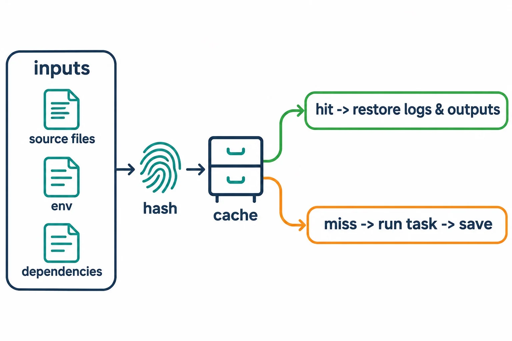

"Turborepo를 가져와 놓고 왜 활용을 안 해?" 개인 모노레포 labs의 설정을 보다가 나온 질문이다. 확인해 보니 터보는 순서대로 작업을 돌리고 바뀐 패키지만 고르고 안 바뀐 앱의 배포를 건너뛰는 데에만 쓰이고 있었다. 셋 다 pnpm 워크스페이스로도 대부분 되는 일이다. 정작 터보만 할 수 있는 캐시는 CI에서 꺼져 있었다.

labs에는 Next.js·Astro 앱 9개와, [디자인 토큰](/posts/design-token-conventions/)을 비롯한 공유 패키지 여섯 개가 있다. 회사 프로젝트에서 [Turborepo로 모노레포를 꾸린 적](/posts/retrospective-2025-q1/)이 있고 labs도 같은 구성으로 시작했다. 그런데 "워크스페이스만 쓰면 되는데 왜 터보를 쓰냐"고 다시 물으니 바로 답하기 어려웠다. 답을 찾다가 결국 캐시를 제대로 켜게 됐다.

## 1. 워크스페이스와 터보는 하는 일이 다르다

둘은 경쟁 관계가 아니다. pnpm 워크스페이스 위에 터보를 얹는 구조다.

| | pnpm 워크스페이스 | Turborepo |
| --- | --- | --- |
| 맡는 일 | 패키지 **설치와 연결**(`workspace:*`, catalog, lockfile) | 패키지별 스크립트 **실행 관리** |
| 없으면 | 앱에서 `@ui/react`를 import할 수 없다 | 스크립트는 `pnpm -r`로 돌리면 된다 |

워크스페이스는 모노레포의 뼈대라 빠질 수 없다. 터보는 빼도 돌아간다. 그래서 진짜 질문은 "`pnpm -r run build`로 충분한데 왜 `turbo run build`를 쓰냐"다.

## 2. pnpm만으로도 되는 것

생각보다 많다. [pnpm 문서](https://pnpm.io/cli/recursive)에 따르면 `pnpm -r run`은 기본으로 위상 순서(topological order)를 지킨다. 의존 패키지가 먼저 돌고 그 패키지를 쓰는 앱이 나중에 돈다. 동시 실행 수는 기본값이 "4와 CPU 코어 수 중 작은 값"이다.

바뀐 패키지만 고르는 것도 된다. [필터 문법](https://pnpm.io/filtering)에 git 기준점을 넣으면 그 뒤로 바뀐 패키지와, 그 패키지를 쓰는 패키지까지 고른다.

```sh
pnpm --filter "...[origin/main]" test
```

labs의 CI가 쓰는 터보 `--affected`와 거의 같은 일이다. 순서와 필터만 놓고 보면 터보를 따로 넣을 이유가 약하다.

## 3. 터보만 하는 것은 캐시다

pnpm은 매번 스크립트를 처음부터 실행한다. 터보는 실행 전에 작업의 입력으로 지문(해시)을 만든다. [Turborepo 문서](https://turborepo.com/docs/crafting-your-repository/caching)의 표현으로는 "지문이 같으면 캐시에 적중한다". 적중하면 작업을 돌리지 않고 처음 실행 때 저장해 둔 로그와 출력 파일을 그대로 되살린다.



지문에 들어가는 입력은 두 갈래다. 저장소 전체에 걸리는 전역 해시(루트 설정, lockfile 등)와 작업별 해시(그 패키지의 소스 파일, 선언한 환경변수, 의존 작업의 해시)다. 둘 중 하나라도 바뀌면 캐시를 쓰지 않고 다시 실행한다.

캐시는 저장 위치에 따라 둘로 나뉜다.

- **로컬 캐시**: 내 컴퓨터의 `.turbo/cache`에 저장된다. 같은 컴퓨터에서 두 번째로 돌릴 때만 빨라진다.
- **원격 캐시**: 저장소가 서버에 있어서 CI, 내 컴퓨터, 배포 빌드가 결과를 같이 쓴다. [Vercel Remote Cache](https://turborepo.com/docs/core-concepts/remote-caching)는 모든 플랜에서 무료이고 Vercel에 배포하지 않아도 쓸 수 있다. 직접 서버를 띄우는 방법도 있다.

GitHub Actions는 매번 빈 컴퓨터에서 시작한다. 원격 캐시가 없으면 CI에서는 로컬 캐시도 의미가 없고 매번 처음부터 다시 돈다.

## 4. labs는 캐시를 안 쓰고 있었다

labs의 CI 설정에는 원격 캐시 토큰이 없었고 `.turbo` 폴더를 보존하는 단계도 없었다. 그래서 PR마다 lint, typecheck, test가 전부 처음부터 돌았다. 캐시 없이 돈 CI 한 번의 결과는 이랬다.

| 단계 | 작업 수 | 캐시 적중 | 걸린 시간 |
| --- | --- | --- | --- |
| lint | 11 | 0 | 46.1초 |
| typecheck | 11 | 0 | 33.5초 |
| test | 10 | 0 | 30.6초 |

터보를 쓰고는 있었지만 캐시가 없으니 이 부분은 `pnpm -r`과 다를 게 없었다.

## 5. 캐시를 켜기 전에 지문부터 고쳤다

원격 캐시는 결과를 여러 곳이 같이 쓰는 기능이다. 지문에 입력이 하나라도 빠져 있으면 바뀐 코드에 예전의 "통과" 결과를 붙여 주는 사고가 난다. 그래서 토큰을 넣기 전에 지문을 먼저 점검했다.

### 공유 패키지를 고쳐도 typecheck 지문이 그대로였다

`packages/ui` 파일 하나에 한 줄을 더하고 그 패키지를 쓰는 hub 앱의 작업 해시를 앞뒤로 비교했다(`turbo run ... --dry=json`).

| hub 작업 | `ui` 수정 전 | `ui` 수정 후 |
| --- | --- | --- |
| build | `907cbbae…` | `90d8cce9…` (바뀜) |
| lint | `2ba4b8c0…` | `1e4a2233…` (바뀜) |
| test | `35ca0c7c…` | `35ca0c7c…` (그대로) |
| typecheck | `7439f6f4…` | `7439f6f4…` (그대로) |

`typecheck`와 `test`에 의존 관계를 걸어 두지 않아서 의존 패키지의 소스가 지문에 들어가지 않았다. 이 상태로 원격 캐시를 켜면 `ui`의 props를 바꿔 앱이 깨져도 CI는 예전 "타입 검사 통과"를 꺼내 보여 준다.

Turborepo 문서의 [작업 설정 페이지](https://turborepo.com/docs/crafting-your-repository/configuring-tasks)에 똑같은 사례가 나온다. `ui` 패키지의 인터페이스를 바꿨는데 앱의 타입 검사가 캐시에 적중하는 상황이다. `dependsOn: ["^typecheck"]`로 고치면 맞게는 되지만 패키지마다 타입 검사가 끝나기를 기다리느라 병렬로 돌지 못한다. 문서가 권하는 방법은 아무 일도 하지 않는 빈 작업, transit 노드다.

```json
{
  "tasks": {
    "transit": { "dependsOn": ["^transit"] },
    "typecheck": { "dependsOn": ["transit"] },
    "test": { "dependsOn": ["transit"] }
  }
}
```

`transit`이라는 스크립트는 어느 패키지에도 없어서 실제로는 아무것도 실행되지 않는다. 대신 의존 패키지의 해시가 사슬처럼 이어져서 `ui`가 바뀌면 hub의 `typecheck` 지문도 바뀐다. 고친 뒤 같은 실험을 다시 하니 build, lint, test, typecheck 해시가 모두 바뀌었다.

### 환경변수, 입력, 출력도 빠진 게 있었다

- **환경변수**: fe-deep 앱은 서버 쪽 환경변수(`SUPABASE_SERVICE_ROLE_KEY` 등)를 읽는데, `turbo.json`에 하나도 선언하지 않았다. 선언하지 않은 값은 지문에 들어가지 않는다. 값이 바뀌어도 예전 빌드를 재사용할 수 있어서 앱별 `turbo.json`에 선언했다. `NEXT_PUBLIC_*`는 터보가 Next.js 앱에서 [알아서 포함](https://turborepo.com/docs/crafting-your-repository/using-environment-variables)해서 따로 적지 않았다.
- **입력**: 기본 입력(`$TURBO_DEFAULT$`)은 gitignore된 파일을 뺀다. 로컬 환경변수 파일은 입력에 따로 넣었다. 반대로 테스트 파일과 e2e 폴더는 빌드 입력에서 뺐다. 테스트만 고쳤을 때는 다시 빌드할 이유가 없다.
- **출력**: komorebi 앱은 정적 export라 결과가 `out/`에 생기는데, 출력 목록에 없었다. 캐시에 적중해도 배포할 파일이 되살아나지 않는 상태였다.

이 수정을 마친 뒤에 GitHub Actions에 원격 캐시 토큰을 연결했다.

## 6. 캐시를 켜면 얼마나 빨라지나

원격 캐시는 결과를 저장하는 곳만 다르고 지문을 만들어 결과를 되살리는 방식은 로컬 캐시와 같다. 그래서 labs의 lint, typecheck, test를 내 컴퓨터(Apple M2 Pro)에서 방식만 바꿔 돌리고 시간을 쟀다. 앞의 세 줄은 두 번씩 잰 값이다.

| 실행 방식 | 다시 실행한 작업 | 걸린 시간 |
| --- | --- | --- |
| `pnpm -r`로 lint, typecheck, test를 차례로 | 전부 | 50.0~57.9초 |
| `turbo run lint typecheck test --force`(캐시 무시) | 32개 전부 | 28.3~36.3초 |
| 같은 명령, 바뀐 파일 없음 | 0개(32개 적중) | 0.32~0.33초 |
| `apps/hub` 파일 하나를 고친 뒤 | 2개 | 3.1초 |
| `packages/ui` 파일 하나를 고친 뒤 | 12개 | 13.2초 |

캐시를 무시해도 터보가 더 빠른 건, 서로 기다릴 필요가 없는 작업을 종류에 상관없이 동시에 돌리기 때문이다. `pnpm -r`로는 lint가 모든 패키지에서 끝나야 typecheck가 시작된다.

큰 차이는 두 번째 실행부터 난다. 바뀐 게 없으면 32개 작업이 0.3초 만에 끝난다. hub를 고치면 hub의 작업 2개만 다시 돌고, `ui`를 고치면 `ui`와 그 패키지를 쓰는 앱의 작업 12개가 다시 돈다. 5장에서 transit 노드를 넣지 않았다면 이 12개 중 typecheck와 test는 캐시에서 예전 결과를 꺼냈을 것이다.

CI도 같은 지문을 쓴다. 원격 캐시를 연결한 뒤 같은 커밋으로 GitHub Actions를 두 번 돌렸다. 첫 번째 실행이 결과를 원격 캐시에 올리고 두 번째 실행은 빈 컴퓨터에서 시작했는데도 그 결과를 내려받아 끝났다.

| CI 단계 | 1회차(캐시 채움) | 2회차(원격 캐시 적중) |
| --- | --- | --- |
| lint | 29.7초(0/11 적중) | 0.63초(11/11 적중) |
| typecheck | 23.0초(0/11 적중) | 0.70초(11/11 적중) |
| test | 20.0초(0/10 적중) | 0.46초(10/10 적중) |

PR에서 이미 돌린 작업과 지문이 같으면 main에 머지한 뒤에도 다시 돌지 않는다. 실패한 CI를 다시 돌릴 때도 이미 통과한 작업은 건너뛴다.

## 7. 다른 방법과 비교: pnpm만, Turborepo, Nx

모노레포 도구를 고를 때 가장 많이 비교하는 상대는 Nx다. Nx도 [작업 입력으로 해시를 만들어](https://nx.dev/docs/concepts/how-caching-works) 같은 해시면 결과를 되살리는 캐시가 핵심이다. 세 가지를 공식 문서 기준으로 나란히 놓으면 이렇다.

| | pnpm만 | Turborepo | Nx |
| --- | --- | --- | --- |
| 패키지 설치·연결 | 담당 | 안 함 | 안 함 |
| 의존 순서대로 실행 | `pnpm -r` | 작업 그래프 | 작업 그래프 |
| 바뀐 것만 실행 | `--filter "...[ref]"` | `--affected` | `nx affected` |
| 로컬 캐시 | 없음 | 있음 | 있음 |
| 원격 캐시 | 없음 | Vercel, 자체 서버 | Nx Cloud, 자체 서버 |
| 설정 | 스크립트 | `turbo.json` 하나 | `nx.json`, 플러그인 |
| 그 밖에 | | 배포 건너뛰기(`turbo-ignore`) | 분산 CI(Nx Cloud) |

Nx는 [기존 pnpm 워크스페이스에 `nx init`으로 얹을 수 있다](https://nx.dev/docs/guides/adopting-nx/adding-to-monorepo). 원격 캐시인 Nx Cloud는 무료 Hobby 플랜부터 시작할 수 있고 Turborepo처럼 자체 서버를 둘 수도 있다. `@nx/next` 같은 플러그인이 `next.config` 같은 설정 파일을 읽어 빌드 작업과 캐시 입력·출력을 알아서 만든다. 앞에서 손으로 채운 입력·출력 목록을 플러그인이 대신 관리해 주는 셈이다. 분산 CI까지 필요한 큰 팀이라면 Nx 쪽이 할 수 있는 일이 많다.

labs는 Turborepo를 그대로 쓰기로 했다. 앱 9개를 이미 Vercel에 배포하고 있어서 원격 캐시와 `turbo-ignore`가 추가 비용 없이 붙는다. 설정도 `turbo.json` 한 파일이고 앱의 `package.json` 스크립트는 건드리지 않아도 된다. 혼자 쓰는 저장소에 분산 CI는 필요 없다.

## 정리

- pnpm 워크스페이스는 모노레포의 뼈대다. 터보는 그 위에서 스크립트 실행을 관리한다.
- 의존 순서대로 실행하고 바뀐 패키지만 고르는 일은 pnpm으로도 된다. 터보만 할 수 있는 건 캐시다.
- 캐시를 안 쓰면 터보는 pnpm과 거의 차이가 없다. labs가 그 상태였다.
- 원격 캐시를 켜기 전에 지문부터 점검해야 한다. 공유 패키지를 바꿔도 typecheck 지문이 그대로인 구멍은 transit 노드로 막았다.
- 앱이 한두 개라면 워크스페이스만으로 충분하다. 앱과 공유 패키지가 늘어날수록, 같은 일을 다시 하지 않는 데서 얻는 이득이 커진다.
